Version 1.0.0-beta-2 (November 2026). Please report any difference between this
manual and the app. The *Quick start* sums up daily use in a few pages; this
manual covers everything: **Part I** how to use the app, **Part II** the
reference (settings, entities, states, flows).

**New in 1.0** (the to-do is no longer a separate thing: it is a state of the activity)
- **One activity, from plan to closure.** What used to be a to-do item is now an activity in the **To do** state: when you
  start it, it becomes Work or Travel; when you stop it, Done or Incomplete. No duplicates, no moving between lists.
  There are eleven displayed states, each with its icon and colour (§1).
- **Four creation buttons**: **To do**, **Work**, **Travel**, **Absence** (§4). Work can be recorded *Now*, *Already
  started* or *Past*; Travel starts at once, even without a client.
- **One detail dialog** for every activity (§6): state, timeline, actions, fields, segments, expenses and attachments,
  place, notes, tags.
- **No more "Suspend"**: an activity becomes *Suspended* by itself only when another one starts and concurrent activities
  are not allowed. No more "Complete the details" step: an activity closed without a client or a work segment is
  **Incomplete** and is edited like any other.
- **Named priorities**: None, Low, Medium, High, Urgent, Emergency (instead of P1…P5).
- **Bin** instead of "Ignored": a deleted item is restored or deleted permanently (§8).
- **Absences** with a kind (Absence, Holiday, Leave, Sick leave), an optional company and one segment per working day
  (§9); they can also be planned ahead.
- **Travel while working**: the app asks "Have you completed the work activity?" (§5). Stopping an activity with an
  outbound trip and work offers the **return trip** (§6).
- **Closing in the future** up to 24 hours and the **"Save rounded values"** switch in Reports settings (§6, §17).
- Reopening a closed activity always asks for confirmation; **"Put back to do"** undoes a tick given by mistake.
- Reports count absences apart; the CSV has the absence rows and the `absence_min` and `absence_kind` columns.
- Policy: `todosOnly` is now `plannedOnly` (the old name is still read). Interchange version 2 (version 1 files are
  still imported); in plugins `@todo` becomes `@activity` and `todoDone` `activityClosed` (the old names are read).

### Upgrading to 1.0
- **Data is converted automatically** on first start: to-do items become activities in the To do state (or Done, if ticked),
  planned absences become activities of kind Absence, ignored items go to the Bin, priorities are converted (P1 →
  Emergency, P2 → Urgent, P3 → High, P4 → Medium, P5 → Low; none → None). A to-do still open with activities already
  closed stays an activity of its own in the To do state. The to-do colour is gone: the Agenda uses the client's colour,
  else the company's.
- **Backups of earlier versions are restored** as usual: the data is converted during the restore.
- **Sync requires every device and the server to be on 1.0.** An older app says "Update the app to sync"; update the
  server first (§ Sync with ActivityTrack Web), then phones and PCs. After the upgrade the first sync realigns the data
  with the server; **changes not yet synced are kept and pushed**.

**New in 0.9.9** (an external security review of 0.9.8)
- A record the server sends with a strange identifier (not letters, digits, `-` and `_`) is refused and
  reported in the sync errors instead of being used in a file name or an address.
- When the server's policy changes the app, the notification **"Policy ... applied"** lists the first
  eight changes. Pair only with your own organisation's server (see *Sync*).
- **Updates** now go through a **signed manifest**: in *Updates* choose the source (the project on GitLab,
  the paired server or an address of your own) and the channels (beta, test, development). Without a signed
  policy the manifest must carry the app's signature or the paired server's; with a signed policy, the
  policy's own signature. The server can announce a new version at the first exchange. The downloaded file
  is checked against its SHA-256 before the installation opens. To trust the server's signature the
  0.9.9 pairing link is needed: a phone already paired pairs again once.

**New in 0.9.8** (the first release from GitLab; the km recount and the settings menu not yet tried on a long trip)
- **Travel km** are no longer inflated on long trips. Positions at most 2 minutes apart are joined
  directly; only where they are farther apart the road distance (OSRM) or the straight line × factor is used,
  and a road distance far longer than the straight line is discarded. Positions that imply more than
  250 km/h (a stray point) are left out of the count. The km of the trips whose positions are still on the
  phone are computed again once, when the network allows.
- In *Settings*, **Other settings** stays unfolded when you come back from one of its sections.
- **ActivityTrack moved from GitHub to GitLab** (`gitlab.com/infraconsulting`): the app now looks for new
  versions there. The versions up to 0.9.7-beta1 still ask GitHub and will not see this one: install
  `ActivityTrack-0.9.8.apk` from the GitLab *Releases* by hand, over the old app (the data stay).

**New in 0.9.6** (unit tests only: not yet tried on the phone, except the site map on the current position)
- **Planned absences**: in *To-dos* and the *Agenda*, "Add → Absence" plans a day or several, whole-day or
  from–to, with a label and a **colour** (red by default). It follows the to-do policies and shows in the
  Agenda over the working hours (or the whole day), also once done. Any to-do can take a colour too.
  The absences recorded from the day-start prompt are now done absences, converted when the app updates.
  Needs ActivityTrack Web 0.9.6 to sync (wire schema 2).
- The **map of a site** opens on the typed coordinates, else on your current position (zoom 13).

**New in 0.9.5** (tested on the debug phone, except the GPX export, the week and month views and the policy switches)
- The **track map** (*More → Tracks*, and *⋮ → Route of the activity* in an activity): the
  movements of an activity, a day, a week or a month on a map, with a "Travels only" filter;
  tap a line to see the activity (*Tracks: map, export and clean-up*, under *Location*).
- **Export of the track** as **GPX** or **KML** (Google Earth Pro), with every position as
  recorded and the activity done there; **Clean up tracking** deletes the positions of a day,
  those older than a month, or all of them; "Delete the tracks once exported".
- **Position sampling**: every 5 minutes while working and every minute while travelling by
  default, both settable (*Settings → Location*), to draw the route taken.
- **Offline maps**: basic maps of areas of about 100 km, a few MB each, from ActivityTrack Web
  (with the sync, on Wi-Fi) or from the *maps* folder of the data folder; they show instead of
  the OSM tiles when those are off or there is no network.
- Policy: `trackMap`, `trackExport`, `trackMapEnabled`, `workSampleMin`, `travelSampleSec`,
  `offlineMapsEnabled`. With ActivityTrack Web 0.9.5 an administrator chooses the areas and the
  zoom on the *Mappe* page.

**New in 0.9.4-beta5** (tested on the debug phone, except the policy confirmation)
- An **unsigned policy** in the data folder, a **new plugin** or a plugin whose
  **addresses changed** are used only after a confirmation: the app shows what
  changes and the file's SHA-256 fingerprint (§11, "Policy and integrations").
  Plugins already in use ask once, at the first start after the update.
- Restoring a backup refuses files too large or damaged; two backups at once no
  longer overwrite each other (§11).
- Minor fixes: a lost encryption key no longer closes the app, notifications
  always open the right screen.

**New in 0.9.4-beta4** (tested on the debug phone)
- Without concurrent activities (policy), **Resume** on a suspended activity
  suspends the running one, as starting a new one does (§4).
- A pause or travel inserted inside a work stretch, confirming the overlap,
  is now saved: before, the change was lost (§6).

**New in 0.9.4-beta1** (tested on the debug phone)
- Settings: the **"Save"** button stays above the keyboard while typing in a
  field (§14).
- With ActivityTrack Web 0.9.4 the web page is called **Dispositivi**
  (devices): besides phones, PCs with **ActivityTrack Desktop**, the app for
  the notification area of Linux and Windows, pair there too (§11).

**New in 0.9.3** (tested on the debug phone, except the update check)
- **Compatible versions**: at every sync app and server tell each other their
  version. When the server no longer accepts this version, or the server is
  the one behind, the sync stops with a notification saying what to update;
  the data stay on the phone (§11).
- **Updates**: the app installed from GitLab checks once a day for a new
  version and tells it; betas only to who chooses them (§17, *Updates*).

**New in 0.9.1**
- With ActivityTrack Web: **to-dos assigned** by a manager reach the phone
  like your own; reassigned to someone else, they leave it (§11).
- No push notifications and no Google services: the phone syncs as told in
  §11 (within 15 minutes in the background, at once with the app open).

**New in 0.9.0** (tested on the debug phone)
- **Sync with ActivityTrack Web**, the organisation's server: pair the phone
  by scanning a **QR code**, then activities, to-dos, master data and
  attachments stay in step both ways, also after days without network;
  **central** and personal master data, **policy** from the server,
  conflicts reported (§11).
- **Tags in the master data** with a **colour**: on the activities they show
  as **coloured dots** at the top right (Home, Agenda, Report) and as
  coloured tags in the activity screen; an option, or the policy, allows
  only the master data's tags (§3, §6, §10).

**New in 0.8.2** (tested on the debug phone)
- The dialogs start from the **last company and client** chosen (new
  client, new to-do, new contact), also after closing the app (§3).
- Adding companies, clients, roles and quick picks opens **the same
  dialog** everywhere, Master data included: a new client gets its
  **colour** at once (§3, §10).
- A to-do already started (its activity still open) no longer shows on
  the Home list as planned (§3).
- The time grid follows the finger with a large font and in landscape
  (0.8.1).

**New in 0.8.0** (tested on the debug phone)
- The Home has **one list** for to-dos and stopped activities, with the
  **period**, **State**, **Company** and **Tag** filters on one row (§3).
- **Gestures** follow one rule for every row: left is the step forward,
  right puts off or goes back; still configurable, stopped activities too
  (§3).
- **Policies** can set, lock or hide every option, gestures included
  (§11).
- Done to-dos show **"done"** and when they were done, no longer
  "planned" with the planned time; in the list they are sorted by that
  moment and dimmed like the closed activities.
- Tapping a to-do, **State**: "Open", "Done" or "Ignored", whatever it was
  before; **"Remove the plan"** removes its date and time (§8).
- Clearer names: the state "To complete" is now **"Details missing"**;
  what is closed or completed is called **"Done"**.
- The big card's buttons carry their **name under the icon**; the first
  **Suspend** explains once how it differs from Pause (§5).
- **New activity**: two selectors, **Work / Travel** and **Now / Already
  started / Past**; the green button says what happens ("Start now",
  "Start from 09:15", "Record 09:15–10:40") (§4).
- **Stop**: one closing sheet with the end, the return travel, the missing
  description and the to-do done, instead of questions in a row (§6).
- **Activity screen**: a summary on top (state, total, bar of the segments),
  expenses and attachments further down, Delete in the ⋮ menu, Save
  prominent (§6).
- **To-dos** is a tab of the bottom bar; the Home "To-dos" tab ends with
  "All to-dos →" (§3).
- **Undo** for a few seconds after "done", "ignore", "postpone", "remove the
  plan" or a change of state of a to-do (§8).
- **First start**: with no client the Home shows **"Getting started"** (§2).
- The Report and the evening summary show one **total** (the reported
  time); Settings list the essential sections first, the others under
  **"Other settings"** (§14).

**New in 0.7.6** (tested on the debug phone)
- One name for the to-dos: the Home tab and the widget are called
  **To-dos**.
- Settings: a dot in the title flags unsaved changes and leaving asks first
  (§14).
- To-do editor: a live warning when the plan passes the due date, with
  "Align the due date" (§8).
- **Quick stop** in the Stop question (§5); **gesture tips** at first use
  (§3, "Gestures").
- The to-dos widget suspends the running activities when it starts one.
- Fixes: the widgets update at once (a done to-do no longer stays on the
  to-dos widget, the running activity's time moves on); at night, before 06:00, "Closed · Today" shows the working day
  begun yesterday at 06:00, as the reports do.

**New in 0.7.2** (tested on the debug phone)
- **Times** coloured by kind: work green, pause yellow, travel blue; the
  **running** segment can change its date and start (§6).
- **Integrations**: an activity deleted after sending is deleted in the
  management system too at the next sync; Antares asks for the client's
  **Premises** for activities on a service (without it they were refused).
- A guide to writing a plugin (`plugins/GUIDE.en.md` in the repository).

**New in 0.7.1** (planning not tested on the phone)
- To-do **planning**: date only, date and start (a moment), or date and
  range; at the end of the working hours a notice proposes to re-plan those
  not worked on (§8).
- **Colour** also when adding a company or a client from the screens (the
  "+").

**New in 0.7.0**
- **Antares (Saidea)**: the first management system connected as a plugin,
  tested on the demo (login, services, clients, tickets as to-dos, activities
  sent and updated). Separate guide: *Antares integration*.
- Tickets arrive where you are the technician or the applicant; their HTML
  descriptions become plain text.
- Dialogs: the first field's label is no longer cut; drop-down menus stay
  above the keyboard.

**New in 0.6.8.1**
- Manual: every screenshot updated to the current app.

**New in 0.6.8** (tested on the debug phone)
- The **policy** acts on the screens: fields hidden, renamed, coloured or
  required, features switched off, settings locked with a padlock, use
  **without companies** (§11, "Policy and integrations").
- The management system's fields show in the activity screen (in 0.6.7
  they stayed invisible).

**New in 0.6.7** (version not tested on the phone)
- **Policy** (`policy.json`) and **integrations as plugins** (`plugins`
  folder): §11, "Policy and integrations". First release, to be tried.

**New in 0.6.4** (version not tested on the phone)
- **Agenda**: reopens on the last view; in Day and Week the working hours fill
  the screen and **two fingers** change the scale (§7).
- **Time grid** centred on the working hours (§3).
- To-dos: **"Edit"** instead of "Re-plan" (§8).
- **Colour dot** in the company, client and contact lists (§10).
- **"Back up now"** in Import / export, beside the restore (§11).
- Manual PDF: screenshots no longer fill a whole page.

**In 0.6.3**: overlapping segments resolved on confirm, deleting an activity
and hand-made to-dos, menu icons.

Names in quotes are the labels of the English interface. The app speaks English, Italian, German and Spanish: by default
it follows the phone's language, and if the phone's is one the app does not know it uses **English**. It is changed in
Settings → "Display" → **"Language"** (**System default**, Italiano, English, Deutsch, Español); if a policy fixes the
language (`ui.language`) the item is locked, with the padlock, and the policy's language is used; when the policy goes,
the user's choice is back. If `ui.language` is there but is not a supported language (`it`, `en`, `de`, `es`), the policy
stays valid and only loses that field: the language is **forced to English**, over the user's choice and the system's
language; the item is locked, shows English and says "Forced to English by a policy with an invalid value". A missing or
null `ui.language` forces nothing.

---

# Part I — Using the app

## 1. Concepts

**Activity** — a piece of work for a client (or for a company, when
travelling without a known client). It has client, company, role,
description, locality, notes, external references (tickets, URLs, codes),
tags, expenses and attachments.

**Segments** — the time of an activity is made of segments:
- **Work** (green), **Travel** (blue), **Pause** (yellow).
- They are recorded to the minute; rounding and day attribution apply only to
  reports and exports.

**States of an activity** — an activity has a state, with its icon and colour on the Home, in the lists and in the
detail dialog. There are eleven, in this order of precedence:

| State | Icon | Colour | When |
|---|---|---|---|
| Deleted | bin | grey | it is in the Bin (§8) |
| Absence | dot | fuchsia | it is an absence (Absence, Holiday, Leave, Sick leave) |
| Late | **!** | brown | to do, with the due date or the planned block passed |
| Planned | clock | grey | to do, with a date, a time or a due date |
| To do | check box | white | to do, without dates |
| Work | ▶ | green | running, the open segment is work |
| Travel | car | blue | running, the open segment is travel |
| Pause | ⏸ | yellow | running, the open segment is a pause |
| Suspended | moon | orange | running but with no open segment: another one started |
| Done | ✓ | greenish | closed and complete |
| Incomplete | ■ | reddish | closed, but without a client or a work segment (or a required management-system field empty) |

A ticked-off to-do without recorded segments is **Done**. Under the state the dialog says "In <state> since" with the
start time. Several activities can run at the same time (e.g. a travel and a work call for another client) when the
policy allows it.

**Total** — the time of the Report and of the evening summary: the sum of
rounded work and travel of all activities, by the rules below.

**Report rules** (Settings → "Reports")
- Work: rounded up to the quarter hour with a 5-minute tolerance (e.g.
  1 h 04 → 1 h; 1 h 05 → 1 h 15); short work counts at least 15 min.
- Travel: rounded up to 5 minutes.
- Pause: rounded down to 5 minutes, at least 5.
- Night: an activity ending by 06:00 the next day stays on its start day;
  later than that, it is split at midnight.

---

## 2. First start

**Installation** — the app in use comes from the repository's GitLab
*Releases* (file `ActivityTrack-<version>.apk`); new versions install over the
old one and keep the data. The phone may also hold **ActivityTrackDbg**, the
test build installed from the PC: a separate app with its own data and folder
(`ActivityTrackDbg`).

1. **Data folder** — the app asks for a folder (`ActivityTrack`) for
   attachments, backups and exports. The files stay even if the app is
   uninstalled. If the folder is moved or renamed the app says so ("Access to
   the data folder was lost") and asks for it again.
2. **Permissions** — notifications and location are asked on first start. In
   Settings → "Location":
   - "Location access" → **"Allow all the time"**: tracking can then restart
     after a reboot or from a notification;
   - "Battery optimisation" → **"Allow"**: on OxygenOS this keeps the system
     from stopping tracking.
3. **Minimum master data**: with no client the Home shows **"Getting
   started"** with **"Create the first client"** (name, company with its "+",
   colour) and **"Import from a file or a management system"**; or "More" →
   "Master data": at least one company and one client. Also useful: "Working hours and lunch break" (for the day-start
   prompt and the evening summary) and a site for frequent clients (the client
   is then proposed automatically).

---

## 3. The bottom bar

| Tab | Content |
|---|---|
| **Home** | the running activity's card (or the four buttons To do / Work / Travel / Absence), small cards of the others; below, the list of activities in their states, with its filters |
| **To-dos** | all the activities to do, with state and priority filters and the Bin (§8) |
| **Agenda** | consultation: list, day, week, month |
| **Report** | one day's report: total, one line per activity, export |
| **More** | "Import / export", "Master data", "Settings" (with "Gestures") |

From a tab other than Home, Back returns to Home.

### The Home
- With no activity running, the top panel says "No activity running" and has **four buttons**: **To do**, **Work**,
  **Travel**, **Absence** (§4). With an activity running, the big card shows it, with time, state and commands (the name
  under each button), and the four buttons move to the top right, on dark grey discs. **Travel** starts at once, without
  a client; while you are working it first asks "Have you completed the work activity?" (§5).
- Below, a **small card** for every other open activity (paused or suspended): state and times in the form
  "from–to (duration)" (e.g. "11:00–11:45 (0:45)") and a button to resume it or pause it. Tapping it moves the activity
  to the big card.
- At the bottom **one list** of all the activities, in their states: each row has the coloured state icon (§1) on the
  left, the title, "client · state" and the time on the right; done or incomplete rows are dimmed. The groups, in this order:
  **Late**, **Incomplete** (when the State filter includes them, as it does at the start, and there are any), **Today**, **Next days**, **Without a date**, **Earlier**: the list is a time line,
  so what has no date sits between the next days and the past ones.
- The filters, on one row: the **period** (**Today**, default, from the 06:00 boundary as in the reports; **24 h**,
  **3 d**, **7 d**, **30 d**, **All**: forward for activities to do, which stay when late; backward for what is done);
  then **State**, **Company** and **Tag**, grey while they are at their start value and coloured when you change them.
  **State** picks among the displayed states (§1) with the shortcuts "Only to do", "Only done", "All"; **Incomplete**
  activities always stay in view, whatever the period. The choices are remembered. At the end **"All to-dos →"** opens
  the "To-dos" tab of the bottom bar (§8).
- When one activity pushes another's end back (its end is after the start of the new one), the Home tells you the end was
  moved back (§6).

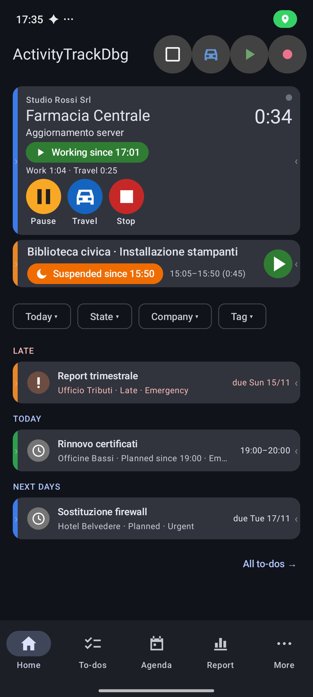

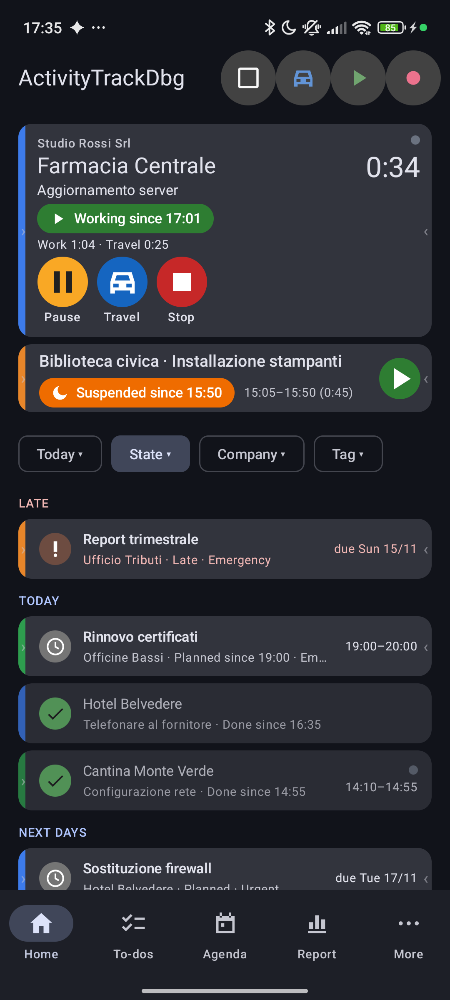

### Gestures (dragging the cards)
Every card can be dragged left or right (Home, Agenda list, "To-dos" tab). A short drag shows the buttons, to tap; a
long one runs the first at once. One rule for every row: **left is the step forward**, **right is putting off or going
back**.

| Card | Left | Right |
|---|---|---|
| Running activity | Pause, or Resume if paused or suspended | Stop |
| To do | Start or Done | Postpone (if planned) or Delete (goes to the Bin) |
| Done or Incomplete | — | Reopen (asks for confirmation) |
| Deleted (Bin) | Restore | Restore |

After a gesture on an activity **"Undo"** stays for 10 seconds. You change them in "Settings" → **"Gestures"**: for every
card type and direction what to offer (even no action, or the directions swapped), and whether the long drag runs the
first at once. On first use the Home shows a **hint** about gestures ("Got it" dismisses it) and the cards have a small
‹ › at the sides until you drag one; "Gestures" → **"Show the gesture hints again"** shows them again. The
drags that suspended are gone.

### Company and client colours
In a company or client screen ("More" → "Master data") pick a **colour** out
of twelve, or "No colour". Activity and to-do cards have a thin **vertical
band** on the left with the company colour; when a list shows a single
company, the band has the **client** colour. Without a chosen colour there is
no band; in the Agenda the blocks of those companies are grey.

Next to the planned-to-dos period (and in the "To-dos" tab) the **"All
companies"** button filters activities to do by company: the filter stays until you
remove it with ✕. Running activities are not filtered. In the "To-dos" tab
the period filter (**24 h**, **3 d**, **7 d**, **30 d**, **All**, the same as
on Home) shows the
activities planned or due within that time (late ones always),
the **"Bin"** chip shows the deleted ones. **"Filters"** opens the
advanced filters: client, **priority** (None … Emergency), **state** (To do, Planned, Late…), planned
yes/no; "Clear" removes them.

### Coloured tags
Tags with a colour in the master data ("More" → "Master data" → "Tags",
§10) show as **coloured dots at the top right** of the Home cards, of the
list and Agenda rows (the Day view's blocks too) and of a Report day's
detail: up to four, then "+N". Free tags, or tags without a colour, have a
grey dot. In the activity screen the tags are written out, in their colour.

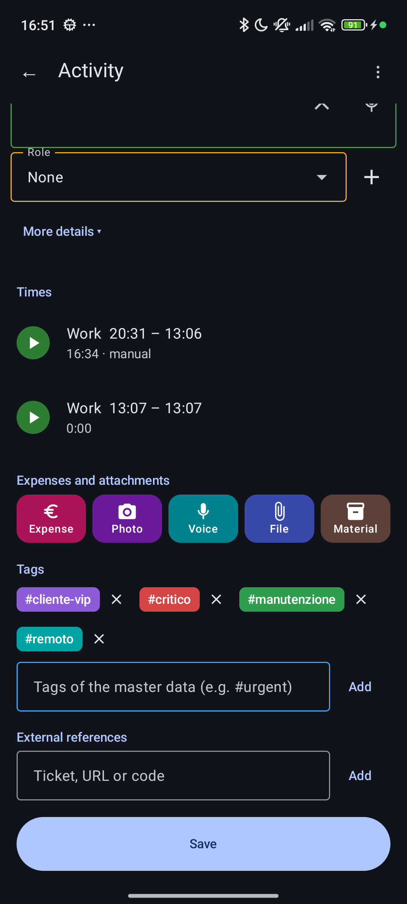

### Compact display
Settings → "Display" → **Compact**: slightly smaller text, tighter cards and
buttons, to see more activities and to-dos at once.

### New company or client on the fly
The **+** next to a master-data field creates the new item without leaving,
already selected (a quick pick fills the description): Company, Client,
Quick pick and Role in "New activity" and in the activity screen; Company and
Client in the to-do editor; the client of a contact (also one imported from
the phone book); the company of a client and of a quick pick, with its
proposed role. The dialog is the same when adding from Master data (0.8.2):
for a client name, company and colour. The dialogs propose the **last
company and client** chosen in any dialog (new client, new to-do, new
contact), also after the app is reopened: one usually works for a company
the whole day. "New activity" keeps its own proposal (§4).

### Required and optional fields
The border colour tells how much a field matters:

| Border | Meaning | Examples |
|---|---|---|
| **red** | required, still empty | client, description, to-do title |
| **green** | required, filled | the same once filled; expense amount and description |
| **yellow** | important, not required | role, planned date and time, start and end |
| **blue** | accessory | notes, references, locality, duration, due date, priority |

The field you are typing in has a thicker border in the theme colour: do
not mistake it for the accessory blue. Drop-down menus show the
colour of companies and clients. In "New activity" the company only filters
the clients: with "All companies" the border is neutral, and it turns green
once a company is picked or comes from the client.

### Dates and times
Dates are picked on the Android calendar. Times on a **5-minute grid**: one
row per hour, 12 cells per row, 12 hours at a time (**▲ Earlier** /
**Later ▼** move the window by 3 hours). With no time chosen yet the window
opens centred on that day's working hours.
- single time: tap a cell; **"Exact time"** opens the Android clock for
  minutes off the grid (e.g. 09:37); OK without a tap keeps the time as it
  was;
- segments (Edit segment, + Travel, + Pause): tapping Start or End, the grid
  picks both: touch the first cell and drag to the last, or tap the first and
  then the last (also after moving the window). The header shows the range
  and its length; **hatched** cells are taken by other segments of that day.

Optional fields have an ✕ to empty them.

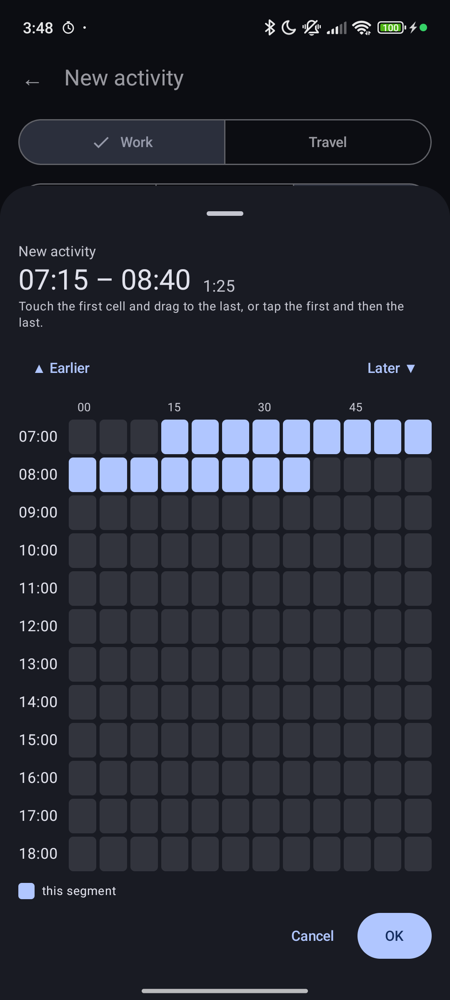

### Emptying a field
Text fields (description, notes, names, tags, references, agenda search…)
show an **✕** as soon as they hold text: tap it and the field is emptied. In
the client search boxes the ✕ empties the search and lists everything again;
the chosen client stays until you pick another.

---

## 4. Creating an activity

Four buttons, in the "No activity running" panel of the Home or, with an activity running, at the top right: **To do**,
**Work**, **Travel**, **Absence**. The Agenda offers them too ("Add", or a tap on a free slot).

**Work** — opens the "New activity" screen (the same entries come from the widget, the shortcuts and the calls):
- at the top, with "Editable times" (on at the start), **Now / Already started / Past**, which decides which times to ask for;
- **Company** filters the clients; **Client** is a box where you type to search (case and accents do not count) or pick
  from the list, in the order chosen in Master data. If you are within the radius of a site, client and company are
  already suggested; otherwise the app suggests the company of today's last activity;
- then **Quick pick**, **Description** and **Role**: description and role are suggested from the last activity on the same
  client in the last 30 days. The microphone in the field dictates the text;
- **"More information"** opens **Segments**, **Notes** and **External references**; the management-system fields appear
  here when optional, or among the main fields when required;
- **Now**: no time, the activity starts at once.
- **Already started**: only **"Started at"**, with the shortcuts **15 / 30 / 60 min ago**; the activity stays running and
  you stop it with Stop. A time that has not yet come today asks **"Start at HH:MM"**: **"Plan today at HH:MM"** creates a
  planned *To do* activity, **"Start now"** starts at once, **"Started yesterday at HH:MM"** records it from yesterday.
- **Past**: **Date** (empty = today), **Start / End** on the same row and the **Segments** visible; a single **"Save"**
  button. The activity is recorded already closed, with no questions about running activities. A future date offers to
  plan it as *To do*.
- The buttons at the bottom are **Work** (green) and **Travel** (blue): they say what happens ("Start now", "Start from
  HH:MM", "Record HH:MM–HH:MM").

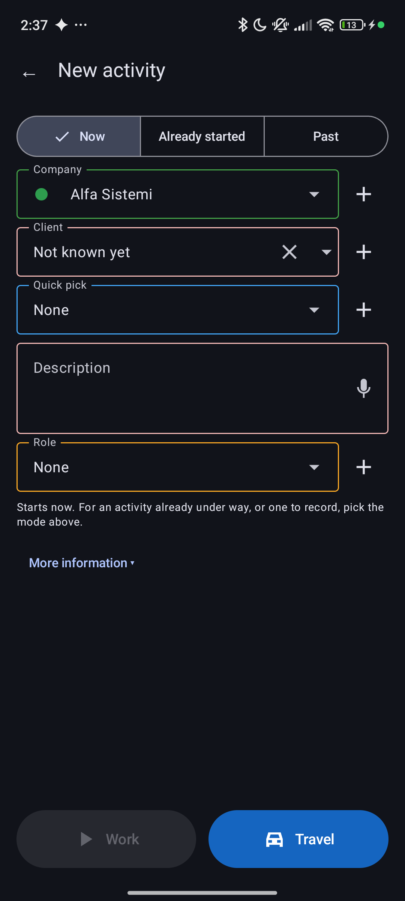

**Travel** — starts at once, as an anonymous activity (no client or description, which you add later in the detail
dialog). If you are working the app first asks "Have you completed the work activity?" (§5).

**To do** — the dialog asks **Company**, **Client**, **Description**, **Date**, **Time** (with an optional duration),
**Due date** and **Priority** (None, Low, Medium, High, Urgent, Emergency); under "More information": **Notes**,
**References** and **Planned segments** (drawn dashed: they never count in the totals and disappear when the activity
starts). See also §8.

**Absence** — see §9.

**If another activity is already running**, the app asks what to do with it:
- working: close it or leave it running (concurrent, if allowed);
- travelling: "is the travel over?" (yes = stop, no = leave it);
- paused: close it or leave it.

If the policy does not allow **concurrent activities**, "leave it" is not offered: the running activity becomes
**Suspended** (if paused, it is stopped), and **Resume** on a suspended activity (Home, widget, tile, notification) does
the same to the running one. This is the only way an activity becomes Suspended: there is no "Suspend" button.

**Other ways to start**
- from the day-start notification ("Start activity");
- from an activity in the **To do** state (client, description and references already filled in): **Start** in its dialog
  or in the list;
- from the 4×1 **widget** or the icon's **shortcuts** (recent clients): the start screen opens with the client already chosen;
- from a recognised **call**: the screen opens in **Past** mode with the times of the call.

---

## 5. While working

### Commands
On the Home card and in the notification:

| Icon | Command |
|---|---|
| ▶ green | Work / Resume |
| ⏸ yellow | Pause |
| 🚗 blue | Travel |
| ⏹ red | Stop |

The card shows the time of the current segment large and the state in a coloured label; under each button is its name.
**Pause** is an interruption inside the activity, counted as pause. There is no "Suspend": to work on something else, just
start it (§4).

**Travel while working.** If you tap Travel while working, the app asks **"Have you completed the work activity?"**: **Yes**
closes the activity and starts a new, anonymous travel activity; **No** makes the travel inside the same activity (a travel
from a widget is always a travel in the same activity). From a pause, Work and Travel restart directly.

**"Stop"** closes the activity (§6). Stop from the notification, the widget or the quick tile always stops at once.

### Ongoing notification
One notification per running activity, with a chronometer and commands.
While location is active it cannot be swiped away; otherwise it comes back
when you reopen the app.

### Reminders
- **Confirm** every 30 minutes of work or travel: "Still on …?" with "Yes",
  "Pause" or "Stop at hh:mm" (stops at the last confirmation, if you forgot).
  Without an answer the activity goes on.
- **Pause** every 15 minutes ("Still on pause?"), muted during the lunch
  break.
- **Summary** at the end of working hours: the day's total.

### Location (automatic)
- One point every 5 minutes (settable), every minute while travelling (settable), plus one when the phone moves. Positions leave the phone only with an explicit track export (see *Tracks*).
- **"Away from …?"** — while working, beyond 100 m: "Travel since hh:mm"
  (the travel starts when you left), "Ignore", "Stop at hh:mm".
- **"Arrived?"** — while travelling, after 15 minutes standing within 100 m:
  at a client's site it proposes "Work for … since hh:mm" (it assigns that
  client to the travel if it had none); at home it proposes to stop;
  otherwise "Work since hh:mm" or "Still travelling".
- Travel km are the distance between the recorded positions (2 minutes apart or less) or road
  distances (OSRM) where they are farther apart, and the locality comes from the address
  service (Nominatim), when the network is available.

Tap the notification **buttons**, not the text: the text opens the app and
closes the notification without running the action. If the buttons are not
visible, drag the notification down to expand it.

At the top of the activity screen, below the state, a row of buttons adds an
**Expense**, a **Photo**, a **Voice** note, a **File** and a **Material**; the
"Expenses", "Materials" and "Attachments" sections further down list them
(they appear once there is one).

### Tracks: map, export and clean-up
**More → Tracks**, or **⋮ → Route of the activity** in an activity.
- **Map** of the movements of a day, a week or a month (or of one activity):
  green lines for work, blue for travel, a green dot where an activity starts and a red one
  where it ends; tap a line to see the activity. The map is shown if
  **Settings → Location → Movement map** is on, there is a base map (the map tiles of
  **Settings → Online services**, or a downloaded *offline map*), and the policy allows it. "Travels only" hides the rest.
- **Export track**: a **GPX** (routes and tools such as QGIS) or **KML** (Google Earth Pro) file, with every
  recorded position as recorded (time and accuracy) and, for each activity, client, company,
  role, activity, locality, tags, times and km. It goes to the *export* folder and can be shared. The
  box **"Delete the tracks once exported"** removes exactly the exported positions after the file is written. If you can see the
  map, you can export, unless the policy (`trackExport`) forbids it.
- **Offline maps**: basic maps (roads, rivers, borders, place names) of areas of about 100 km, a few MB each.
  A phone paired with ActivityTrack Web receives those the administrator prepared, with the sync, on Wi-Fi.
  Without a server, copy `.pmtiles` files into the **maps** folder of the data folder and use
  *Settings → Location → Offline maps → Import from the data folder*. The map that covers your track is shown instead of
  the OSM tiles when those are off or there is no network; each map has a *Delete* button.
- **Clean up tracking**: deletes the positions older than one month, those of a day, or all of them.
  Activities, times and km stay; the positions of a running activity and of a travel whose km are
  still being computed are kept.

### Expenses
In the activity screen, the **Expense** button: amount in euro,
description, optional "Receipt photo". Quick expense: the **€** button of the
widget or the **"Expense"** icon shortcut (goes to the most recent running
activity).

### Consumables
The **Material** button: the consumables left at the client. **Description**
required; **quantity**, **unit of measure** and **unit cost** optional.
Picking one from Master data → **Consumables** copies description, unit and
cost, still editable (a later price change leaves the recorded lines as
they are). The "Materials" section shows the total; tap a line to edit or
delete it.

### Attachments
Buttons **Photo** (camera), **Voice** (records until "Stop and save"),
**File** (any document). Tapping an attachment: "Open" or "Delete".
Files live in the data folder, under `attachments/<year>/<activity>/`.

### Calls with clients
With recognition on (Settings → **Calls**, incoming and outgoing
separately), at the end of every call with a number listed in Master data →
**Contacts** the app reads the call log and:
- records the call (shown in the client screen, **"Calls"** section, with its
  length);
- while you are working for **the same client**, does nothing else: the call
  is part of the activity;
- while you are working for **another client**, **pauses** that activity for
  the length of the call, with the description "Phone call CLIENT", and
  resumes it at the end ("Pause …" option); a call under a minute makes no
  pause;
- except for the same client, proposes with a notification to **record the
  call as an activity** ("Propose …" option): "Create activity" opens "New
  activity" with the client, the description "Phone call with NAME" and the
  times rounded to 5 minutes (start down, end up).

It works only within working hours (not on holidays and days off), unless
**"Also outside working hours (on call)"** is on: then it always works.
Calls with unknown numbers are ignored.

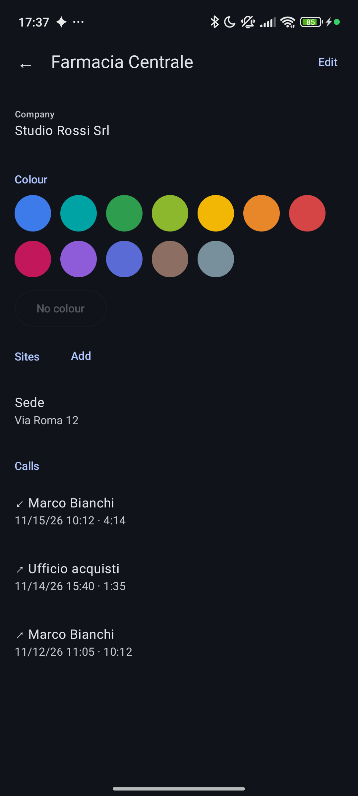

---

## 6. Stopping and editing

**Stop** from the app (button or drag) closes the activity:
- with "Editable times" you can give the **End**: empty = now; otherwise the activity closes at that time, even **up to 24
  hours in the future** (useful to stop just before a planned break). If another activity starts before that time, the
  end of the first is **moved back** to the start of the new one, with a notice. Beyond 24 hours, or without "Editable
  times", the end cannot be in the future;
- if the activity lasted **under a minute** (no attachments or expenses), a notice with **"Discard"**: it probably started
  by mistake;
- **"Quick stop"** stops at once without looking at the rest; **"Cancel"** leaves everything as it was.

**Return trip.** If the activity has an outbound travel followed by work, and no travel after its last work, Stop offers
three choices:
1. **Start return trip** — the activity stays running, travelling;
2. **End the activity** — closes it;
3. **End the activity and add the return trip** — closes it and adds a travel equal to the outbound (same duration and
   km, start and arrival swapped). Offered only with editable times, because the return's end may be in the future (it is
   a declared estimate).

An activity with nothing to ask stops at once.

**Closed: Done or Incomplete.** There is no "Complete the details" step: after Stop the activity is **Done** if it has a
client, at least one work segment and the management system's required fields filled in; otherwise it is **Incomplete**
(■ reddish icon, always in view on the Home) and is fixed like any other by opening it. A ticked-off *To do* without
segments is **Done**.

**Reopening.** From the dialog (or with the gesture) **Reopen** takes a closed activity back to running, in **Work** or
**Travel**, and **always asks for confirmation**; the time in between stays a gap, it is not filled. For an item ticked
off by mistake, without recorded segments, **"Put back to do"** removes the tick.

**Save rounded values.** In Settings → "Reports" the switch **"Save rounded values"** (off at the start; works only with
"Editable times"; the policy can fix it) makes the **buttons** (start, switch, stop, reopen) record rounded times: the
start down, the stop up, the switch to the nearest multiple, each on the quantum of the segment's rule (§1). Times typed by
hand stay exact.

### The activity dialog
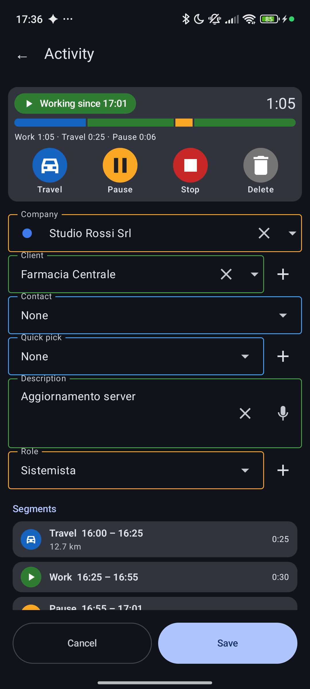

Tapping any activity (running, to do, closed, absence, deleted) opens the same dialog; from the top:
- the **state** in the Home's style ("In Work since 09:06", with icon and colour) and, on the right, the **total work
  time**; below it the coloured **timeline** with the segments in order;
- the **action buttons of the state** (for example Start for a To do; Pause, Travel, Stop for a running one; Reopen for a
  closed one; Restore for a deleted one);
- company, client, quick pick, description (dictation), role, contact (optional, if the client has contacts: it ties the
  activity to the person you worked for);
- **Segments**: each has the coloured icon of its kind (work green, pause yellow, travel blue, absence fuchsia; planned
  ones dashed). The split button **Work · Travel · Pause** adds forgotten segments (with km too; at least a minute). With
  "Editable times" on, tapping a finished segment opens **"Edit segment"**: date, start, end and, for travels, km;
  **"Delete"** removes it (not the running segment nor the only one left). Of the running segment you can change date and
  start; the end is recorded by the next command. If a segment overlaps others of the same activity, the app shows them and
  asks for confirmation: confirming, the saved segment wins and the others are shortened, split in two or deleted where
  it covers them. With other activities' segments there is no check: they stay concurrent activities;
- **pauses** have an optional **description** (e.g. "Call CLIENT" for those created by a call): tapping a pause edits or
  deletes it, even with "Editable times" off;
- **Expenses and attachments**: a row of coloured buttons (**Expense**, **Photo**, **Voice note**, **File**,
  **Material**) above their sections; "External references": tickets, URLs or codes (recognised automatically);
- **Place**: if location services are on, the app suggests it from a site of the client, the company or yours, else from
  the municipality;
- **Notes** and **Tags**: labels (e.g. `#remote`, `#urgent`); type one or more in the field and tap "Add", or tap a
  suggestion: first those of the master data, with their colour, then the free ones already used. The ✕ on a tag removes
  it. They can be added after closing too. A free (grey) tag is kept in master data by tapping it: **"Keep in master
  data"** gives it a colour. With **"Free tags too"** off (or fixed by the policy) only master-data tags are added
  ("Master-data tags only: … not added");
- at the bottom **"Cancel"** and **"Save"**;
- **"Delete"** in the **⋮** menu at the top moves the **whole activity** to the Bin (§8). If it has attachments, delete
  them first by hand from the "Attachments" section. An activity born from a management-system **ticket** deletes only
  the recorded time: the item goes back to *To do*.

---

## 7. Consulting: Agenda and Report

### Agenda
At the top the modes and the period ("‹ ›" to scroll, "Today" to come back;
on the right the period's reported total).
- **List** — the month, day by day, with a search on client, description or
  tag (`remote` or `#remote`); tags follow the description; activities to do,
  late or planned, show with their state icon.
- **Day** — a timeline: every activity is a block from start to end;
  concurrent activities side by side; the planned segments of activities to do are **dashed**
  blocks, absences **fuchsia** blocks.
- **Week** — seven columns from Monday; tapping a day opens the Day view.
- In Day and Week the timeline covers the whole day and opens with all the
  working hours on the screen (or on the running activity, when outside
  them); **two fingers** (pinch) zoom the scale in or out.
- The Agenda reopens on the last view picked.
- **Month** — a grid with reported hours per day, one dot per company and one
  for activities to do; tapping a day opens the Day view.

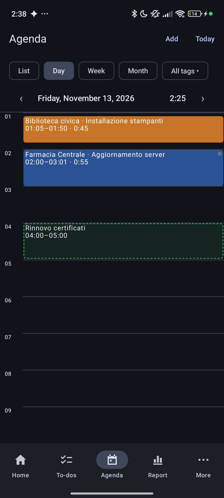

**Tag filter**: the "All tags ▾" chip next to the modes (shown when the
period has tagged activities) shows only the activities with that tag;
to-dos are hidden and totals count only what is shown.

A block's colour is the **client's**, else the **company's** (activities to do no longer have a colour of their own).
Tapping an activity, to do or not, opens its dialog (§6), with the actions of its state.

**Planning from the agenda**: in Day and Week tap a free slot: a new to-do
planned at that time opens (half-hour steps). "Add" at the top does the same
for the day shown (today: the next half hour; other days: 09:00).

### Report
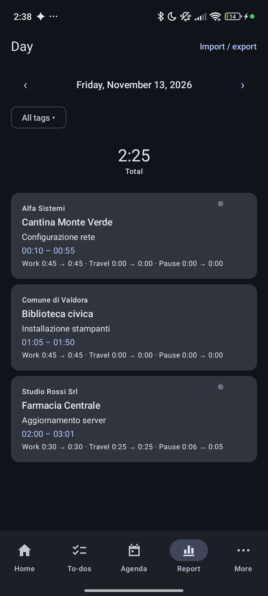

One day's report: the **total** (rounded work and travel), one line per
activity with exact → rounded work, travel and pause, and the **absences counted apart** (by kind: Absence, Holiday, Leave, Sick leave); export starts from here
too. The CSV also has the absence rows and the `absence_min` and `absence_kind` columns. With the tag filter only the activities with that tag remain and the
total is their sum. Export has a **Tag** field
too (only the activities with that tag; the other interchange sections are
not filtered).

---

## 8. To-dos, priority and Bin

A *To do* is an **activity in the To do state**: imported from a management system or created by hand (the **To do** button of
the Home, the **"To-dos"** tab of the bottom bar → "Add", or the Agenda). When you start it, it becomes Work or Travel and,
at the end, Done or Incomplete: it is always the same activity, with the same dialog (§6).

The "To do" dialog has: **Company**, **Client**, **Description**, planned **Date**, **Time** (with an optional duration),
**Due date** (with time), **Priority**; under "More information": **Notes**, **References** (one per line) and **Planned
segments**.

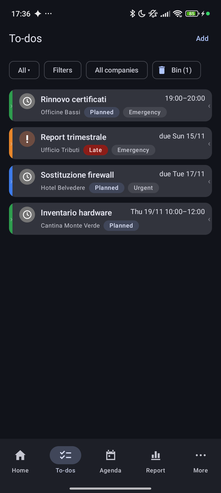

**States.** An activity to do is **To do** (no dates), **Planned** (a date, a time or a due date) or **Late** (§1). The "To-dos"
list shows the states, the priority names, the **state and priority filters** and the **Bin** chip. Planning is separate from
the due date: replanning does not change the management system's due date; but if you save a plan later than the due date,
the app asks whether to align them: "Align the due date" copies the planned day, "Keep" leaves everything as it is. While you
fill in the form, under the due date a red "It will show as late…" appears with the "Align the due date" button. It applies on
the same day too, if the planned start is after the due time: aligning removes the due time.
- **Priority**: **None, Low, Medium, High, Urgent, Emergency** (0 to 5), in a drop-down. It replaces P1…P5 of 0.9: old values
  were converted (P1 → Emergency … P5 → Low). A management system with another scale is converted by its plugin.
- **Date only**: the item is for the whole day; in the Agenda it sits in the band above the grid, in the calendar it is an
  all-day event, has no reminder and is "Late" from the next day.
- **Time**: tapping the field opens the grid; a **tap** and OK set only the **start**, a **drag** (or two taps) sets **start
  and end**. The planned segment is drawn dashed and never counts in the totals.
- **At the end of working hours**, if one or more activities planned for today have not been worked on, a single
  notification arrives with the list and **"Replan to …"**, which moves them to the next working day keeping the time.
- **Reminder**: 15 minutes before the planned time the notification "Title at HH:MM" arrives with "Start activity",
  "Postpone 30 min" and "Replan" (opens the dialog). It arrives out of hours and on days off too; it goes away if the
  activity is started, ticked, replanned, deleted or if the block has passed.
- Tapping an item opens the dialog (§6), with **Start**, **Postpone**, **"Remove the plan"** (the item stays, with no date or
  reminder), **Done** (ticks it, recording no time), **Delete**. An item ticked by mistake goes back with **"Put back to do"**.
- After "done", "postponed", "Delete", "Restore" or "Remove the plan", a message with **"Undo"** appears at the bottom for a
  few seconds.
- An imported item that was deleted is not restored by the next management-system sync.

**Bin.** Instead of "Ignored": **Delete** moves the activity (to do, closed or absence) to the **Bin** ("Bin" chip in the
"To-dos" tab): it disappears from the Home, Agenda, reports, exports and calendar, and gets no reminders. From the Bin:
**Restore** puts it back where it was; **Delete permanently** removes it for good (asks for confirmation; if it has
attachments they must be removed first).

**Assigned by the server.** A manager can assign a *To do* activity; while it is still To do it can be reassigned, then you
carry it forward (§ Sync with ActivityTrack Web).

---

## 9. Absences and days off

**Absence** (Home button) records or plans an absence, which is an activity of kind Absence (state **Absence**, fuchsia). The
dialog asks for:
- the **kind**: **Absence**, **Holiday**, **Leave**, **Sick leave**;
- the **company** (optional: empty applies to every company);
- **From** and **To** (days; empty "To" = the same day);
- **From time / To time** (optional): with times it is an hourly **leave**, one segment per day with those times; without
  them, the app creates **one segment for each working day** in the range, following the working hours (with the lunch
  break in the middle if set) and skipping **days off** (public holidays and the days set in Master data);
- the **notes**.

You can plan **holidays in the future** too. In the Agenda absences are fuchsia blocks; in reports they are counted **apart**
(by kind), not added to work, travel and pause. They are opened, edited and deleted (Bin) like any activity.

- 15 minutes after the start of working hours, if you have started nothing, **"No activity today"** arrives: "Absent today"
  (records an absence), "Late arrival…" (asks the time) or "Start activity".
- It does not arrive on **national holidays** (Easter Monday included, 4 October from 2026) nor on **days off** ("Master
  data" → "Days off": date and note, e.g. the patron saint or holidays).

---

## 10. Master data

- In the Companies, Clients and Contacts lists a **dot** shows the chosen
  colour (for contacts, their client's).
- **Companies** — in the company screen: **"Management system"** (code in the
  management system, connector; for now the generic file one) and **"This
  company's calendar"**; below, the company's **sites**.
- **Clients** — belong to a company (it cannot change after the first
  activity); they have their own sites and, at the bottom of the screen, the
  **calls** recorded with their contacts.
- **Sites** — label, coordinates, radius, address. Coordinates from "Current
  position" or "Map" (move the map under the crosshair and "Use this point").
- **Roles**, **Quick picks** (recurring descriptions, with a proposed role).
- **Tags** — name and **colour** out of the twelve (or none), in
  alphabetical order; archived ones last. The name is unique: no two tags
  with the same text. **Renaming** a tag changes it on every activity that
  has it too; **deleting** it leaves the text on the activities, as a free
  (grey) tag. With the server, **central** tags are managed on the web by
  the administrator or a manager (they cannot be edited on the phone); a tag
  of yours with the same name as a central one becomes the central one and
  takes its colour.

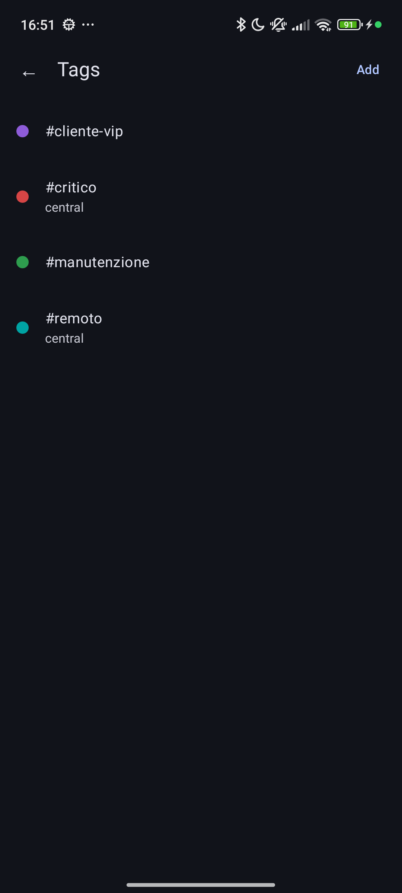
- **List order** — at the top of Companies, Clients, Roles and Quick picks pick
  **A–Z**, **Last used** (most recently used first; for quick picks, the last
  time you picked them) or **Manual**: in manual order every row has a ≡
  handle on the right; hold it and drag the row where you want it (clients
  move within their company). New items go to the end. The chosen order also
  applies to the drop-down menus (e.g. "New activity"); archived items always
  stay last. By default: clients by last use, the rest alphabetical.

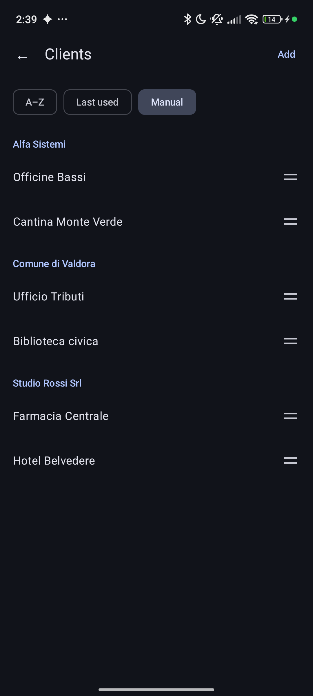

- **Contacts** — the clients' people: name, client, numbers (optional, one per
  line) and **e-mail** (optional). **"Import from the phone book"** picks a number from the
  phone's contacts and proposes it as a new contact. They drive call
  recognition (§5); numbers match with or without the international prefix.

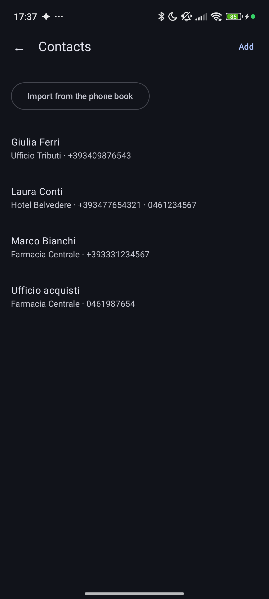

- **Consumables** — description, unit of measure, unit cost, company
  (optional, for different price lists); proposed in the activities'
  material lines.
- **Places** — home and other places (home ends a return travel).
- **Working hours and lunch break** — per weekday.
- **Days off**.

---

## 11. Import / export, backup

"More" → "Import / export".

**Export**
- **CSV**: one line per activity and day, rounded; needs a period (at most a
  year).
- **JSON / XML** (generic format, `docs/INTERCHANGE.md`): pick the content
  (master data, to-dos, activities, absences and days off), the period (empty
  = everything), company and client; "Site coordinates" only when needed.
- **Tag** (when there are tagged activities): only the activities with that
  tag, in CSV and in the interchange (master data and the other sections stay
  whole).
- "Export" saves into the `export` folder; "Export and share" also opens the
  Share menu (email, Drive…).

**Import** — a generic JSON or XML file (also partial, e.g. only clients or
only to-dos). The report shows what was added, what was already there, the
**conflicts** (the app's data stays unchanged) and what was not imported,
with the reason. Importing the same file again creates no duplicates.

**Backup** — the app saves the database into the `backup` folder at the
frequency and hour chosen in Settings (every day at 02:00 unless changed;
14 kept, adjustable); **"Back up now"** here, in Import / export. **"Restore backup"**
replaces all data with a chosen backup: first it saves the current data as
`…-before-restore.zip`, then it restarts the app.

### Sync with ActivityTrack Web
**ActivityTrack Web** is the organisation's server: it keeps a copy of the
phone's data, shows it in the browser (also, read-only, to whoever does the
accounting) and keeps the same user's phones in step. Without a server the
app works as always.

**Pairing the phone.** On the web: *Dispositivi* → **"Associa un dispositivo"**
(devices → pair a device; up to ActivityTrack Web 0.9.3: *Phones* → "Pair a
phone") shows a QR code, valid for 10 minutes and for one use. In the app: Settings →
**Sync** → **"Scan the QR code"** (the first time it asks for the camera
permission), or **"Paste the link"** if the code came as text. The phone
asks **"Pair with this server?"**: if it was paired with another server,
that pairing ends; if the server's certificate is not from an authority the
phone knows, from then on the phone trusts only the key in the code
(**"pinned key"**). An expired or used code gives "The code has expired or
was already used: make a new one on the web page".

**Pair only with your own organisation's server.** The server you pair with receives all your synced
data and can set the app's policy (settings, features, addresses) and decide which phone sends data to
the plugins. Do not scan a QR code or open a pairing link that you did not get from your administrator.
When the server's policy changes the app, a notification lists the first changes.

**The PC.** A PC with **ActivityTrack Desktop**, the app for the
notification area of Linux and Windows, pairs from the same page: paste the
link shown below the code. Activities and *to-dos* started on the PC show on
the phone at the next sync, and the other way round; the reminders come on
both. A PC never sends to the management systems.

**The first sync** sends the server everything the phone has and receives
what the server already has. Companies, clients, roles and tags with the
same name are not doubled: they become one, with the server's data.

**When it syncs.** At once when you open the app, a few seconds after each
change, every 30 seconds while the app is open (for what comes from the web
or another phone) and every 15 minutes in the background, whenever there is
a network. Without a network the changes wait and leave when the connection
is back. There are no push notifications: a change made on the web arrives
within 15 minutes, at once with the app open.

**Versions.** From 1.0 the sync requires **the server and every device to be on 1.0**: an older app receives
"Update the app to sync" and does not sync until updated (local changes are not lost). After the upgrade the first sync
**realigns** the data with the server, and changes not yet synced are kept and pushed. Afterwards app and server stay
compatible with the two previous versions of each other. When the server no longer accepts this version of the app,
or the app is newer than the server, the sync stops: a notification and the
Sync page say what to update (the app, or the server through the
administrator). The data stay on the phone and sync as soon as the versions
match again. Attachment files download on Wi-Fi, or when you open the
attachment. GPS positions stay on the phone: km and times travel.

**Assigned activities.** A manager (or an administrator) can create a *To do* activity
on the web and assign it to you: it reaches the phone like your own, you
start it and close it as usual. While it is still To do the manager can reassign it: if so, it leaves your
phone at the next sync.

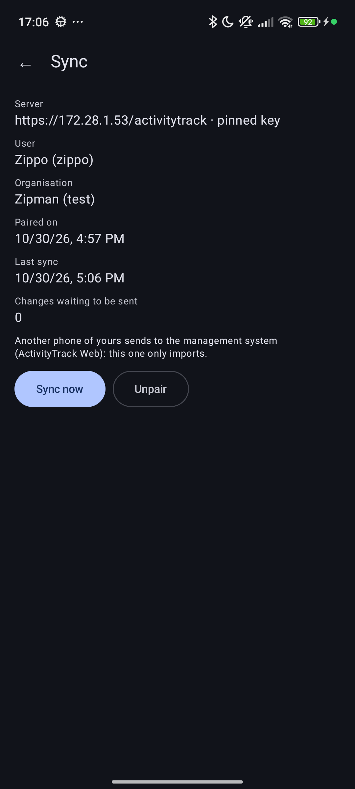

The page shows server, user, organisation, last sync and **changes waiting
to be sent**; **"Sync now"** does not wait for the next round.

**Central and personal master data.** The ones created on the web by the
administrator or a manager are **central**: the lists mark them "central"
and they cannot be edited on the phone ("A central record: the administrator or
a manager changes it, on the web"). The ones created on the
phone are yours (personal); under a central client you can add sites and
contacts of your own.

**Management systems.** When a user has several phones, only one sends the
activities to the management systems (chosen on the web); the others only
import and say so ("Another phone of yours sends to the management
system").

**Conflicts.** When the same data changes in two places, the latest change
wins, field by field. Some cases are left to look at:
- segments overlapping after a sync: the activity screen says **"To
  check"**; fix the times (with times locked by the policy the
  administrator or the manager fixes them on the web) and the mark goes;
- two activities running when the policy does not allow it: the older one
  is suspended and a notification says so;
- a change the server refuses: it shows under **"Not synced"** with the
  reason; **"Discard the change"** brings back the server's version (a
  record that never reached the server is deleted).

**Policy from the server.** With a server the policy comes from there and
wins over a `policy.json` in the data folder (next section); it is updated
at every sync.

**Unpairing and revocation.** **"Unpair"** detaches the phone from the
server: the data stay on the phone; syncing again needs a new code. If the
pairing is revoked on the web, the page says "The server revoked this
phone's pairing" and syncing stops, again without losing data.

### Policy and integrations

**Policy** — a `policy.json` file in the data folder (beside `backup`)
changes the app without going through Settings: it switches features off,
hides, renames or colours fields, fixes settings (greyed with a padlock, or
hidden). It is meant for a company handing the app to its staff, or for
another trade ("Site" instead of "Client").
- The app reads it at start and whenever it comes back to the foreground.
  A valid one: first a `…-policy.zip` backup (never removed automatically),
  the previous policy saved as `policy_old.json`, then it is applied and
  notified. An invalid one: the notification lists the errors with their
  line, and the file is ignored until it changes.
- **Unsigned policy: confirm first.** A new unsigned `policy.json` is not
  applied by itself: a notification ("Apply the new policy?") leads to a
  window, shown also whenever the app comes to the foreground, with the
  policy's name, what it changes against the policy in force (one line per
  key: `+` added, `−` removed, `old → new`) and its SHA-256 fingerprint
  (the start, **"Show it all"** for the whole one; the same as
  `sha256sum policy.json` on a computer). **"Apply"** applies it as above;
  **"Refuse"** leaves the policy in force and the file is not asked again
  until it changes (it shows as refused in the policy history);
  **"Later"** asks again next time. A signed policy, and the one from the
  server, need no confirmation.
- **Signature** (optional), in two ways. **By the management server** (since 0.9.9): the server generates its own
  key and certificate and signs the phones' policies with them (and the update manifests). No CA vouches for that
  certificate: the phone trusts it through the **pairing**, whose link carries its fingerprint (SHA-256). A
  phone **paired before 0.9.9** does not have it: it **keeps the policy in force** and a notification says to
  **pair it again** (Settings → Sync); the new policy is applied after the new pairing. **By hand**, for who
  has no server: `policy.json.sig`, made by `scripts/sign-policy.sh` with a certificate of a CA the phone
  trusts. Either way the first signed policy fixes the signer's name (CN): from then on only policies signed
  with the same name are accepted.
- Removing the file does not remove the policy: an empty policy does
  (signed, if the previous one was).
- What it can do: switch features off (planning, travel, expenses,
  materials, attachments, gestures, calendar, calls, import / export…),
  rename, colour, hide or require fields (a required field blocks starting
  and saving), fix settings (since 0.8.0 all of them: gestures too,
  stop radius and minutes, km factor, the online service addresses,
  rounding mode and minimum, and the choices the screens remember such as
  the Home period and State, the Agenda view, the list orders; locked they
  stay greyed with the padlock, hidden they disappear outside Settings
  too), let activities start only from planned or assigned *To do* activities (`plannedOnly`, formerly `todosOnly`, still read), create
  companies, clients and contacts by import only, force the language.
- **Without companies**: with the company field hidden, clients and *To do* activities
  have no company and the Companies menu disappears (fit for a freelancer).
- Every key is in `docs/POLICY.md`, with an example in
  `docs/samples/policy-example.json`.

**Integrations (plugins)** — a management system is connected with a
`<name>.json` file in the data folder's `plugins` folder (the published
plugins are in the repository's `plugins` folder; format in
`docs/PLUGINS.md`).
- Company screen → "Management system" → "Connector": pick the plugin; its options show
  (those with `*` are required), "Log in" when the system has a login, then
  "Sync now".
- A sync downloads the system's lists, clients, contacts and to-dos, and
  sends the closed activities; repeating it creates no duplicates.
- The activity screen shows the plugin's fields (e.g. the service and the
  activity type). On closing, the app asks whether to send, always sends or
  never does, as the plugin's options say; without network it waits.
- With a signed policy, plugins must be signed with the same name too
  (`<name>.json.sig`).
- **Unsigned plugin: confirm first.** A new plugin file, or one whose
  addresses (base URL, login and token addresses, any other address in the
  file) changed since the version confirmed, is not used until confirmed: a
  notification leads to a window, shown also when the app comes to the
  foreground, with the addresses (`+` new, `−` no longer used) and the
  SHA-256 fingerprint of the file. **"Use"** enables it; **"Refuse"**
  leaves it unused and not asked again until the file changes; **"Later"**
  asks again next time. A changed file with the same addresses is used at
  once. Plugins configured before this version are asked once.
- Every management system has a guide of its own (for Antares: *Antares
  integration*).

---

## 12. Calendar

Settings → "Calendar":
1. allow calendar access;
2. "Activities calendar": a phone calendar (Google, or CalDAV through DAVx5)
   or "New ActivityTrack calendar on the phone";
3. a company can have its own calendar (company screen), which replaces the
   generic one.

Every activity becomes one event per day, from its start: title "Client –
Description", the description holds rounded times, km, references and notes.
Planned *To do* activities become "tentative" events (Client – Description) up to a year
ahead; once started or done the event becomes the activity's (or leaves the calendar). The description's last line carries
hashtags per kind of time: `#lavoro`, `#viaggio`, `#pausa`, `#pianificata`,
always in Italian whatever the phone language (search them in the calendar
app), followed by the activity's tags. Events are **private**: people sharing
the calendar (e.g. a shared Google calendar) see only "busy", without title or
details. Sync goes one way, from the app to the calendar: changes made in the
calendar are overwritten. The last 14 days update by themselves; "Sync 90
days" goes further back.

---

## 13. Widgets, tile, shortcuts

- **"Activity status" widget (4×1)** — the running activity with commands
  and "€"; with none, the recent clients and the start button.
- **"Pause / resume" widget (1×1)** — pauses or resumes the most recent
  activity; with none, opens the start screen.
- **"Current activity" widget (4×2, 0.7.4)** — the most recent open activity
  as in the Home's big card: company, client, activity, state ("Working
  since 09:06"), work and travel totals and the elapsed time moving once a
  minute; below, the commands of the current state (**Stop** stops at once,
  as from the notification). With no open activity: **▶ Start** (opens "New
  activity") and **🚗 Travel** (starts at once). Resizable beyond 4×2.
- **"To-dos" widget (4×2, 0.7.4)** — the next planned to-dos (the overdue
  one first, its time in red), each with **▶**: when the to-do has a client
  the activity starts at once with its data, without opening the app, and
  without concurrent activities the running ones become Suspended (resumable with one tap; paused ones
  are stopped); otherwise ▶ opens "New activity" to pick one. The started row shows
  **Pause** and **Stop**; done to-dos leave the widget; when the rows do not
  fit, the widget scrolls. How far to look ahead (24 h default, 3, 7 or 30
  days; the overdue always in) is in Settings → "Display" → "To-dos
  widget".
- **Quick Settings tile** — same as the 1×1 widget. On OxygenOS add it from
  Settings → "Quick Settings tile" → "Add".
- **Shortcuts** (long press on the icon) — the 4 most recent clients and
  "Expense".

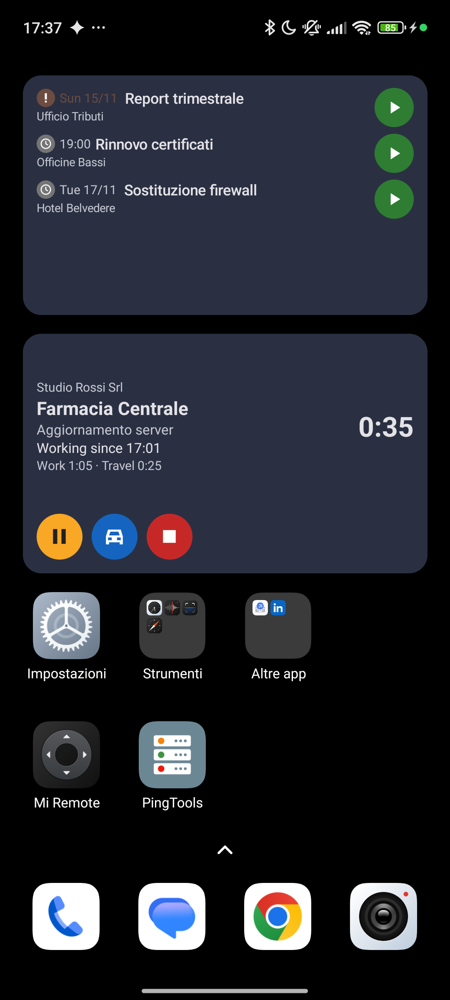
<!-- screenshot to retake: widgets without Suspend, "To-dos" widget with the new state icons -->

---

## 14. Settings

Settings are split into sections, each with its own page and "Save". The
list shows the essential sections first (**Display**, **Times**,
**Reminders**, **Location**) and **"Gestures"**; the others are under
**"Other settings ▾"** (0.7.8). With unsaved changes the section
title shows a dot (•) and leaving asks first ("Leave without saving",
0.7.6). Every item is explained in Part II,
§17.

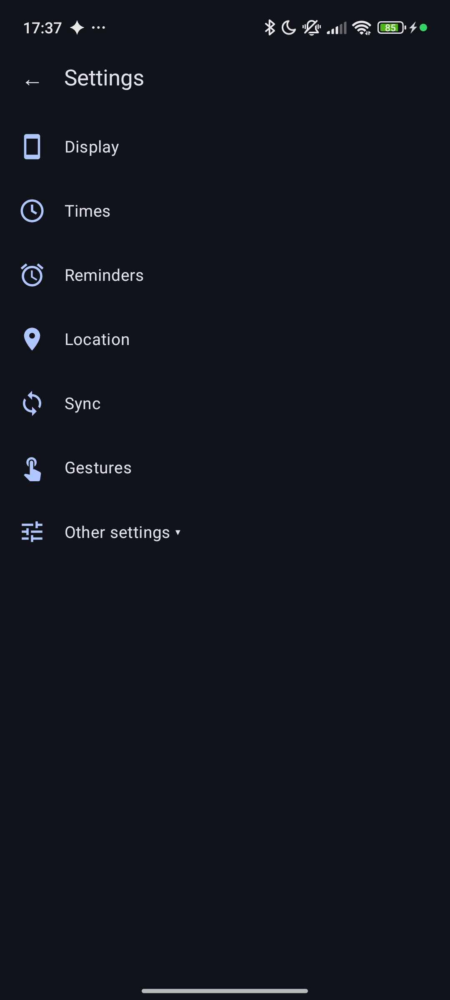
<!-- screenshot to retake: Settings (Reports now has "Save rounded values"; Gestures without Suspend) -->

| Section | Item | Default |
|---|---|---|
| Display | Normal / Compact | Normal |
| | Language | System default |
| | To-dos widget: window | 24 h |
| Times | Times freely editable: start and end chosen when starting and stopping, segments editable and deletable (off: times as recorded; "+ Travel" and "+ Pause" stay) | on |
| Calls | Recognise incoming / outgoing calls | off |
| | Pause the activity of another client / Propose an activity | on |
| | Also outside working hours (on call) | off |
| Reminders | Confirm interval | 30 min |
| | Maximum confirmations | 0 (unlimited) |
| | Pause reminder interval | 15 min |
| | Day-start prompt delay | 15 min |
| Notifications | for every kind (confirm, pause, planned, movement, arrival, day start, summary, details missing, running) opens the Android page for banner, sound and vibration | — |
| Location | access, battery, quick tile | — |
| | Movement alert threshold | 100 m |
| | Arrival radius / time | 100 m / 15 min |
| | Road distance factor (without OSRM) | 1.25 |
| Calendar | activities calendar, sync 90 days | none |
| Dictation | Dictation language | Italian |
| Reports | night activities until | 06:00 |
| | work / travel / pause rounding | §1 |
| Online services | Nominatim, OSRM, OpenStreetMap tiles (switchable, with endpoint) | on |
| Storage | data folder, backups kept, back up now | 14 |
| Advanced | Planned to-do reminder (min before) | 15 |
| | Postpone (min) | 30 |

Out-of-range values are adjusted when saving.

---

## 15. Data and privacy

- Everything stays on the phone and in the data folder you chose.
- The **coordinates** of your movements are never sent to the calendar, to the
  management systems or to the server; only the locality (e.g. "Milano"). They
  leave the phone only if you export the track (GPX / KML) yourself. To record no
  positions at all, switch tracking off (policy `location`).
- Calendar events are private: people sharing the calendar see only "busy".
- Online services (addresses, distances, maps) receive only the coordinates
  of single points; they can be switched off or pointed to your own servers.
- Management-system credentials are encrypted with the phone's keystore.
- With call recognition the app reads the call log on the phone and keeps
  only the calls with your contacts; it does not read the phone book (the
  import uses the number you pick).

---

## 16. Troubleshooting

| Problem | Solution |
|---|---|
| Tracking stops | Settings → Location: "Allow all the time" and battery "Unrestricted" |
| The activity notification is gone | reopen the app: it comes back |
| A contact's call is not recognised | a switchboard may present a number different from the published one: look up the number received in the phone's call log and add it to the contact |
| "Access to the data folder was lost" | the folder was moved or renamed: pick it again |
| Dictation: "language not available" | Settings → Dictation: pick the language; for offline use download the language pack in the phone's voice settings |
| The quick tile is not in the list | Settings → "Quick Settings tile" → "Add" |
| A notification action does nothing | tap the button, not the text; expand the notification if the buttons are hidden |
| Import: "Not imported" | the report gives the reason (e.g. unknown company, activity running on another phone) |

# Part II — Reference

## 17. Settings in detail

Every section has its own "Save". Values outside the allowed range are moved
to the nearest limit.

### Display

| Item | Effect | Default |
|---|---|---|
| Normal / Compact | Compact: text at 88 %, tighter cards and buttons. | Normal |
| Language | **System default** (the phone's language; English if the app does not know it), Italiano, English, Deutsch or Español, each in its own name. A policy (`ui.language`) fixes and locks it (padlock); with an unsupported value the language is English and the item says so. | System default |
| To-dos widget: window | How far the like-named widget looks ahead: 24 h, 3, 7 or 30 days; overdue to-dos are always included. A policy can lock it (padlock). | 24 h |
| Free tags too | On: any tag can be typed. Off: only the master data's tags; free ones already on activities stay. Policy: `tagsFreeText`. | On |

### Times

| Item | Effect | Default |
|---|---|---|
| Times freely editable | On: **Start** and **End** fields when starting, an **End** field in the Stop question, segments editable and deletable (new values replace the recorded ones). Off: times stay as recorded, segments cannot be touched; "+ Travel" and "+ Pause" stay available. It may later be set by a policy. | on |

### Calls

| Item | Effect | Default |
|---|---|---|
| Recognise incoming calls | calls received from contacts are recorded and handled (§5); switching it on asks for access to the phone state and the call log | off |
| Recognise outgoing calls | the same for calls you make | off |
| Pause the running activity of another client | during the call, another client's running activity is paused (at least a minute) | on |
| Propose an activity after a call | "Create activity" notification with client, description and rounded times | on |
| Also outside working hours (on call) | off: within working hours only, not on holidays and days off; on: always | off |

### Reminders

| Item | Effect | Range | Default |
|---|---|---|---|
| Confirm interval | how many minutes of work or travel between "Still on …?" | 10–240 min | 30 |
| Maximum confirmations | after how many unanswered confirmations the app stops asking (0 = never) | 0–100 | 0 |
| Pause reminder interval | how many minutes of pause between "Still on pause?"; muted during lunch | 10–120 min | 15 |
| Day-start prompt delay | minutes after working hours begin before "No activity today" | 0–240 min | 15 |

### Notifications
For every kind of notification (confirm, pause, planned, movement, arrival,
day start, summary, details missing, running) it opens the Android page where you
choose banner, sound and vibration.

### Location

| Item | Effect | Range | Default |
|---|---|---|---|
| Location access | "Allow all the time" lets tracking restart by itself | — | — |
| Battery optimisation | "Unrestricted" keeps OxygenOS from stopping the service | — | — |
| Quick Settings tile | adds the Pause / resume tile | — | — |
| Movement alert threshold | distance beyond which, while working, "Away from …?" comes | 50–5000 m | 100 |
| Arrival radius | within how many metres you count as standing | 25–1000 m | 100 |
| Arrival time | after how many minutes standing, while travelling, "Arrived?" comes | 5–120 min | 15 |
| Road distance factor | road km = straight line × factor, between positions more than 2 min apart when OSRM is not available | 1.0–3.0 | 1.25 |
| Position sampling while working | how often a position is recorded | 1, 2, 5, 10, 15, 20, 30, 60 min | 5 min |
| Position sampling while travelling | finer, to draw the route taken (more battery) | 15, 30, 60 s; 2, 5, 10, 15, 30 min | 1 min |
| Movement map | shows the Tracks map; it needs the map tiles of *Online services* | on / off | on |

### Calendar
Calendar access, the activities calendar (Google or CalDAV through DAVx5, or
"New ActivityTrack calendar on the phone") and "Sync 90 days". A company's
calendar is chosen in its screen and wins over the generic one.

### Dictation
Speech recognition language (Italian, English, German, Spanish), independent
of the phone language. Default: Italian.

### Reports

| Item | Effect | Default |
|---|---|---|
| Night activities until | an activity ending by this time the next day stays on its start day (0:00–12:00) | 06:00 |
| Work rounding | mode, quantum (1, 5, 15, 30 or 60 min) and minimum | up with tolerance, 15 min |
| Travel rounding | same | up, 5 min |
| Pause rounding | same | down, 5 min, minimum 5 |
| Save rounded values | the buttons (start, switch, stop, reopen) record rounded times: start down, stop up, switch to the nearest multiple; times typed by hand stay exact; only with "Editable times"; the policy can fix it | off |

Rounding modes:
- **up with tolerance**: rounds up only beyond a third of the quantum (15
  min: up to 5 minutes past the quarter it rounds down);
- **up**: to the next quantum;
- **down**: to the previous quantum.

### Online services
Nominatim (locality from addresses), OSRM (road km) and OpenStreetMap tiles:
each can be switched on or off and pointed to your own server. Default: on,
public servers.

### Storage
Data folder, daily backups kept (1–365, default 14). "Back up now" and the
restore are in More → Import / export.

### Updates
The installed version and the check of newer versions: once a day the app
downloads the **update manifest**, a signed file that lists the versions by
channel with the address and SHA-256 of the packages. When there is a new
version it shows it here with **"Download"** and sends a notification (one
per version); the downloaded file is checked against its SHA-256 and handed
to Android's installer (the first time Android asks to let ActivityTrack
install apps). **"Check now"** does not wait for the next day.

The manifest's **source** is the project (GitLab, the default), the paired
server or an https address of your own. Who may sign it: without a signed
policy, the app itself or the paired server (whose certificate is in the
pairing link); with a signed policy, only the policy's own signature. The
paired server can also announce a new version at the first exchange, whatever
the source chosen, and offer it for download itself. A manifest that is
unsigned, signed by someone else or older than the last one seen is refused,
and the reason shows here.

An app installed from a store (Play, F-Droid…) is updated by the store: the
check (**"Check now"**) stays optional but offers no download.

| Item | Effect | Default |
|---|---|---|
| Check for new versions | Once a day. Policy: `updateCheck`. | On |
| Source | The project (GitLab), the paired server, a custom address. Policy: `updateSource`. | The project |
| Manifest address | Only with the custom address, https. Policy: `updateUrl`. | Empty |
| Include the beta, test, development versions | The channels followed besides the stable one. Policy: `updateBetas`, `updateChannels`. | Off |

### Advanced

| Item | Range | Default |
|---|---|---|
| Planned to-do reminder (minutes before) | 0–240 | 15 |
| Postpone (minutes) | 10–240 | 30 |

### Gestures
For activities and to-dos, what a left and a right drag offer (also nothing)
and whether a long drag runs the first action at once. Defaults: activities
running activities left Pause / Resume, right Stop; to-dos left Start or Done, right Postpone or Delete; closed
ones right Reopen; long drag on. Suspend is gone.

### Settings kept by the screens
The to-do company filter, the period (24 h, 7 days, 30 days, all), State, Priority
and the order of every master-data list are set in the screens themselves and
stay until you change them.

## 18. Entities and relations

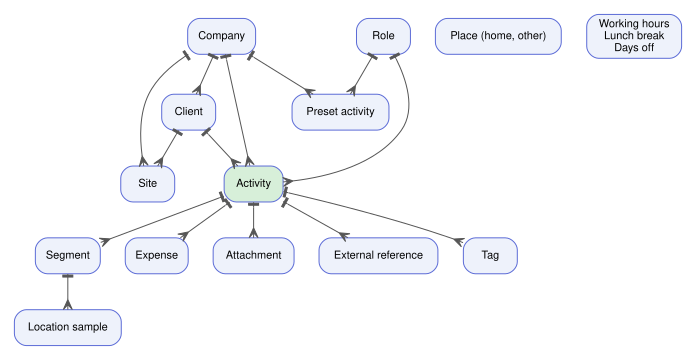

| Entity | Content | Relations |
|---|---|---|
| Company | name, colour, management-system code, connector, calendar | has clients, sites, to-dos, quick picks |
| Client | name, colour, code | belongs to a company (fixed after the first activity); has sites |
| Site | label, coordinates, radius, address | of a company or a client; used to propose client and company and to detect arrival |
| Role | name | proposed by quick picks, chosen on the activity |
| Quick pick | text, proposed role, company (optional) | fills the description |
| Activity | kind (activity or absence), state, client, company, role, description, locality, notes, plan, due date, priority (None … Emergency), management-system key | has segments, expenses, attachments, references, tags; to do, running, closed or deleted |
| Segment | kind (work, travel, pause, absence), planned or real, start, end, km, source (tracked or by hand), description (pauses) | of an activity; location samples belong to segments |
| Expense | amount, description, receipt | of an activity |
| Attachment | photo, voice note, file | of an activity, in the data folder |
| External reference | ticket, URL, code | of an activity |
| Tag | name, colour (when in the master data); free when typed | of an activity; the tags of the master data give its colour, linked by name |
| Contact | name, numbers, e-mail | of a client; recognises calls; optional on an activity |
| Consumable | description, unit, unit cost, company | proposed in the material lines |
| Material line | description, quantity, unit, unit cost | of an activity |
| Call | contact, direction, start, end | of a contact and its client |
| Place | home or other, coordinates | home ends return travels |
| Working hours, lunch break, days off | per day | drive reminders and summaries |

## 19. Activity states

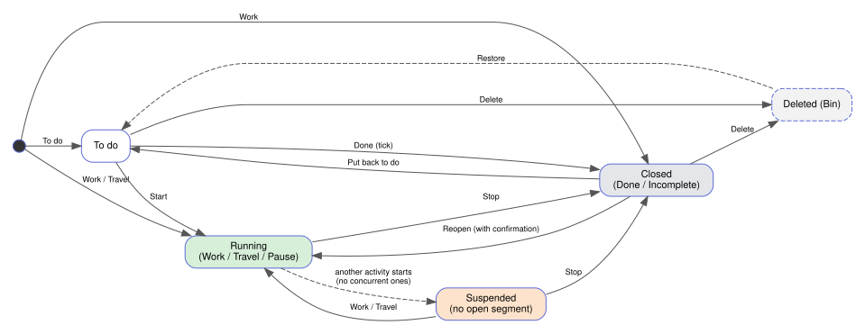

The activity has three **stored states** (To do, Running, Closed) plus being **Deleted** (in the Bin) or of kind
**Absence**; from these, the open segment and the dates the app derives the **displayed state** (§1, §20).

| Stored state | Entered by | Left by |
|---|---|---|
| To do | creation with "To do"; "Put back to do" | Start (becomes Running), Done (tick), Delete |
| Running | Start; Work or Travel from a closed one (Reopen); creation with Work "Now" / "Already started" or Travel | Stop (Closed), Delete; mode change |
| Closed | Stop; creation with Work "Past"; tick; Absence | Reopen (Running), Put back to do (only without segments), Delete |
| Deleted | Delete | Restore, Delete permanently |

While running, the activity has a **mode**: every change closes the open segment and opens a new one.

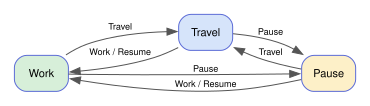

Rules:
- an activity does not start paused; from a pause you go back to Work or Travel, or to what was open before;
- from Work to Travel the app asks whether the work activity is over (§5);
- several activities can run together, each with its own pauses; without concurrent ones (policy) the others become
  *Suspended* when one starts;
- an activity under a minute, stopped from the app, can be discarded;
- an added or edited segment lasts at least a minute and lies in the past (the end of the last segment up to 24 hours
  ahead with editable times; absences even further); over other segments of the same activity it is saved after a
  confirmation, which shortens them;
- on start the planned segments are replaced by the real ones.

## 20. Displayed states

Every activity shows **one state**: the first that applies, in the order of the table in §1: **Deleted**, **Absence**,
**Late**, **Planned**, **To do**, **Work**, **Travel**, **Pause**, **Suspended**, **Done**, **Incomplete**.

An activity to do is **late** when the due date has passed (after the due time, or from the next day when the due date has no
time), or when all its planned segments are over, or — without segments — when the planned block has passed (a whole-day plan
from the next day). The same rule applies on the phone, the web and the PC.

A closed one is **Done** if it has no real segments (a ticked item) or if it has a client, at least one work segment and all the
fields its management system requires; otherwise it is **Incomplete**.

## 21. Flows

### Start
1. Company and client suggested: from the site you are in (within the radius), else the company of today's last activity; a
   client chosen from the widget, a shortcut or a *To do* activity takes precedence.
2. Description and role: from the last activity on the same client in the last 30 days, until you change them.
3. With "Editable times": **Now** (no time), **Already started** (only the start; a time still to come asks whether to plan,
   start now or from yesterday) or **Past** (date, start and end: recorded closed).
4. Activities already running: for each the app asks what to do (close, leave; for a travel "is the travel over?"); without
   concurrent ones they become Suspended. A **Past** activity asks nothing. **Travel** from Work asks "Have you completed the
   work activity?".

### Stop
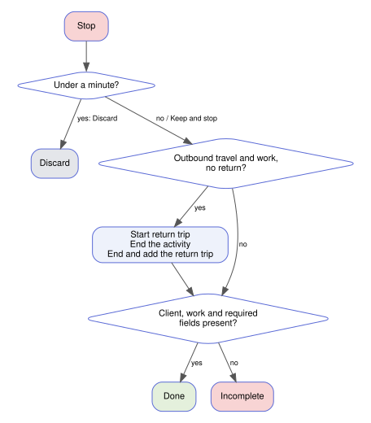

From the app Stop offers, when needed, the end and the return trip (§6). Stop from the notification, the widget or the quick
tile stops at once, with no questions; the closing is still Done or Incomplete by the same rules.

### Reminders
One alarm at a time, set on the nearest reminder; confirm and pause reminders
never go below 10 minutes (Android limits alarms in Doze).

| Reminder | When | Answers |
|---|---|---|
| Confirm | every *confirm interval* of work or travel, also outside working hours | Yes, Pause, Stop at (last confirmation) |
| Pause | every *pause interval* while paused; muted at lunch | Resume, Stop |
| Planned end | at the end chosen when starting, once | Yes, stop at HH:MM; No, go on |
| Day start | *delay* after working hours begin, on working days that are not off, if nothing happened | Absent today, Late entry, Start |
| Summary | at the end of working hours | — |
| Planned to-do | *minutes before* the plan, also outside working hours | Start, Postpone, Re-plan |

### Location
- One point every 5 minutes while working and every minute while travelling
  (both settable), plus one when the phone moves, only while an activity is
  running (also paused).
- Working, beyond the *movement threshold*: "Away from …?" with "Travel since
  HH:MM" (from the first point beyond the threshold).
- Travelling, standing within the *radius* for the *arrival time*:
  "Arrived?"; at a client's site it proposes work for that client, at home to
  stop.
- Km: positions 2 min apart or less joined directly; farther apart OSRM when on, otherwise straight line × factor; locality from
  Nominatim. Coordinates leave the phone only with the track export (GPX / KML).

### Report and export
- *Total*: the sum of rounded work and travel (Report and evening summary).
- An activity across midnight stays on its start day if it ends by the
  *night activities until* time, otherwise it is split at midnight.
- CSV: one line per activity and day, with start, end, rounded work, pause and
  travel hours, company, client, role, description, km, expenses, notes,
  references, locality, tags, materials (total in €, apart from the
  expenses); km, expenses and materials on the first day.

### Calendar
One event per activity and day, from its start (a running activity ends
"now"). Every change re-syncs the last 14 days; "Sync 90 days" goes further
back. Planned *To do* activities are tentative events up to a year ahead. All events
are private. Sync goes only from the app to the calendar.

### Import and export
The generic format (JSON or XML) holds master data, activities (to do and absences too) with
segments, expenses, references and tags, and days off. It is **version 2** of the format; version 1 files (with to-dos
apart) are still imported. Import
recognises what it already has (codes and identifiers), creates no duplicates
and on a conflict keeps the app's data, listing the conflict in the report.
Activities running on another phone are not imported.

### Backup and restore
Every day a copy of the database goes into the `backup` folder (zip). Restore
first saves the current data as `…-before-restore.zip`, then replaces the
database and restarts the app.
