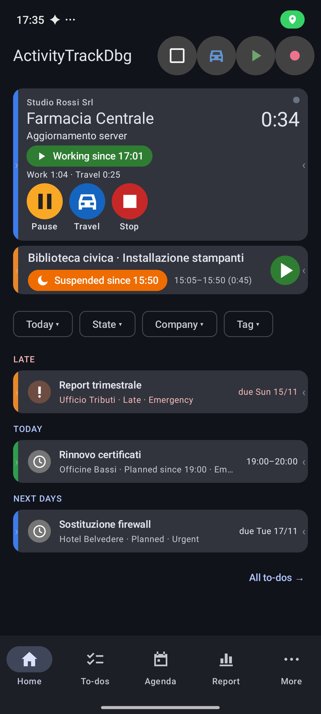
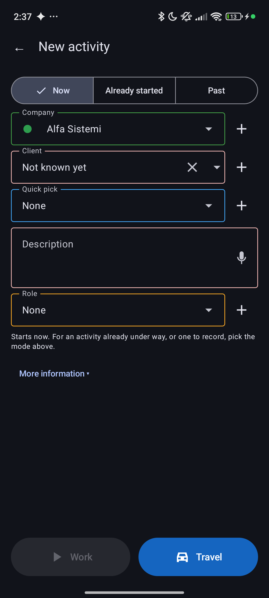
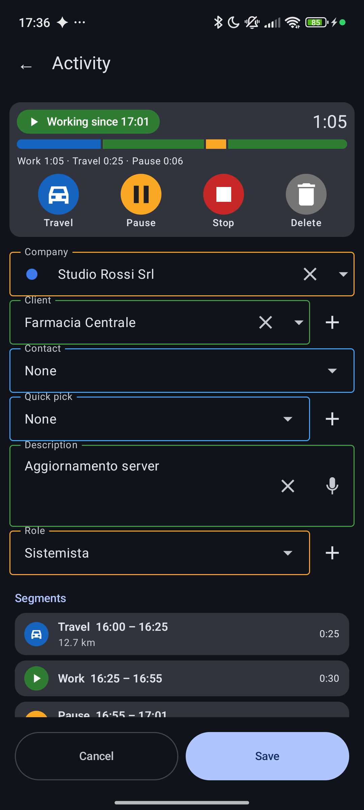
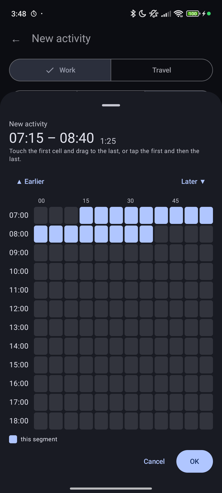

Version 1.0.0-beta-1 · for everyday use; the *User manual* explains everything else.

## 1. First time
1. Install `ActivityTrack-<version>.apk` from the GitLab *Releases*.
2. Pick the **data folder** (e.g. `ActivityTrack`): attachments, backups and
   exports go there.
3. Allow **notifications** and **location** ("Allow all the time"); in
   Settings → Location remove the battery restrictions.
4. On Home, **"Getting started"** → **"Create the first client"** (with its
   **company**), or "Import from a file or a management system"; in More →
   Master data set the **working hours**.
5. With an **ActivityTrack Web** server: Settings → Sync → "Scan the QR
   code" shown on the web (*Dispositivi* → "Associa un dispositivo"); from
   then on the data stay in step by themselves.

## 2. Creating
On Home you have four buttons: **To do**, **Work**, **Travel** (starts at once, even without a client) and **Absence**.
A *To do* is an activity in the "To do" state: when you start it, it becomes Work or Travel, at the end Done or
Incomplete (states: see the *User manual*).

In "Work" pick **Now / Already started / Past**, then the **client** (type to search), the **description** (or a quick pick;
also dictated with the microphone) and the **role**. "Already started" asks
only the start time, "Past" the day, start and end. The green button says
what it will do: "Start now", "Start from 09:15", "Record 09:15–10:40". "More information" opens segments, notes
and references.

## 3. While working
- The card (and notification) buttons, with their names underneath:
  **▶ Work**, **⏸ Pause** (a break inside the activity), **🚗 Travel**, **⏹ Stop**.
  There is no "Suspend": starting another activity sets the first aside (Suspended) when concurrent ones are not allowed.
- **Travel** while working asks "Have you completed the work activity?": Yes = it closes and a new travel starts,
  No = travel inside the same activity.
- Drag the card: left pause / resume, right stop.
- Every 30 minutes the app asks "Still on …?": answer from the notification.
- When you move, the app proposes the **travel**; when you arrive, the
  **work**.
- With Settings → **Calls** on, a phone call with a contact of another
  client pauses the activity and proposes to record the call.

## 4. Stopping
**⏹ Stop** closes the activity. If you made an outbound trip and work with no return, the app offers: **Start return
trip**, **End the activity**, **End the activity and add the return trip** (a copy of the outbound). With editable times you
can give the end up to 24 hours in the future. With a client, work and the required fields the activity is **Done**,
otherwise **Incomplete**: tap it, fix and "Save". Reopening a closed one always asks for confirmation. Tapping any
activity opens its dialog: state, timeline, actions, segments (Work · Travel · Pause button), expenses, attachments,
place, notes and tags.

## 5. Consulting
- **Agenda**: list, day, week, month; search and tag filter.
- **Report**: the day's total, CSV export.
- **To-dos** (a tab of the bottom bar): activities from a management system or
  created by hand, with reminders and a **priority** (None … Emergency); after "Done" or "Delete" an **"Undo"**
  shows for a few seconds. Deleted ones are in the **Bin** (Restore / Delete permanently).
- **Absence**: kind (Absence, Holiday, Leave, Sick leave), days and, if you like, times: a leave.

**States** (icon and colour): To do (check box, white), Planned (clock, grey), Late (!, brown), Work (▶, green), Travel
(car, blue), Pause (⏸, yellow), Suspended (moon, orange), Done (✓, greenish), Incomplete (■, reddish), Absence (dot,
fuchsia), Deleted (bin, grey).

**Moving to 1.0**: data converts by itself and old backups restore; to sync, server and devices must all be on 1.0.

## 6. Field colours
A field's border tells how much it matters:
- **red**: required and still empty (client, description);
- **green**: required and filled;
- **yellow**: important but optional (role, times);
- **blue**: accessory (notes, locality, references).

The field you are typing in has a thicker border in the theme colour.

## 7. Times
Times are picked on the **5-minute grid**: tap a cell, or drag for a range;
"Exact time" for minutes off the grid.

## 8. If something goes wrong

| Problem | Solution |
|---|---|
| Tracking stops | Location "Allow all the time", battery unrestricted |
| The notification is gone | reopen the app |
| A notification action does nothing | tap the button, not the text |
