Versione 1.0.0-beta-3 (novembre 2026). Segnalare ogni differenza tra questo manuale
e l'app. La *Guida rapida* riassume in poche pagine l'uso quotidiano; questo
manuale descrive tutto: la **Parte I** l'uso, la **Parte II** il riferimento
(impostazioni, entità, stati, flussi).

**Novità della 1.0** (il *Da fare* non è più una cosa a parte: è uno stato dell'attività)
- **Un'attività sola, dalla pianificazione alla chiusura.** Ciò che prima era una voce *Da fare* ora è
  un'attività nello stato **Da fare**: quando la avvii diventa Lavoro o Viaggio, quando la fermi Fatta o
  Incompleta, senza duplicati e senza passare da un elenco all'altro. Gli stati mostrati sono undici, ognuno con la
  sua icona e il suo colore (§1).
- **Quattro pulsanti di creazione**: **Da fare**, **Lavoro**, **Viaggio**, **Assenza** (§4). Lavoro si può
  registrare *Adesso*, *Già iniziata* o *Passata*; il Viaggio parte subito, anche senza cliente.
- **Una sola scheda di dettaglio** per qualunque attività (§6): stato, linea del tempo, azioni, campi, tratti,
  spese e allegati, località, note, tag.
- **Niente più "Sospendi"**: un'attività diventa *Sospesa* da sola solo quando ne parte un'altra e le attività
  contemporanee non sono ammesse. Niente più passo "Completa i dettagli": un'attività chiusa senza cliente o
  tratto di lavoro è **Incompleta** e si corregge come le altre.
- **Priorità con nome**: Nessuna, Bassa, Media, Alta, Urgenza, Emergenza (al posto di P1…P5).
- **Cestino** al posto di "Ignorate": una voce eliminata si ripristina o si elimina definitivamente (§8).
- **Assenze** con tipo (Assenza, Ferie, Permesso, Malattia), azienda facoltativa e uno spezzone per ogni giorno
  lavorativo (§9); anche pianificate in anticipo.
- **Viaggio durante il lavoro**: l'app chiede "Hai completato l'attività lavorativa?" (§5). Allo Stop di
  un'attività con andata e lavoro, l'offerta del **viaggio di ritorno** (§6).
- **Chiusura nel futuro** fino a 24 ore e interruttore **"Salva i valori arrotondati"** in Rendicontazione (§6, §17).
- Riaprire un'attività chiusa chiede sempre conferma; **"Rimetti da fare"** annulla la spunta data per errore.
- Nei report le assenze sono contate a parte; il CSV ha le righe delle assenze e le colonne `absence_min` e `absence_kind`.
- Policy: `todosOnly` si chiama ora `plannedOnly` (il vecchio nome è ancora letto). Interscambio versione 2 (i file
  della versione 1 si importano ancora); nei plugin `@todo` diventa `@activity` e `todoDone` `activityClosed` (i vecchi nomi si leggono).

### Aggiornamento alla 1.0
- **I dati si convertono da soli** al primo avvio: le voci *Da fare* diventano attività nello stato Da fare (o
  Fatta, se spuntate), le assenze pianificate diventano attività di tipo Assenza, le voci ignorate vanno nel
  Cestino, le priorità si convertono (P1 → Emergenza, P2 → Urgenza, P3 → Alta, P4 → Media, P5 → Bassa; nessuna →
  Nessuna). Un *Da fare* ancora aperto, con attività già chiuse, resta un'attività Da fare a sé.
  Il colore delle *Da fare* non c'è più: l'Agenda usa quello del cliente, altrimenti dell'azienda.
- **I backup di versioni precedenti si ripristinano** come sempre: i dati vengono convertiti durante il ripristino.
- **La sincronizzazione richiede che tutti i dispositivi e il server siano alla 1.0.** Un'app più vecchia dice
  "Aggiorna l'app per sincronizzare"; aggiorna prima il server (§ Sincronizzazione), poi i telefoni e i PC.
  Dopo l'aggiornamento la prima sincronizzazione riallinea i dati al server; **le modifiche non ancora sincronizzate
  restano e vengono inviate**.

**Novità della 0.9.9** (una revisione di sicurezza esterna della 0.9.8)
- Un record che il server manda con un identificativo strano (non lettere, cifre, `-` e `_`) viene rifiutato e
  segnalato tra gli errori di sincronizzazione, invece di finire in un nome di file o in un indirizzo.
- Quando la policy del server cambia l'app, la notifica **"Policy ... applicata"** elenca le prime otto
  modifiche. Associati solo al server della tua organizzazione (vedi *Sincronizzazione*).
- Gli **aggiornamenti** passano da un **manifesto firmato**: in *Aggiornamenti* scegli la fonte (il progetto su
  GitLab, il server associato o un indirizzo tuo) e i canali (beta, test, sviluppo). Senza policy firmata il
  manifesto deve portare la firma dell'app o quella del server associato; con una policy firmata, la stessa
  firma della policy. Il server può segnalare la versione nuova al primo scambio. Il file scaricato viene
  controllato con il suo SHA-256 prima di aprire l'installazione. Per fidarsi della firma del server serve
  il collegamento di associazione della 0.9.9: chi era già associato si riassocia una volta.

**Novità della 0.9.8** (la prima versione da GitLab; il ricalcolo dei km e il menu delle impostazioni non ancora provati su un viaggio lungo)
- I **km dei viaggi** non si gonfiano più sui percorsi lunghi. Le posizioni distanti al più 2 minuti si
  congiungono direttamente; solo dove sono più distanti si usa la distanza su strada (OSRM) o la linea d'aria
  × fattore, e una distanza su strada molto più lunga della linea d'aria viene scartata. Le posizioni che
  implicano più di 250 km/h (un punto isolato) non entrano nel conto. I km dei viaggi di cui il telefono
  conserva ancora le posizioni vengono ricalcolati una volta, quando la rete lo permette.
- In *Impostazioni* **Altre impostazioni** resta aperto quando si torna da una delle sue sezioni.
- **ActivityTrack è passato da GitHub a GitLab** (`gitlab.com/infraconsulting`): l'app cerca lì le nuove
  versioni. Le versioni fino alla 0.9.7-beta1 interrogano ancora GitHub e non vedranno questa: installa
  `ActivityTrack-0.9.8.apk` dalle *Releases* di GitLab a mano, sopra l'app (i dati restano).

**Novità della 0.9.6** (solo test automatici: non ancora provata sul telefono, tranne la mappa delle sedi sulla posizione corrente)
- **Assenze pianificate**: in *Da fare* e *Agenda*, «Aggiungi → Assenza» pianifica uno o più giorni, tutto il
  giorno o dalle–alle, con etichetta e **colore** (rosso se non scelto). Segue le policy dei Da fare e compare
  nell'Agenda sulle ore lavorative (o sull'intera giornata), anche da fatta. Anche un Da fare può avere un colore.
  Le assenze registrate dall'avviso di inizio giornata sono ora assenze fatte, convertite all'aggiornamento.
  Per sincronizzare serve ActivityTrack Web 0.9.6 (schema 2).
- La **mappa di una sede** si apre sulle coordinate scritte, altrimenti sulla posizione corrente (zoom 13).

**Novità della 0.9.5** (provata sul telefono di debug, tranne l'esportazione GPX, le viste settimana e mese e gli interruttori della policy)
- La **mappa degli spostamenti** (*Altro → Tracciati*, e *⋮ → Percorso dell'attività* in un'attività):
  gli spostamenti di un'attività, di un giorno, di una settimana o di un mese su una mappa, con il
  filtro "Solo viaggi"; tocca una linea per vedere l'attività (*Tracciati: mappa, esportazione e
  pulizia*, sotto *Posizione*).
- **Esportazione del tracciato** in **GPX** o **KML** (Google Earth Pro), con ogni posizione così
  com'è registrata e l'attività svolta in quel luogo; **Pulizia tracciamento** elimina le posizioni
  di un giorno, quelle più vecchie di un mese o tutte; "Elimina i tracciati dopo l'esportazione".
- **Campionamento della posizione**: ogni 5 minuti in lavoro e ogni minuto in viaggio, di
  predefinito, entrambi impostabili (*Impostazioni → Posizione*), per disegnare il percorso fatto.
- **Mappe offline**: mappe basilari di aree di circa 100 km, pochi MB ciascuna, da ActivityTrack
  Web (con la sincronizzazione, su Wi-Fi) o dalla cartella *maps* della cartella dati; compaiono
  al posto dei tile OSM quando questi sono spenti o manca la rete.
- Policy: `trackMap`, `trackExport`, `trackMapEnabled`, `workSampleMin`, `travelSampleSec`,
  `offlineMapsEnabled`. Con ActivityTrack Web 0.9.5 l'amministratore sceglie le aree e lo zoom
  nella pagina *Mappe*.

**Novità della 0.9.4-beta5** (provata sul telefono di debug, tranne la conferma della policy)
- Una **policy non firmata** nella cartella dati, un **plugin nuovo** o un plugin
  con **indirizzi cambiati** si usano solo dopo una conferma: l'app mostra cosa
  cambia e l'impronta SHA-256 del file (§11, "Policy e integrazioni"). I plugin
  già in uso lo chiedono una volta, al primo avvio dopo l'aggiornamento.
- Il ripristino di un backup rifiuta file troppo grandi o danneggiati; due backup
  insieme non si sovrascrivono più (§11).
- Correzioni minori: una chiave di cifratura persa non fa più chiudere l'app,
  le notifiche aprono sempre la schermata giusta.

**Novità della 0.9.4-beta4** (provata sul telefono di debug)
- Senza attività contemporanee (policy), **Riprendi** su un'attività sospesa
  sospende quella in corso, come quando se ne avvia una nuova (§4).
- Una pausa o un viaggio inseriti dentro un tratto di lavoro, confermando la
  sovrapposizione, ora si salvano: prima la modifica andava persa (§6).

**Novità della 0.9.4-beta1** (provata sul telefono di debug)
- Impostazioni: il pulsante **"Salva"** resta sopra la tastiera mentre si
  scrive in un campo (§14).
- Con ActivityTrack Web 0.9.4 la pagina del web si chiama **Dispositivi**: oltre
  ai telefoni si associano anche i PC con **ActivityTrack Desktop**, l'app per
  l'area di notifica di Linux e Windows (§11).

**Novità della 0.9.3** (provata sul telefono di debug, tranne il controllo degli
aggiornamenti)
- **Versioni compatibili**: a ogni sincronizzazione app e server si dicono la
  versione. Se il server non accetta più questa versione, o è il server a
  essere indietro, la sincronizzazione si sospende con una notifica che dice
  cosa aggiornare; i dati restano sul telefono (§11).
- **Aggiornamenti**: l'app installata da GitLab controlla una volta al giorno
  se c'è una versione nuova e la segnala; le beta solo a chi le sceglie (§17,
  *Aggiornamenti*).

**Novità della 0.9.1**
- Con ActivityTrack Web: le voci **Da fare assegnate** da un responsabile
  arrivano sul telefono come le proprie; se vengono riassegnate a un altro,
  spariscono (§11).
- Nessuna notifica push né servizi Google: il telefono sincronizza come
  descritto in §11 (entro 15 minuti in background, subito ad app aperta).

**Novità della 0.9.0** (provata sul telefono di debug)
- **Sincronizzazione con ActivityTrack Web**, il server dell'organizzazione:
  si associa il telefono inquadrando un **codice QR**, poi attività, voci da
  fare, anagrafiche e allegati restano allineati nei due sensi, anche dopo
  giorni senza rete; anagrafiche **centrali** e personali, **policy** dal
  server, conflitti segnalati (§11).
- **Tag dell'anagrafica** con un **colore**: sulle attività compaiono come
  **pallini colorati** in alto a destra (Home, Agenda, Report) e come tag
  colorati nella scheda; un'opzione, o la policy, ammette solo i tag
  dell'anagrafica (§3, §6, §10).

**Novità della 0.8.2** (provata sul telefono di debug)
- I dialoghi ripartono dall'**ultima azienda e dall'ultimo cliente**
  scelti (nuovo cliente, nuova voce *Da fare*, nuovo contatto), anche
  dopo aver chiuso l'app (§3).
- Aggiungere aziende, clienti, ruoli e scelte rapide apre **lo stesso
  dialogo** ovunque, anche da Anagrafiche: il nuovo cliente ha subito il
  suo **colore** (§3, §10).
- Una voce *Da fare* già avviata (con l'attività aperta) non compare più
  nella lista della Home come pianificata (§3).
- La griglia degli orari segue il dito anche con il carattere grande e in
  orizzontale (0.8.1).

**Novità della 0.8.0** (provata sul telefono di debug)
- La Home ha **una sola lista** per voci da fare e attività fermate, con i
  filtri **periodo**, **Stato**, **Azienda** e **Tag** su una riga (§3).
- **Gesti** con una sola regola per tutte le righe: a sinistra il passo
  avanti, a destra rimandare o tornare indietro; restano configurabili,
  anche per le attività fermate (§3).
- Le **policy** possono fissare, bloccare o nascondere ogni opzione, gesti
  compresi (§11).
- Le voci da fare completate mostrano **"fatta"** e quando sono state
  fatte, non più "pianificata" con l'orario previsto; nella lista sono
  ordinate per quel momento e appaiono attenuate come le attività chiuse.
- Toccando una voce, **Stato**: "Aperta", "Fatta" o "Ignorata", qualunque
  fosse prima; **"Togli pianificazione"** toglie data e orario (§8).
- Nomi più chiari: lo stato "Da completare" ora si chiama **"Dettagli
  mancanti"**; ciò che è chiuso o completato si chiama **"Fatte"**.
- I pulsanti del riquadro grande hanno il **nome sotto l'icona**; il primo
  **Sospendi** spiega una volta la differenza con la Pausa (§5).
- **Nuova attività**: due selettori, **Lavoro / Viaggio** e **Adesso / Già
  iniziata / Passata**; il pulsante verde dice cosa succede ("Avvia
  adesso", "Avvia dalle 09:15", "Registra 09:15–10:40") (§4).
- **Stop**: un solo foglio di chiusura con fine, rientro, descrizione
  mancante e voce *Da fare* completata, al posto delle domande in fila (§6).
- **Scheda attività**: riepilogo in cima (stato, totale, barra dei tratti),
  spese e allegati più in basso, Elimina nel menu ⋮, Salva in evidenza (§6).
- **Da fare** è una scheda della barra in basso; la scheda "Da fare" della
  Home finisce con "Tutte le Da fare →" (§3).
- **Annulla** per qualche secondo dopo "fatta", "ignora", "posticipa",
  "togli pianificazione" o un cambio di stato di una voce (§8).
- **Primo avvio**: senza clienti la Home mostra **"Per iniziare"** (§2).
- Il Report e il riepilogo serale mostrano un solo **totale** (il tempo
  rendicontato); le Impostazioni mostrano prima le sezioni essenziali,
  le altre sotto **"Altre impostazioni"** (§14).

**Novità della 0.7.6** (provata sul telefono di debug)
- Un solo nome per le voci da fare: la scheda della Home e il widget si
  chiamano **Da fare**.
- Impostazioni: un pallino nel titolo segnala le modifiche non salvate e
  uscire chiede conferma (§14).
- Editor delle *Da fare*: avviso in tempo reale se la pianificazione
  supera la scadenza, con "Allinea la scadenza" (§8).
- **Stop rapido** nella domanda di Stop (§5); **suggerimenti sui gesti** al
  primo uso (§3, "Gesti").
- Il widget "Da fare", avviando una voce, sospende le attività in corso.
- Correzioni: i widget si aggiornano subito (una voce fatta non resta nel
  widget "Da fare", il tempo dell'attività in corso avanza); di notte, prima delle 06:00, "Chiuse ·
  Oggi" mostra la giornata iniziata ieri alle 06:00, come i report.

**Novità della 0.7.2** (provata sul telefono di debug)
- **Tempi** colorati per tipo: lavoro verde, pausa gialla, viaggio blu; del
  tratto **in corso** si possono cambiare data e inizio (§6).
- **Integrazioni**: un'attività eliminata dopo l'invio viene cancellata
  anche nel gestionale alla sincronizzazione successiva; Antares chiede la
  **Sede** del cliente per le attività su un servizio (senza, il gestionale
  le rifiutava).
- Guida per scrivere un plugin (`plugins/GUIDE.it.md` nel repository).

**Novità della 0.7.1** (pianificazione non provata sul telefono)
- **Pianificazione** delle *Da fare*: solo la data, data e inizio (un
  momento), oppure data e intervallo; a fine orario un avviso propone di
  ripianificare quelle non lavorate (§8).
- **Colore** anche quando si aggiunge un'azienda o un cliente dalle
  schermate (il "+").

**Novità della 0.7.0**
- **Antares (Saidea)**: primo gestionale collegato come plugin, provato sul
  demo (accesso, servizi, clienti, ticket come *Da fare*, invio e
  aggiornamento delle attività). Guida a parte: *Integrazione Antares*.
- I ticket del gestionale arrivano se sei tecnico o richiedente; le loro
  descrizioni HTML diventano testo semplice.
- Dialoghi: l'etichetta del primo campo non è più tagliata; i menu a tendina
  restano sopra la tastiera.

**Novità della 0.6.8.1**
- Manuale: tutte le schermate aggiornate all'app attuale.

**Novità della 0.6.8** (provata sul telefono di debug)
- La **policy** agisce sulle schermate: campi nascosti, rinominati,
  colorati o obbligatori, funzioni spente, impostazioni bloccate con il
  lucchetto, uso **senza aziende** (§11, "Policy e integrazioni").
- I campi del gestionale compaiono nella scheda dell'attività (nella 0.6.7
  restavano invisibili).

**Novità della 0.6.7** (versione non provata sul telefono)
- **Policy** (`policy.json`) e **integrazioni come plugin** (cartella
  `plugins`): §11, "Policy e integrazioni". Primo rilascio, da provare.

**Novità della 0.6.4** (versione non provata sul telefono)
- **Agenda**: si riapre sull'ultima vista; in Giorno e Settimana l'orario di
  lavoro riempie lo schermo e la scala si regola con **due dita** (§7).
- **Griglia degli orari** centrata sull'orario di lavoro (§3).
- *Da fare*: **"Modifica"** al posto di "Ripianifica" (§8).
- **Pallino colorato** negli elenchi di aziende, clienti e contatti (§10).
- **"Esegui backup ora"** in Importa / esporta, accanto al ripristino (§11).
- PDF del manuale: le schermate non escono più a pagina intera.

**Nella 0.6.3**: tratti sovrapposti risolti con una conferma, eliminazione di
un'attività e delle voci *Da fare* create a mano, icone nei menu.

I nomi tra virgolette sono le voci dell'interfaccia in italiano. L'app parla italiano, inglese, tedesco e spagnolo: di
base segue la lingua del telefono, e se il telefono ne ha una che l'app non conosce usa l'**inglese**. Si cambia in
Impostazioni → "Visualizzazione" → **"Lingua"** (**Predefinita del sistema**, Italiano, English, Deutsch, Español); se
una policy fissa la lingua (`ui.language`) la voce è bloccata, con il lucchetto, e vale quella della policy; tolta la
policy, torna la scelta dell'utente. Se `ui.language` c'è ma non è una lingua supportata (`it`, `en`, `de`, `es`), la
policy resta valida e perde solo quel campo: la lingua è **forzata sull'inglese**, sopra la scelta dell'utente e la lingua
del sistema; la voce è bloccata, mostra English e dice "Lingua forzata sull'inglese da una policy con un valore errato".
Un `ui.language` assente o nullo non impone nulla.

---

# Parte I — Uso

## 1. Concetti

**Attività** — un intervento per un cliente (o per un'azienda, in viaggio
senza cliente noto). Ha cliente, azienda, ruolo, descrizione, località,
note, riferimenti esterni (ticket, URL, codici), spese e allegati.

**Segmenti** — il tempo di un'attività è fatto di tratti:
- **Lavoro** (verde), **Viaggio** (blu), **Pausa** (giallo).
- Sono registrati al minuto esatto; arrotondamenti e attribuzione ai giorni
  si applicano solo nei report e nelle esportazioni.

**Stati di un'attività** — l'attività ha uno stato, con la sua icona e il suo colore in Home, negli elenchi e
nella scheda. Sono undici, in quest'ordine di precedenza:

| Stato | Icona | Colore | Quando |
|---|---|---|---|
| Eliminata | cestino | grigio | è nel Cestino (§8) |
| Assenza | punto | fucsia | è un'assenza (Assenza, Ferie, Permesso, Malattia) |
| In ritardo | **!** | marrone | da fare, con la scadenza o il blocco pianificato passati |
| Pianificata | orologio | grigio | da fare, con una data, un orario o una scadenza |
| Da fare | casella | bianco | da fare, senza date |
| Lavoro | ▶ | verde | in corso, il tratto aperto è di lavoro |
| Viaggio | auto | blu | in corso, il tratto aperto è un viaggio |
| Pausa | ⏸ | giallo | in corso, il tratto aperto è una pausa |
| Sospesa | luna | arancione | in corso ma senza tratto aperto: ne è partita un'altra |
| Fatta | ✓ | verdino | chiusa e completa |
| Incompleta | ■ | rossiccio | chiusa, ma senza cliente o senza tratto di lavoro (o con un campo obbligatorio del gestionale vuoto) |

Una voce *Da fare* spuntata, senza tratti registrati, è **Fatta**. Sotto lo stato la scheda dice "In <stato> dalle"
con l'ora di inizio. Più attività possono essere in corso insieme (es. un viaggio e una telefonata di lavoro per
un altro cliente), se la policy lo ammette.

**Totale** — il tempo del Report e del riepilogo serale: la somma di lavoro e
viaggio arrotondati di tutte le attività, secondo le regole seguenti.

**Regole del report** (modificabili in Impostazioni → "Rendicontazione")
- Lavoro: arrotondato al quarto d'ora per eccesso, con tolleranza di 5 minuti
  (es. 1 h 04 → 1 h; 1 h 05 → 1 h 15); un lavoro breve vale almeno 15 min.
- Viaggio: per eccesso a 5 minuti.
- Pausa: per difetto a 5 minuti, minimo 5.
- Notte: un'attività che finisce entro le 06:00 del giorno dopo resta sul
  giorno di inizio; oltre, viene divisa a mezzanotte.

---

## 2. Primo avvio

**Installazione** — l'app da usare si scarica dalle *Releases* del repository
GitLab (file `ActivityTrack-<versione>.apk`); le versioni successive si
installano sopra la precedente senza perdere i dati. Sul telefono può esserci
anche **ActivityTrackDbg**, la versione di prova installata dal PC: è un'app
separata, con dati e cartella propri (`ActivityTrackDbg`).

1. **Cartella dati** — l'app chiede una cartella (`ActivityTrack`)
   per allegati, backup ed esportazioni. I file restano anche se l'app viene
   disinstallata. Se la cartella viene spostata o rinominata l'app lo segnala
   ("L'accesso alla cartella dati è stato perso") e chiede di sceglierla di nuovo.
2. **Permessi** — notifiche e posizione vengono chiesti all'apertura. In
   Impostazioni → "Posizione":
   - "Accesso alla posizione" → **"Consenti sempre"**: serve perché il
     tracciamento riparta anche dopo un riavvio o da una notifica;
   - "Ottimizzazione batteria" → **"Consenti"**: su OxygenOS evita che il
     sistema interrompa il tracciamento.
3. **Anagrafiche minime**: senza clienti la Home mostra **"Per iniziare"**
   con **"Crea il primo cliente"** (nome, azienda con il suo "+", colore) e
   **"Importa da un file o da un gestionale"**; oppure "Altro" →
   "Anagrafiche": almeno un'azienda e un cliente. Utili anche "Orario di lavoro e pausa pranzo" (per l'avviso
   di inizio giornata e il riepilogo serale) e una sede per i clienti
   frequenti (proposta automatica del cliente).

---

## 3. La barra in basso

| Scheda | Contenuto |
|---|---|
| **Home** | riquadro dell'attività in corso (o i quattro pulsanti Da fare / Lavoro / Viaggio / Assenza), riquadri piccoli delle altre; sotto, la lista delle attività nei loro stati, con i filtri |
| **Da fare** | tutte le attività da fare, con filtri per stato e priorità e il Cestino (§8) |
| **Agenda** | consultazione: lista, giorno, settimana, mese |
| **Report** | il report di un giorno: totale, righe per attività, esportazione |
| **Altro** | "Importa / esporta", "Anagrafiche", "Impostazioni" (con "Gesti"), "Informazioni e licenze" (versione, licenza dell'app e dei componenti di altri autori) |

Da una scheda diversa dalla Home, il tasto Indietro torna alla Home.

### La Home
- Senza attività in corso il riquadro in alto dice "Nessuna attività in corso" e ha **quattro pulsanti**:
  **Da fare**, **Lavoro**, **Viaggio**, **Assenza** (§4). Con un'attività in corso il riquadro grande la mostra, con
  tempo, stato e comandi (il nome sotto ogni pulsante), e i quattro pulsanti passano in alto a destra, su dischi
  grigio scuro. **Viaggio** parte subito, senza cliente; se stai lavorando chiede prima "Hai completato l'attività
  lavorativa?" (§5).
- Sotto, un **riquadro piccolo** per ogni altra attività aperta (in pausa o sospesa): stato e orari nella forma
  "dalle–alle (durata)" (es. "11:00–11:45 (0:45)") e un pulsante per riprenderla o metterla in pausa. Toccandolo,
  l'attività passa nel riquadro grande.
- In basso **una sola lista** di tutte le attività, nei loro stati: ogni riga ha a sinistra l'icona colorata dello
  stato (§1), il titolo, "cliente · stato" e l'orario a destra; le righe fatte o incomplete sono attenuate. I
  gruppi, in quest'ordine: **In ritardo**, **Incomplete** (se il filtro Stato le comprende, come all'inizio, e ce ne sono), **Oggi**, **Prossimi giorni**, **Senza
  data**, **Giorni precedenti**: la lista è una linea del tempo, quindi ciò che non ha data sta tra i giorni a venire e
  quelli passati.
- I filtri, su una riga: il **periodo** (**Oggi**, predefinito, dal confine delle 06:00 come nei report; **24 h**,
  **3 gg**, **7 gg**, **30 gg**, **Tutti**: in avanti per le attività da fare, che in ritardo restano sempre;
  all'indietro per ciò che è fatto); poi **Stato**, **Azienda** e **Tag**, grigi finché sono quelli di partenza e
  colorati quando li cambi. **Stato** sceglie tra gli stati mostrati (§1) con le scorciatoie "Solo da fare",
  "Solo fatte", "Tutti"; le attività **Incomplete** restano sempre in vista, qualunque sia il periodo. Le scelte
  restano ricordate. In fondo **"Tutte le Da fare →"** apre la scheda "Da fare" della barra in basso (§8).
- Se un'attività ne fa slittare un'altra (la sua fine è dopo l'inizio della nuova), la Home avvisa che la fine
  è stata anticipata (§6).

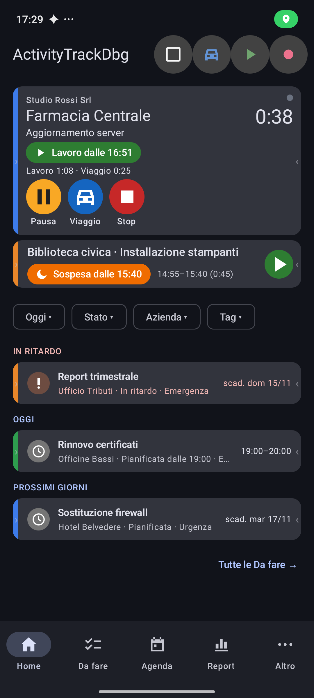

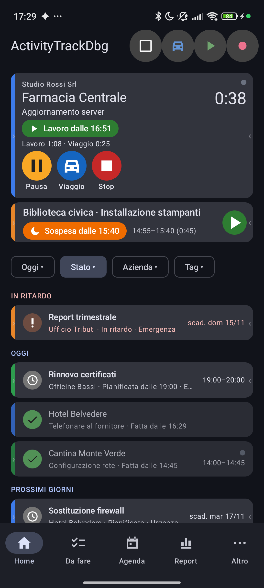

### Gesti (trascinare i riquadri)
Ogni riquadro si trascina a sinistra o a destra (Home, lista dell'Agenda,
scheda "Da fare"). Un trascinamento breve mostra i pulsanti, da toccare;
uno lungo esegue subito il primo. Una sola regola per tutte le righe:
**a sinistra il passo avanti**, **a destra rimandare o tornare indietro**.

| Riquadro | A sinistra | A destra |
|---|---|---|
| Attività in corso | Pausa, o Riprendi se è in pausa o sospesa | Stop |
| Da fare | Avvia o Fatta | Posticipa (se pianificata) o Elimina (va nel Cestino) |
| Fatta o Incompleta | — | Riapri (chiede conferma) |
| Eliminata (Cestino) | Ripristina | Ripristina |

Dopo un gesto su un'attività **"Annulla"** resta per 10 secondi. Si cambiano in "Impostazioni" →
**"Gesti"**: per ogni tipo di riquadro e direzione cosa proporre (anche nessuna azione, o le direzioni invertite), e
se il trascinamento lungo esegue subito la prima. Al primo uso la Home mostra un **suggerimento** sui gesti ("Ho
capito" lo chiude) e i riquadri hanno ai lati una piccola ‹ › finché non se ne trascina uno; "Gesti" →
**"Mostra di nuovo i suggerimenti sui gesti"** li ripropone. Non ci sono più i trascinamenti per sospendere.

### Colori di aziende e clienti
Nella scheda di un'azienda o di un cliente ("Altro" → "Anagrafiche") scegli
un **colore** fra dodici, o "Nessun colore". I riquadri delle attività e
delle voci da fare hanno una sottile **banda verticale** a sinistra con il
colore dell'azienda; quando la lista mostra una sola azienda, la banda ha il
colore del **cliente**. Senza un colore scelto non c'è banda; in Agenda i
blocchi di quelle aziende sono grigi.

Accanto a "Da fare · 24 h ▾" (e nella scheda "Da fare") il pulsante **"Tutte
le aziende"** filtra le voci da fare per azienda: il filtro resta finché non
lo togli con la ✕. Le attività in corso non vengono filtrate. Nella scheda
"Da fare" il filtro del periodo (**24 h**, **3 gg**, **7 gg**, **30 gg**,
**Tutti**, gli stessi della Home)
mostra le attività pianificate o in scadenza entro quel tempo (quelle in ritardo
sempre), il chip **"Cestino"** mostra le eliminate. **"Filtri"** apre
i filtri avanzati: cliente, **priorità** (Nessuna … Emergenza), **stato** (Da fare, Pianificata, In ritardo…),
pianificata sì/no; "Azzera" li toglie.

### Tag colorati
I tag che hanno un colore nell'anagrafica ("Altro" → "Anagrafiche" → "Tag",
§10) compaiono come **pallini colorati in alto a destra** nei riquadri della
Home, nelle righe della lista e dell'Agenda (anche nei blocchi della vista
Giorno) e nel dettaglio di un giorno del Report: fino a quattro, poi "+N".
I tag liberi, o senza colore, hanno il pallino grigio. Nella scheda
dell'attività i tag sono scritti per intero, nel loro colore.

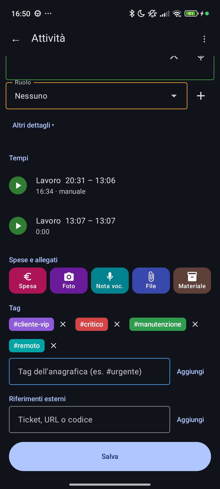

### Visualizzazione compatta
Impostazioni → "Visualizzazione" → **Compatta**: testo un po' più piccolo,
riquadri e pulsanti più stretti, per vedere più attività e voci insieme.

### Nuova azienda o cliente al volo
Il **+** accanto a un campo di anagrafica crea il nuovo elemento senza
uscire, che risulta già scelto (la scelta rapida riempie la descrizione):
Azienda, Cliente, Scelta rapida e Ruolo in "Nuova attività" e nella scheda
attività; Azienda e Cliente nell'editor delle voci da fare; il cliente nel
contatto (anche importato dalla rubrica); l'azienda nel cliente e nella
scelta rapida, con il ruolo proposto. Il dialogo è lo stesso anche quando
si aggiunge da Anagrafiche (0.8.2): per un cliente nome, azienda e colore.
I dialoghi propongono l'**ultima azienda e l'ultimo cliente** scelti in un
dialogo qualsiasi (nuovo cliente, nuova voce da fare, nuovo contatto),
anche dopo la riapertura dell'app: di solito si lavora per un'azienda
tutto il giorno. "Nuova attività" ha la sua proposta (§4).

### Campi obbligatori e facoltativi
Il colore del bordo dice quanto conta un campo:

| Bordo | Significato | Esempi |
|---|---|---|
| **rosso** | obbligatorio, ancora vuoto | cliente, descrizione |
| **verde** | obbligatorio, compilato | gli stessi, una volta riempiti; importo e descrizione della spesa |
| **giallo** | importante, non obbligatorio | ruolo, data e ora pianificate, inizio e fine |
| **blu** | accessorio | note, riferimenti, località, durata, scadenza, priorità |

Il campo in cui stai scrivendo ha il bordo più spesso, del colore del tema:
non confonderlo con il blu degli accessori. Nei menu di aziende e clienti compare il loro colore. In "Nuova
attività" l'azienda è solo un filtro dei clienti: con "Tutte le aziende" il
bordo è neutro, diventa verde quando un'azienda è scelta o viene dal cliente.

### Date e orari
Le date si scelgono con il calendario di Android. Gli orari con una
**griglia a 5 minuti**: una riga per ora, 12 caselle per riga, 12 ore alla
volta (**▲ Prima** / **Dopo ▼** spostano la finestra di 3 ore). Senza un
orario già scelto la finestra si apre centrata sull'orario di lavoro di quel
giorno.
- orario singolo: tocca una casella; **"Orario esatto"** apre l'orologio di
  Android per i minuti fuori dalla griglia (es. 09:37); OK senza toccare nulla
  lascia l'orario com'era;
- tratti (Modifica tratto, + Viaggio, + Pausa): toccando Inizio o Fine la
  griglia sceglie tutti e due: tocca la prima casella e trascina fino
  all'ultima, oppure tocca la prima e poi l'ultima (anche dopo aver spostato
  la finestra). In alto l'intervallo e la durata; le caselle **tratteggiate**
  sono occupate da altri tratti di quel giorno.
I campi facoltativi hanno la ✕ per svuotarli.

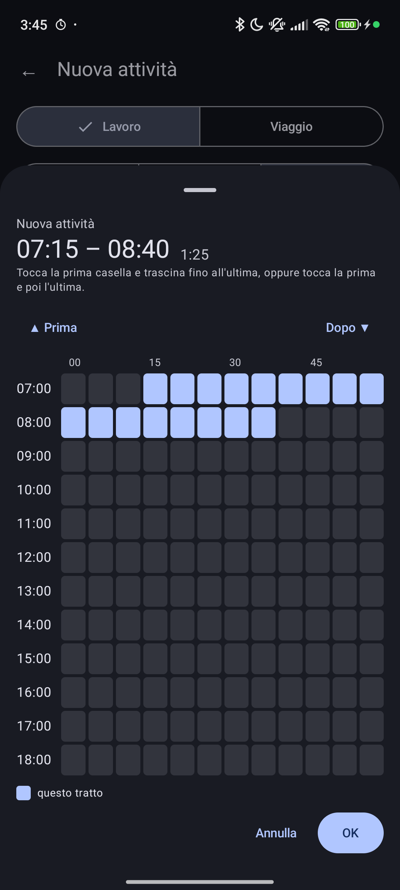

### Svuotare un campo
Nei campi in cui si scrive (descrizione, note, nomi, tag, riferimenti,
ricerca dell'Agenda…) compare una **✕** appena contengono del testo: la
tocchi e il campo si svuota. Nelle caselle cliente con ricerca la ✕ svuota
la ricerca e mostra di nuovo tutto l'elenco; il cliente scelto resta finché
non ne scegli un altro.

---

## 4. Creare un'attività

Quattro pulsanti, nel riquadro "Nessuna attività in corso" della Home o, con un'attività in corso, in alto a destra:
**Da fare**, **Lavoro**, **Viaggio**, **Assenza**. Anche l'Agenda li offre ("Aggiungi", o un tocco su uno spazio libero).

**Lavoro** — apre la schermata "Nuova attività" (le stesse voci vengono dal widget, dalle scorciatoie e dalle chiamate):
- in alto, con "Orari modificabili" (acceso all'inizio), **Adesso / Già iniziata / Passata**, che decide quali orari
  chiedere;
- **Azienda** filtra i clienti; **Cliente** è una casella in cui scrivere per cercare (maiuscole e accenti non
  contano) oppure scegliere dall'elenco, nell'ordine scelto in Anagrafiche. Se ti trovi entro il raggio di una sede,
  cliente e azienda sono già proposti; altrimenti l'app propone l'azienda dell'ultima attività di oggi;
- poi **Scelta rapida**, **Descrizione** e **Ruolo**: descrizione e ruolo vengono proposti dall'ultima attività
  sullo stesso cliente negli ultimi 30 giorni. Il microfono nel campo detta il testo;
- **"Altre informazioni"** apre **Tratti**, **Note** e **Riferimenti esterni**; i campi del gestionale compaiono qui,
  se facoltativi, oppure tra i campi principali, se obbligatori;
- **Adesso**: nessun orario, l'attività parte subito.
- **Già iniziata**: solo **"Iniziata alle"**, con le scorciatoie **15 / 30 / 60 min fa**; l'attività resta in corso e
  la fermi con Stop. Un orario che oggi deve ancora arrivare fa chiedere **"Inizio alle HH:MM"**: **"Pianifica oggi
  alle HH:MM"** crea un'attività *Da fare* pianificata, **"Avvia adesso"** parte subito, **"Avviata ieri alle
  HH:MM"** la registra da ieri.
- **Passata**: **Data** (vuota = oggi), **Inizio / Fine** sulla stessa riga e i **Tratti** visibili; un solo
  pulsante **"Salva"**. L'attività è registrata già chiusa, senza domande sulle attività in corso. Una data futura
  propone di pianificarla come *Da fare*.
- I pulsanti in basso sono **Lavoro** (verde) e **Viaggio** (blu): dicono cosa succede ("Avvia adesso", "Avvia dalle
  HH:MM", "Registra HH:MM–HH:MM").

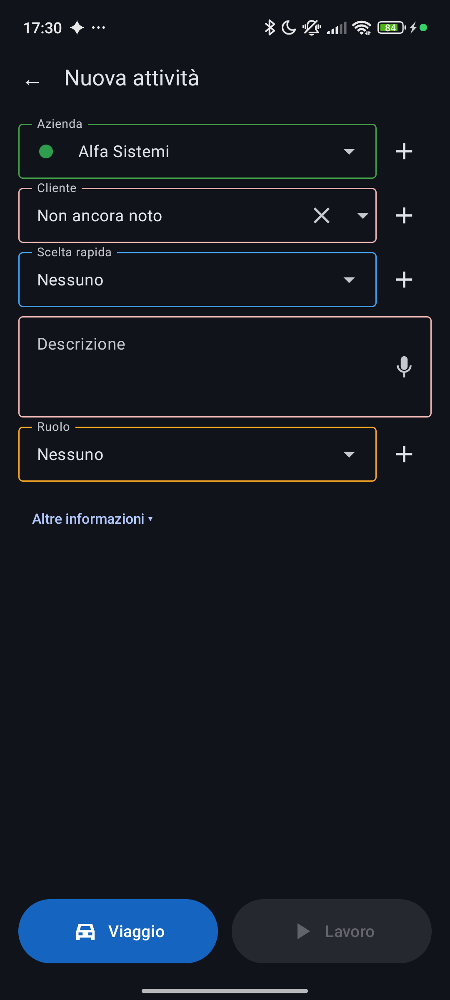

**Viaggio** — parte subito, come attività anonima (senza cliente e descrizione, che si indicano dopo, nella scheda).
Se stai lavorando l'app chiede prima "Hai completato l'attività lavorativa?" (§5).

**Da fare** — la finestra chiede **Azienda**, **Cliente**, **Descrizione**, **Data**, **Orario** (con la durata,
facoltativa), **Scadenza** e **Priorità** (Nessuna, Bassa, Media, Alta, Urgenza, Emergenza); sotto "Altre
informazioni": **Note**, **Riferimenti** e **Tratti pianificati** (disegnati tratteggiati: non contano mai nei
totali e spariscono quando l'attività parte). Vedi anche §8.

**Assenza** — vedi §9.

**Se un'altra attività è già in corso**, l'app chiede cosa farne:
- in lavoro: chiudere o lasciarla andare (le contemporanee, se ammesse);
- in viaggio: "il viaggio è finito?" (sì = ferma, no = lascia);
- in pausa: chiudere o lasciarla.

Se la policy non consente **attività contemporanee**, "lasciarla" non c'è: l'attività in corso diventa **Sospesa**
(se è in pausa, viene fermata) e **Riprendi** su un'attività sospesa (Home, widget, riquadro, notifica) fa lo
stesso con quella in corso. Questo è l'unico modo in cui un'attività diventa Sospesa: non c'è un pulsante
"Sospendi".

**Altri modi per partire**
- dalla notifica dell'avviso di inizio giornata ("Avvia attività");
- da un'attività **Da fare** (cliente, descrizione e riferimenti già compilati): **Avvia** nella sua scheda o nella lista;
- dal **widget** 4×1 o dalle **scorciatoie** dell'icona (clienti recenti): si apre la schermata di avvio con il
  cliente già scelto;
- da una **chiamata** riconosciuta: la schermata si apre in modo **Passata** con gli orari della telefonata.

---

## 5. Durante l'attività

### Comandi
Nella card della Home e nella notifica:

| Icona | Comando |
|---|---|
| ▶ verde | Lavoro / Riprendi |
| ⏸ giallo | Pausa |
| 🚗 blu | Viaggio |
| ⏹ rosso | Stop |

La card mostra il tempo del tratto in corso in grande e lo stato in un'etichetta colorata; sotto ogni pulsante c'è
il suo nome. **Pausa** è un'interruzione dentro l'attività, conteggiata come pausa. Non c'è "Sospendi": per
lavorare a un'altra cosa basta avviarla (§4).

**Viaggio durante il lavoro.** Se tocchi Viaggio mentre lavori, l'app chiede **"Hai completato l'attività
lavorativa?"**: **Sì** chiude l'attività e ne avvia una nuova, anonima, di viaggio; **No** fa il viaggio dentro la
stessa attività (un viaggio dal widget è sempre un viaggio nella stessa attività). Dalla pausa, Lavoro e Viaggio
ripartono direttamente.

**"Stop"** apre il foglio di chiusura (§6). Lo Stop dalla notifica, dal widget o dal riquadro rapido ferma sempre subito.

### Notifica fissa
Una notifica per attività in corso, con cronometro e comandi. Mentre la
posizione è attiva non si può eliminare con uno swipe; negli altri casi
ricompare quando riapri l'app.

### Promemoria
- **Conferma** ogni 30 minuti di lavoro o viaggio: "Ancora su …?" con
  "Sì", "Pausa" o "Stop alle hh:mm" (ferma all'ultima conferma, se te ne eri
  dimenticato). Se non rispondi l'attività continua.
- **Pausa** ogni 15 minuti ("Ancora in pausa?"), muto durante la pausa pranzo.
- **Riepilogo** a fine orario di lavoro: il totale del giorno.

### Posizione (automatica)
- Un punto ogni 5 minuti (impostabile), ogni minuto in viaggio (impostabile), più uno quando il telefono si muove. Le posizioni escono dal telefono solo con un'esportazione esplicita del tracciato (vedi *Tracciati*).
- **"Lontano da …?"** — durante il lavoro, se ti allontani più di 100 m:
  "Viaggio dalle hh:mm" (il viaggio parte dall'ora in cui sei partito),
  "Ignora", "Stop alle hh:mm".
- **"Arrivo?"** — durante un viaggio, dopo 15 minuti fermo entro 100 m:
  presso la sede di un cliente propone "Lavoro da … dalle hh:mm" (assegna quel
  cliente al viaggio se non ne aveva uno); a casa propone lo stop; altrimenti
  "Lavoro dalle hh:mm" o "Sono ancora in viaggio".
- I km del viaggio sono la distanza tra le posizioni registrate (a 2 minuti o meno l'una dall'altra) o la
  distanza su strada (OSRM) dove sono più distanti, e la località proposta
  dal servizio di indirizzi (Nominatim), quando la rete è disponibile.

Tocca i **pulsanti** delle notifiche, non il testo: il testo apre l'app e
chiude la notifica senza eseguire l'azione. Se i pulsanti non si vedono,
trascina la notifica verso il basso per espanderla.

In cima alla schermata dell'attività, sotto lo stato, una riga di pulsanti
aggiunge **Spesa**, **Foto**, **Nota voc.**, **File** e **Materiale**; le
sezioni "Spese", "Materiali" e "Allegati" più in basso li elencano (compaiono
quando ce n'è almeno uno).

### Tracciati: mappa, esportazione e pulizia
**Altro → Tracciati**, oppure **⋮ → Percorso dell'attività** in un'attività.
- **Mappa** degli spostamenti di un giorno, di una settimana o di un mese (o di una sola attività):
  linee verdi per il lavoro, blu per i viaggi, un punto verde dove un'attività inizia e uno rosso
  dove finisce; tocca una linea per vedere l'attività. La mappa compare se è attiva
  **Impostazioni → Posizione → Mappa degli spostamenti**, c'è una mappa di base (le mappe online di
  **Impostazioni → Servizi online**, oppure una *mappa offline* scaricata) e se la policy lo consente. "Solo viaggi" nasconde il resto.
- **Esporta tracciato**: un file **GPX** (percorsi e strumenti come QGIS) o **KML** (Google Earth Pro), con ogni
  posizione registrata così com'è (ora e precisione) e, per ogni attività, cliente, azienda,
  ruolo, attività, località, tag, orari e km. Va nella cartella *export* e si può condividere. La
  casella **"Elimina i tracciati dopo l'esportazione"** cancella esattamente le posizioni esportate dopo aver scritto il file. Se puoi vedere la
  mappa puoi esportare, salvo che la policy (`trackExport`) lo vieti.
- **Mappe offline**: mappe basilari (strade, fiumi, confini, nomi dei luoghi) di aree di circa 100 km, pochi MB ciascuna.
  Un telefono associato ad ActivityTrack Web riceve quelle che l'amministratore ha preparato, con la sincronizzazione,
  su Wi-Fi. Senza server, copia file `.pmtiles` nella cartella **maps** della cartella dati e usa
  *Impostazioni → Posizione → Mappe offline → Importa dalla cartella dati*. Compare la mappa che copre il tuo tracciato, al
  posto dei tile OSM quando questi sono spenti o manca la rete; ogni mappa ha il suo pulsante *Elimina*.
- **Pulizia tracciamento**: elimina le posizioni più vecchie di un mese, quelle di un giorno o tutte.
  Attività, orari e km restano; le posizioni di un'attività in corso e di un viaggio di cui si
  stanno ancora calcolando i km vengono conservate.

### Spese
Nella schermata dell'attività, pulsante **Spesa**: importo in
euro, descrizione, "Foto dello scontrino" facoltativa. Spesa veloce: pulsante
**€** del widget o scorciatoia **"Spesa"** dell'icona (va all'attività in corso
più recente).

### Materiali di consumo
Pulsante **Materiale**: i materiali lasciati al cliente. **Descrizione**
obbligatoria; **quantità**, **unità di misura** e **costo unitario**
facoltativi. Scegliendo un materiale da Anagrafiche → **Materiali di
consumo** descrizione, unità e costo vengono copiati e restano modificabili
(un prezzo cambiato dopo non tocca le righe già registrate). La sezione
"Materiali" mostra il totale; toccando una riga la modifichi o la elimini.

### Allegati
Pulsanti **Foto** (fotocamera), **Nota voc.** (registra finché non tocchi
"Ferma e salva"), **File** (qualsiasi documento). Toccando un allegato:
"Apri" o "Elimina". I file stanno nella cartella dati, in
`attachments/<anno>/<attività>/`.

### Chiamate con i clienti
Se attivi il riconoscimento (Impostazioni → **Chiamate**, entranti e uscenti
separatamente), alla fine di ogni chiamata con un numero presente in
Anagrafiche → **Contatti** l'app guarda il registro chiamate e:
- registra la chiamata (si vede nella scheda del cliente, sezione
  **"Chiamate"**, con la durata);
- se stai lavorando per **lo stesso cliente**, non fa altro: la chiamata fa
  parte dell'attività;
- se stai lavorando per **un altro cliente**, mette quell'attività **in
  pausa** per la durata della chiamata, con la descrizione "Telefonata
  CLIENTE", e la riprende alla fine (opzione "Metti in pausa…"); una chiamata
  sotto il minuto non crea la pausa;
- salvo il caso dello stesso cliente, propone con una notifica di
  **registrare la chiamata come attività** (opzione "Proponi…"): "Crea
  attività" apre "Nuova attività" con il cliente, la descrizione
  "Chiamata telefonica con NOME" e gli orari arrotondati a 5 minuti (inizio
  per difetto, fine per eccesso).

Vale solo in orario di lavoro (non nei festivi e nei giorni liberi), salvo
con l'opzione **"Anche fuori orario (reperibilità)"**: allora vale sempre.
Le chiamate con numeri sconosciuti vengono ignorate.

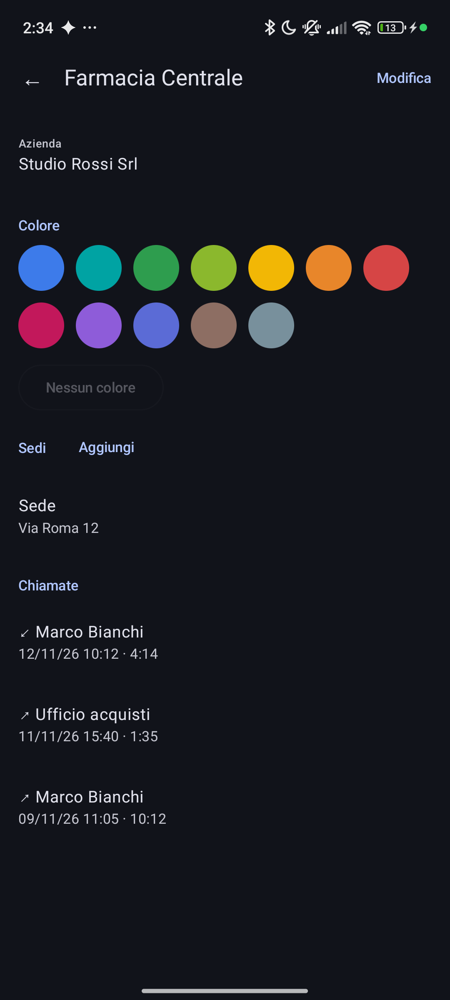

---

## 6. Fermare e modificare

**Stop** dall'app (pulsante o trascinamento) chiude l'attività:
- con "Orari modificabili" puoi indicare la **Fine**: vuoto = adesso; altrimenti l'attività si chiude a
  quell'ora, anche **fino a 24 ore nel futuro** (utile per fermarsi un attimo prima di una pausa programmata). Se
  nel frattempo parte un'altra attività prima di quell'ora, la fine della prima viene **anticipata** all'inizio
  della nuova, con un avviso. Più in là di 24 ore, o senza "Orari modificabili", la fine non può essere nel futuro;
- se l'attività è durata **meno di un minuto** (senza allegati né spese), un avviso con **"Scarta"**: probabilmente
  era partita per errore;
- **"Stop rapido"** ferma subito senza guardare il resto; **"Annulla"** lascia tutto com'era.

**Viaggio di ritorno.** Se l'attività ha un viaggio di andata seguito da lavoro, e non ha un viaggio dopo l'ultimo
lavoro, lo Stop offre tre scelte:
1. **Avvia viaggio di ritorno** — l'attività resta in corso, in viaggio;
2. **Termina l'attività** — la chiude;
3. **Termina l'attività ed aggiungi il viaggio di ritorno** — la chiude e aggiunge un viaggio uguale all'andata
   (stessa durata e stessi km, partenza e arrivo scambiati). Si offre solo con gli orari modificabili, perché la
   fine del ritorno può cadere nel futuro (è una stima dichiarata).

Un'attività senza nulla da chiedere si ferma subito.

**Chiusa: Fatta o Incompleta.** Non c'è un passo "Completa i dettagli": dopo lo Stop l'attività è **Fatta** se ha
un cliente, almeno un tratto di lavoro e i campi obbligatori del gestionale compilati; altrimenti è **Incompleta**
(icona ■ rossiccia, sempre in vista nella Home) e si corregge come ogni altra, aprendola. Una voce *Da fare*
spuntata senza tratti è **Fatta**.

**Riaprire.** Dalla scheda (o con il gesto) **Riapri** riporta un'attività chiusa in corso, in **Lavoro** o in
**Viaggio**, e **chiede sempre conferma**; il tempo intermedio resta un vuoto, non viene riempito. Per una voce
spuntata per errore, senza tratti registrati, **"Rimetti da fare"** toglie la spunta.

**Salva i valori arrotondati.** In Impostazioni → "Rendicontazione" l'interruttore **"Salva i valori arrotondati"**
(spento all'inizio; vale solo con "Orari modificabili"; può essere fissato dalla policy) fa registrare ai
**pulsanti** (avvio, cambio, stop, riapri) orari arrotondati: l'inizio per difetto, lo stop per eccesso, il cambio
al multiplo più vicino, ognuno sul quanto della regola del tratto (§1). Gli orari scritti a mano restano esatti.

### La scheda dell'attività
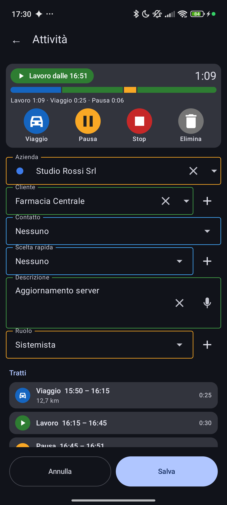

Toccando qualunque attività (in corso, da fare, chiusa, assenza, eliminata) si apre la stessa scheda; dall'alto:
- lo **stato** nello stile della Home ("In Lavoro dalle 09:06", con icona e colore) e, a destra, il **tempo di
  lavoro totale**; sotto la **linea del tempo** colorata con i tratti nel loro ordine;
- i **pulsanti d'azione dello stato** (per esempio Avvia per un Da fare; Pausa, Viaggio, Stop per un'attività in
  corso; Riapri per una chiusa; Ripristina per un'eliminata);
- azienda, cliente, scelta rapida, descrizione (dettabile), ruolo, contatto (facoltativo, se il cliente ha
  contatti: lega l'attività alla persona per cui hai lavorato);
- **Tratti**: ogni tratto ha l'icona colorata del suo tipo (lavoro verde, pausa gialla, viaggio blu, assenza fucsia;
  i pianificati tratteggiati). Il pulsante diviso **Lavoro · Viaggio · Pausa** aggiunge tratti dimenticati (anche
  con i km; almeno un minuto). Con "Orari modificabili" acceso, toccando un tratto concluso si apre **"Modifica
  tratto"**: data, inizio, fine e, per i viaggi, i km; **"Elimina"** lo toglie (non il tratto in corso né l'unico
  rimasto). Del tratto in corso si possono cambiare data e inizio; la fine si registra con il prossimo comando. Se
  un tratto si sovrappone ad altri della stessa attività, l'app li mostra e chiede conferma: confermando, il tratto
  salvato vince e gli altri vengono accorciati, divisi in due o eliminati dove li copre. Con tratti di altre
  attività nessun controllo: restano attività contemporanee;
- le **pause** hanno una **descrizione** facoltativa (es. "Telefonata CLIENTE" per quelle create da una chiamata):
  toccando una pausa la modifichi o la cancelli, anche con "Orari modificabili" spento;
- **Spese e allegati**: una riga di pulsanti colorati (**Spesa**, **Foto**, **Nota voc.**, **File**, **Materiale**)
  sopra le loro sezioni; "Riferimenti esterni": ticket, URL o codici (riconosciuti automaticamente);
- **Località**: se il servizio di posizione è attivo l'app la propone da una sede del cliente, dell'azienda o
  tua, altrimenti dal comune;
- **Note** e **Tag**: etichette (es. `#remoto`, `#urgente`); scrivine uno o più nel campo e tocca "Aggiungi",
  oppure tocca un suggerimento: prima quelli dell'anagrafica, col loro colore, poi quelli liberi già usati. La ✕ su
  un tag lo toglie. Si aggiungono anche dopo la chiusura. Un tag libero (grigio) si tiene in anagrafica
  toccandolo: **"Tieni in anagrafica"** gli dà un colore. Con l'opzione **"Anche tag liberi"** spenta (o fissata
  dalla policy) si aggiungono solo i tag dell'anagrafica ("Solo i tag dell'anagrafica: … non aggiunti");
- in basso **"Annulla"** e **"Salva"**;
- **"Elimina"** nel menu **⋮** in alto sposta l'**intera attività** nel Cestino (§8). Se ha allegati, prima vanno
  eliminati a mano dalla sezione "Allegati". Un'attività nata da un **ticket** del gestionale elimina solo il tempo
  registrato: la voce torna *Da fare*.

---

## 7. Consultare: Agenda e Report

### Agenda
In alto le modalità e il periodo ("‹ ›" per scorrere, "Oggi" per tornare a
oggi; a destra il totale rendicontato del periodo).
- **Lista** — il mese, giorno per giorno, con ricerca per cliente,
  descrizione o tag (`remoto` o `#remoto`); i tag compaiono dopo la
  descrizione; le attività da fare, in ritardo o pianificate, compaiono con l'icona del loro stato.
- **Giorno** — linea del tempo: ogni attività è un blocco dall'inizio alla
  fine; attività contemporanee affiancate; i tratti pianificati delle attività da fare sono
  blocchi **tratteggiati**, le assenze blocchi **fucsia**.
- **Settimana** — sette colonne da lunedì; toccando un giorno si apre la vista Giorno.
- In Giorno e Settimana la linea del tempo copre l'intera giornata e si apre
  con tutto l'orario di lavoro nello schermo (o sull'attività in corso, se è
  fuori orario); **due dita** (pinch) ingrandiscono o riducono la scala.
- L'Agenda si riapre sull'ultima vista scelta.
- **Mese** — griglia con le ore rendicontate per giorno, un pallino per
  azienda e uno per le attività da fare; toccando un giorno si apre la vista Giorno.

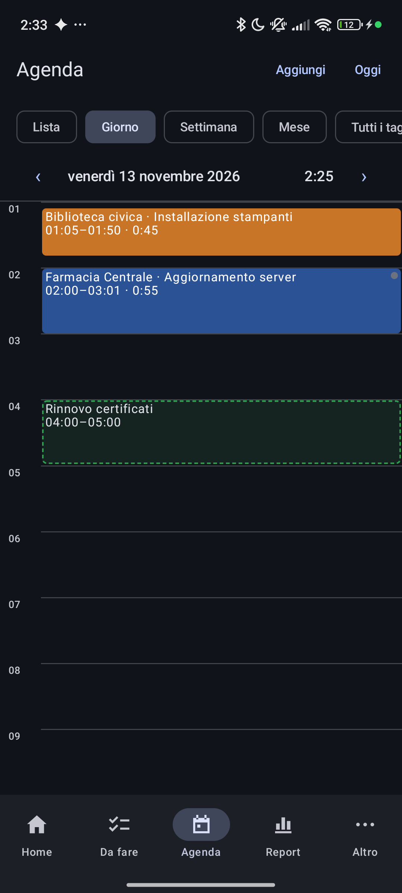

**Filtro per tag**: il chip "Tutti i tag ▾" accanto alle modalità (compare
quando nel periodo ci sono attività con tag) mostra solo le attività con quel
tag; le *Da fare* si nascondono e i totali contano solo ciò che si vede.

Il colore di un blocco è quello del **cliente**, altrimenti dell'**azienda** (le attività da fare non hanno più un
colore proprio). Toccando un'attività, da fare o no, si apre la sua scheda (§6), con le azioni dello stato.

**Pianificare dall'agenda**: nelle viste Giorno e Settimana tocca uno spazio
libero: si apre una nuova *Da fare* pianificata a quell'ora (a passi di
mezz'ora). "Aggiungi" in alto fa lo stesso per il giorno mostrato (oggi: la
prossima mezz'ora; altri giorni: le 09:00).

### Report
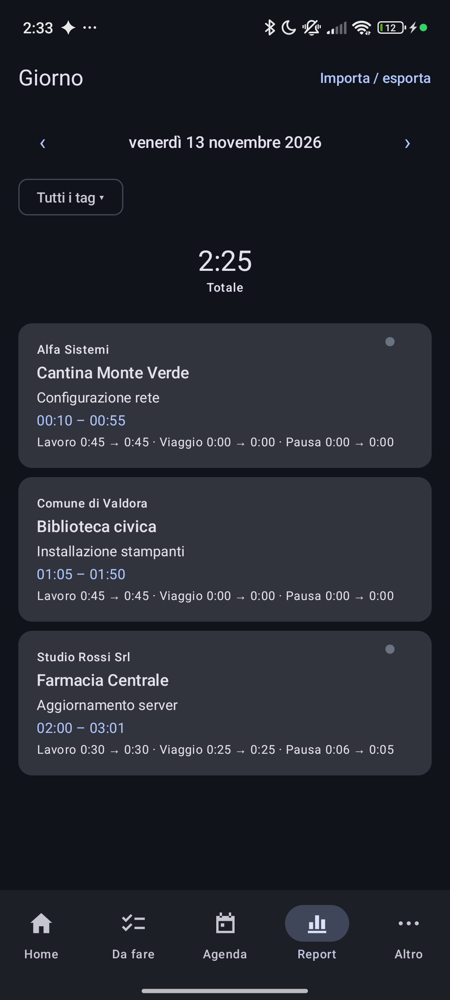

Il report di un giorno: il **totale** (lavoro e viaggio arrotondati), una
riga per attività con lavoro, viaggio e pausa reali → arrotondati, e le **assenze contate a parte** (per tipo: Assenza, Ferie, Permesso, Malattia); da qui
anche l'esportazione. Con il filtro per tag restano le attività con quel tag
e il totale è la loro somma. Il CSV ha anche le righe delle assenze e le colonne `absence_min` e `absence_kind`. Anche
l'esportazione ha il campo **Tag** (solo le attività con quel tag; le altre
sezioni dell'interscambio non sono filtrate).

---

## 8. Da fare, priorità e Cestino

Un *Da fare* è un'**attività nello stato Da fare**: importata da un gestionale o creata a mano (pulsante **Da fare** della Home, scheda
**"Da fare"** della barra in basso → "Aggiungi", oppure l'Agenda). Quando la avvii diventa Lavoro o Viaggio e, alla
fine, Fatta o Incompleta: è sempre la stessa attività, con la stessa scheda (§6).

La finestra "Da fare" ha: **Azienda**, **Cliente**, **Descrizione**, **Data** pianificata, **Orario** (con durata
facoltativa), **Scadenza** (con ora), **Priorità**; sotto "Altre informazioni": **Note**, **Riferimenti** (uno per
riga) e **Tratti pianificati**.

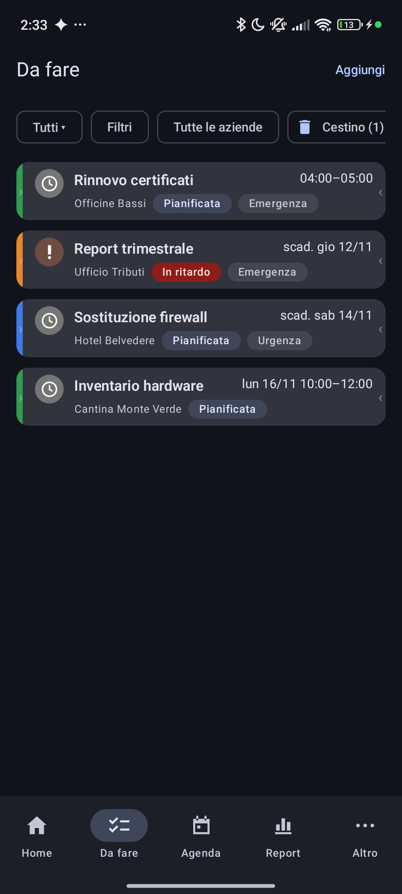

**Stati.** Una voce da fare è **Da fare** (senza date), **Pianificata** (una data, un orario o una scadenza) o **In
ritardo** (§1). Nell'elenco della scheda "Da fare" compaiono gli stati, i nomi delle priorità, i **filtri per stato
e per priorità** e il chip **Cestino**. La pianificazione è separata dalla scadenza: ripianificare non cambia la
scadenza del gestionale; se però si salva una pianificazione successiva alla scadenza, l'app chiede se allinearle:
"Allinea la scadenza" copia il giorno pianificato, "Mantieni" lascia tutto com'è. Già mentre si compila, sotto la
scadenza compare in rosso "Risulterà in ritardo…" con il pulsante "Allinea la scadenza". Vale anche nello stesso
giorno, se l'inizio pianificato è dopo l'ora di scadenza: allineando, l'ora di scadenza si toglie.
- **Priorità**: **Nessuna, Bassa, Media, Alta, Urgenza, Emergenza** (da 0 a 5), in un menu a tendina. Al posto di P1…P5
  della 0.9: i valori vecchi sono stati convertiti (P1 → Emergenza … P5 → Bassa). Un gestionale con un'altra scala
  la converte il suo plugin.
- **Solo la data**: la voce vale per tutto il giorno; in Agenda sta nella fascia sopra la griglia, nel calendario è un
  evento di tutto il giorno, non ha promemoria ed è "In ritardo" dal giorno dopo.
- **Orario**: toccando il campo si apre la griglia; un **tocco** e OK fissano solo l'**inizio**, un
  **trascinamento** (o due tocchi) fissa **inizio e fine**. Il tratto pianificato è disegnato tratteggiato e non
  conta mai nei totali.
- **A fine orario di lavoro**, se una o più attività pianificate per oggi non sono state lavorate, arriva una sola
  notifica con l'elenco e **"Ripianifica a …"**, che le sposta al giorno lavorativo successivo mantenendo l'orario.
- **Promemoria**: 15 minuti prima dell'ora pianificata arriva la notifica "Titolo alle HH:MM" con "Avvia attività",
  "Posticipa 30 min" e "Ripianifica" (apre la scheda). Arriva anche fuori orario e nei giorni liberi; sparisce se
  l'attività viene avviata, spuntata, ripianificata, eliminata o se il blocco è passato.
- Toccando una voce si apre la scheda (§6), con **Avvia**, **Posticipa**, **"Togli pianificazione"** (la voce resta,
  senza data né promemoria), **Fatta** (la spunta, senza registrare tempo), **Elimina**. Una voce spuntata per errore
  torna indietro con **"Rimetti da fare"**.
- Dopo "fatta", "posticipata", "Elimina", "Ripristina" o "Togli pianificazione", in basso compare per qualche secondo
  un messaggio con **"Annulla"**.
- Una voce importata e poi eliminata non è ripristinata dalla sincronizzazione del gestionale successiva.

**Cestino.** Al posto di "Ignorate": **Elimina** sposta l'attività (da fare, chiusa o assenza) nel **Cestino**
(chip "Cestino" nella scheda "Da fare"): sparisce da Home, Agenda, report, esportazioni e calendario, e non riceve
promemoria. Dal Cestino: **Ripristina** la rimette dov'era; **Elimina definitivamente** la cancella senza ritorno (chiede
conferma; se ha allegati vanno prima tolti).

**Assegnate dal server.** Un responsabile può assegnare un'attività *Da fare*; finché è Da fare si può riassegnare, poi
la porti avanti tu (§ Sincronizzazione).

---

## 9. Assenze e giorni liberi

**Assenza** (pulsante della Home) registra o pianifica un'assenza, che è un'attività di tipo Assenza (stato
**Assenza**, fucsia). La finestra chiede:
- il **tipo**: **Assenza**, **Ferie**, **Permesso**, **Malattia**;
- l'**azienda** (facoltativa: vuota vale per tutte le aziende);
- **Dal** e **Al** (giorni; "Al" vuoto = lo stesso giorno);
- **Dalle / Alle** (facoltativi): con gli orari è un **permesso** a ore, un solo spezzone per giorno con quegli
  orari; senza, l'app crea **uno spezzone per ogni giorno lavorativo** dell'intervallo, secondo l'orario di lavoro (con la
  pausa pranzo in mezzo se è impostata) e saltando i **giorni liberi** (festivi e giorni indicati in Anagrafiche);
- le **note**.

Si possono pianificare anche **ferie nel futuro**. Nell'Agenda le assenze sono blocchi fucsia; nei report sono
contate **a parte** (per tipo), senza sommarsi a lavoro, viaggio e pausa. Si aprono, si modificano e si eliminano
(Cestino) come ogni attività.

- 15 minuti dopo l'inizio dell'orario di lavoro, se non hai avviato nulla, arriva **"Nessuna attività oggi"**:
  "Assente oggi" (registra un'assenza), "Entrata in ritardo…" (chiede l'ora) o "Avvia attività".
- Non arriva nei **festivi nazionali** (Pasquetta compresa, 4 ottobre dal 2026) né nei **giorni liberi**
  ("Anagrafiche" → "Giorni liberi": data e nota, es. il santo patrono o le ferie).

---

## 10. Anagrafiche

- Negli elenchi di Aziende, Clienti e Contatti un **pallino** mostra il colore
  scelto (per i contatti, quello del loro cliente).
- **Aziende** — nella scheda: sezione **"Gestionale"** (codice nel gestionale,
  connettore; per ora il generico, a file) e **"Calendario di questa azienda"**;
  sotto, le **sedi** dell'azienda.
- **Clienti** — appartengono a un'azienda (non si può cambiare dopo la prima
  attività); hanno le loro sedi e, in fondo alla scheda, le **chiamate**
  registrate con i loro contatti.
- **Sedi** — etichetta, coordinate, raggio, indirizzo. Coordinate da
  "Posizione attuale" o da "Mappa" (sposta la mappa sotto il mirino e "Usa
  questo punto").
- **Ruoli**, **Scelte rapide** (testi ricorrenti, con ruolo proposto).
- **Tag** — nome e **colore** fra i dodici (o nessuno), in ordine
  alfabetico; archiviati in fondo. Il nome è unico: non ci sono due tag con
  lo stesso testo. **Rinominare** un tag lo cambia anche su tutte le
  attività che lo hanno; **eliminarlo** lascia il testo sulle attività, come
  tag libero (grigio). Con il server, i tag **centrali** li gestisce dal web
  l'amministratore o un responsabile (sul telefono non si modificano); se
  hai già un tag con lo stesso nome di uno centrale, diventa quello centrale
  e ne prende il colore.

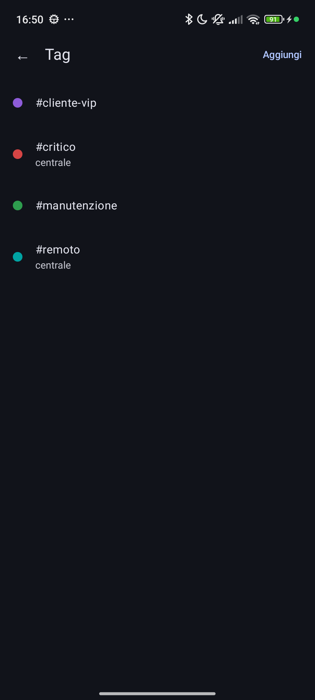
- **Ordine degli elenchi** — in cima ad Aziende, Clienti, Ruoli e Scelte
  rapide scegli **A–Z**, **Ultimo uso** (prima quelli usati più di
  recente; per le scelte rapide, l'ultima volta che le hai scelte) o
  **Manuale**: in manuale ogni riga ha la maniglia ≡ a destra; tienila e
  trascina la riga dove vuoi (i clienti si spostano dentro la loro azienda).
  Le nuove voci vanno in fondo. L'ordine scelto vale anche nei menu a tendina
  (es. "Nuova attività"); gli archiviati restano sempre in fondo.
  All'inizio: clienti per ultimo uso, il resto in ordine alfabetico.

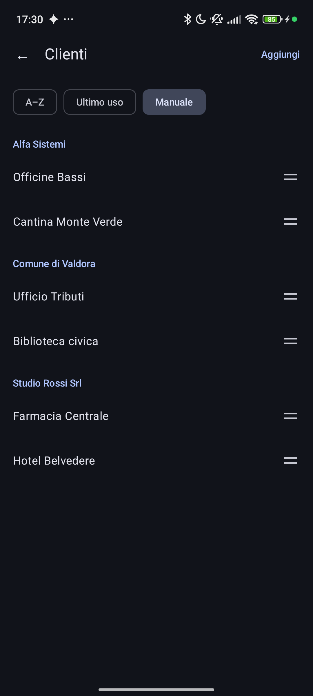

- **Contatti** — persone dei clienti: nome, cliente, numeri (facoltativi, uno
  per riga) ed **e-mail** (facoltativa). **"Importa dalla rubrica"** sceglie un numero dalla rubrica del
  telefono e lo propone come nuovo contatto. Servono al riconoscimento delle
  chiamate (§5); i numeri si confrontano con o senza prefisso
  internazionale.

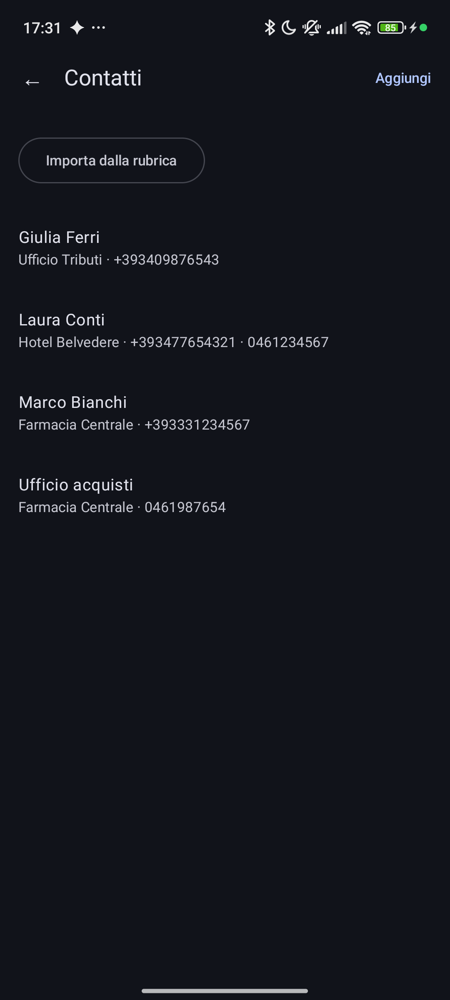

- **Materiali di consumo** — descrizione, unità di misura, costo unitario,
  azienda (facoltativa, per listini diversi); proposti nelle righe dei
  materiali delle attività.
- **Luoghi** — casa e altri luoghi (casa serve per l'arrivo a fine viaggio).
- **Orario di lavoro e pausa pranzo** — per giorno della settimana.
- **Giorni liberi**.

---

## 11. Importa / esporta, backup

"Altro" → "Importa / esporta".

**Esporta**
- **CSV**: una riga per attività e giorno, arrotondata; serve un periodo
  (massimo un anno).
- **JSON / XML** (formato generico, `docs/INTERCHANGE.md`): scegli il
  contenuto (anagrafiche, da fare, attività, assenze e giorni liberi), il
  periodo (vuoto = tutto), azienda e cliente; "Coordinate delle sedi" solo se
  servono.
- **Tag** (se ci sono attività con tag): solo le attività con quel tag, nel
  CSV e nell'interscambio (le anagrafiche e le altre sezioni restano intere).
- "Esporta" salva nella cartella `export`; "Esporta e condividi" apre anche
  il menu Condividi (email, Drive…).

**Importa** — un file JSON o XML generico (anche parziale, es. solo clienti o
solo attività da fare). Il rapporto mostra cosa è stato aggiunto, cosa era già
presente, i **conflitti** (i dati dell'app restano invariati) e ciò che non è
stato importato con il motivo. Reimportare lo stesso file non crea doppioni.

**Backup** — l'app salva il database nella cartella `backup` con la
frequenza e all'ora scelte in Impostazioni (ogni giorno alle 02:00 se non
cambiate; ne conserva 14, modificabile); **"Esegui backup ora"** qui, in
Importa / esporta.
**"Ripristina backup"** sostituisce tutti i dati con un backup scelto: prima
salva i dati attuali come backup `…-before-restore.zip`, poi riavvia l'app.

### Sincronizzazione con ActivityTrack Web
**ActivityTrack Web** è il server dell'organizzazione: tiene una copia dei
dati del telefono, li mostra nel browser (anche a chi rendiconta, in sola
lettura) e li allinea fra i telefoni dello stesso utente. Senza server l'app
funziona come sempre.

**Associare il telefono.** Sul web: *Dispositivi* → **"Associa un dispositivo"**
(fino ad ActivityTrack Web 0.9.3: *Telefoni* → "Associa un telefono") mostra
un codice QR, valido 10 minuti e per una sola volta. Nell'app:
Impostazioni → **Sincronizzazione** → **"Inquadra il codice QR"** (la prima
volta chiede il permesso della fotocamera), oppure **"Incolla il
collegamento"** se il codice è arrivato come testo. Il telefono chiede
**"Associare a questo server?"**: se era associato a un altro server,
quell'associazione termina; se il certificato del server non è di
un'autorità che il telefono conosce, da quel momento il telefono si fida
solo della chiave contenuta nel codice (**"chiave fissata"**). Un codice
scaduto o già usato dà "Il codice è scaduto o già usato: generane uno nuovo
dalla pagina web".

**Associa solo il server della tua organizzazione.** Il server a cui ti associ riceve tutti i dati
sincronizzati e può impostare la policy dell'app (impostazioni, funzioni, indirizzi) e decidere quale telefono
invia i dati ai plugin. Non inquadrare un codice QR e non aprire un collegamento di associazione che non
ti ha dato il tuo amministratore. Quando la policy del server cambia l'app, una notifica elenca le prime modifiche.

**Il PC.** Dalla stessa pagina si associa anche un PC con **ActivityTrack
Desktop**, l'app per l'area di notifica di Linux e Windows: si incolla il
collegamento mostrato sotto il codice. Attività e *Da fare* avviati sul PC
compaiono sul telefono alla sincronizzazione successiva, e viceversa; i
promemoria arrivano su entrambi. Un PC non manda mai ai gestionali.

**La prima sincronizzazione** manda al server tutto ciò che il telefono ha
e riceve ciò che il server ha già. Aziende, clienti, ruoli e tag con lo
stesso nome non si raddoppiano: diventano uno solo, con i dati del server.

**Quando sincronizza.** Subito quando apri l'app, pochi secondi dopo ogni
modifica, ogni 30 secondi mentre l'app è aperta (per ciò che arriva dal web
o da un altro telefono) e ogni 15 minuti in background, appena c'è rete.
Senza rete le modifiche aspettano e partono al ritorno della connessione.
Non ci sono notifiche push: una modifica fatta sul web arriva entro 15
minuti, subito se l'app è aperta.

**Versioni.** Dalla 1.0 la sincronizzazione richiede che **il server e tutti i dispositivi siano alla 1.0**: un'app
più vecchia riceve "Aggiorna l'app per sincronizzare" e non sincronizza finché non si aggiorna (le modifiche locali non
vanno perse). Dopo l'aggiornamento la prima sincronizzazione **riallinea** i dati al server, e le modifiche non ancora
sincronizzate restano e vengono inviate. In seguito app e server restano compatibili con le due versioni
precedenti l'una dell'altro. Se il server non accetta più questa versione
dell'app, o se l'app è più recente del server, la sincronizzazione si
sospende: una notifica e la pagina Sincronizzazione dicono cosa aggiornare
(l'app, o il server tramite l'amministratore). I dati restano sul telefono e
si sincronizzano appena le versioni tornano compatibili. I file degli allegati si scaricano su Wi-Fi, o quando apri l'allegato. Le
posizioni GPS restano sul telefono: viaggiano km e tempi.

**Da fare assegnate.** Un responsabile (o un amministratore) può creare
dal web un'attività *Da fare* e assegnarla a te: arriva sul telefono come le
tue, la avvii e la chiudi come sempre. Finché è ancora Da fare il responsabile può riassegnarla: se lo fa,
sparisce dal tuo telefono alla sincronizzazione successiva.

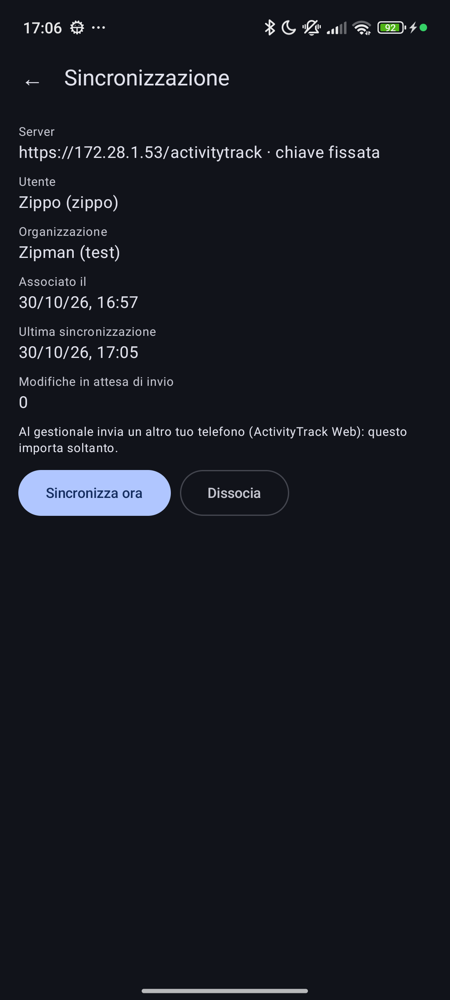

La pagina mostra server, utente, organizzazione, ultima sincronizzazione e
**modifiche in attesa di invio**; **"Sincronizza ora"** non aspetta il
prossimo giro.

**Anagrafiche centrali e personali.** Quelle create dal web
dall'amministratore o da un responsabile sono **centrali**: negli elenchi
hanno la scritta "centrale" e sul telefono non si modificano ("È
un'anagrafica centrale: la modificano l'amministratore o un responsabile,
dal web"). Quelle create sul telefono sono tue (personali); sotto un cliente
centrale puoi aggiungere sedi e contatti tuoi.

**Gestionali.** Se un utente ha più telefoni, solo uno invia le attività ai
gestionali (lo sceglie il web); gli altri importano soltanto e lo dicono
("Al gestionale invia un altro tuo telefono").

**Conflitti.** Se lo stesso dato cambia in due posti, vince la modifica più
recente, campo per campo. Alcuni casi restano da guardare:
- tratti che si sovrappongono dopo una sincronizzazione: la scheda
  dell'attività dice **"Da verificare"**; si correggono gli orari (con gli
  orari bloccati dalla policy li corregge dal web l'amministratore o il
  responsabile) e il segno sparisce;
- due attività in corso, quando la policy non le ammette insieme: la più
  vecchia diventa Sospesa e una notifica lo dice;
- una modifica che il server rifiuta: compare sotto **"Non
  sincronizzati"** con il motivo; **"Scarta la modifica"** riporta la
  versione del server (un elemento mai arrivato al server viene eliminato).

**Policy dal server.** Con il server la policy arriva da lì e prevale su un
`policy.json` nella cartella dati (§ seguente); si aggiorna a ogni
sincronizzazione.

**Dissociare e revoca.** **"Dissocia"** stacca il telefono dal server: i
dati restano sul telefono; per sincronizzare di nuovo serve un nuovo
codice. Se l'associazione viene revocata dal web, la pagina dice "Il server
ha revocato l'associazione di questo telefono" e la sincronizzazione si
ferma, sempre senza perdere dati.

### Policy e integrazioni

**Policy** — un file `policy.json` nella cartella dati (accanto a
`backup`) cambia l'app senza passare dalle Impostazioni: spegne funzioni,
nasconde, rinomina o colora campi, fissa impostazioni (grigie con il
lucchetto, o nascoste). È pensata per un'azienda che distribuisce l'app ai
suoi collaboratori, o per usarla in un altro settore ("Cantiere" al posto di
"Cliente").
- L'app la legge all'avvio e ogni volta che torna in primo piano. Se è
  valida: prima fa un backup `…-policy.zip` (mai cancellato in automatico),
  salva la policy precedente in `policy_old.json`, poi la applica e lo
  notifica. Se non è valida, la notifica elenca gli errori con la riga e la
  ignora finché il file non cambia.
- **Policy non firmata: prima la conferma.** Una nuova `policy.json` non
  firmata non viene applicata da sola: una notifica ("Applicare la nuova
  policy?") porta a una finestra, che compare anche ogni volta che l'app
  torna in primo piano, con il nome della policy, cosa cambia rispetto a
  quella in vigore (una riga per chiave: `+` aggiunta, `−` tolta,
  `vecchio → nuovo`) e la sua impronta SHA-256 (l'inizio, **"Mostrala
  tutta"** per l'intera; la stessa di `sha256sum policy.json` su un
  computer). **"Applica"** la applica come sopra; **"Rifiuta"** lascia la
  policy in vigore e il file non viene più chiesto finché non cambia
  (compare come rifiutato nella cronologia delle policy); **"Più tardi"**
  la richiede la volta successiva. Una policy firmata, e quella del
  server, non chiedono conferma.
- **Firma** (facoltativa), in due modi. **Dal server di gestione** (dalla 0.9.9): il server genera una chiave e
  un certificato suoi e firma con quelli le policy dei telefoni (e i manifesti degli aggiornamenti). Nessuna
  CA garantisce per quel certificato: il telefono si fida tramite l'**associazione**, il cui collegamento ne
  contiene l'impronta (SHA-256). Un telefono **associato prima della 0.9.9** non la conosce: **tiene la policy
  in vigore** e una notifica dice di **associarlo di nuovo** (Impostazioni → Sincronizzazione); la policy nuova
  viene applicata dopo la nuova associazione. **A mano**, per chi non ha un server: `policy.json.sig`, creata
  con `scripts/sign-policy.sh` e un certificato di una CA di cui il telefono si fida. In entrambi i casi la
  prima policy firmata fissa il nome (CN) del firmatario: da lì in poi l'app accetta solo policy firmate con lo
  stesso nome.
- Togliere il file non toglie la policy: serve una policy vuota (firmata, se
  la precedente lo era).
- Cosa può fare: spegnere funzioni (pianificazione, viaggi, spese,
  materiali, allegati, gesti, calendario, chiamate, importa / esporta…),
  rinominare, colorare, nascondere o rendere obbligatori i campi (un campo
  obbligatorio blocca l'avvio e il salvataggio), fissare impostazioni
  (dalla 0.8.0 tutte: anche gesti, raggio e minuti di sosta, fattore km,
  indirizzi dei servizi online, modo e minimo degli arrotondamenti, e le
  scelte ricordate dalle schermate come periodo e Stato della Home, vista
  dell'Agenda, ordine delle liste; bloccate restano grigie con il
  lucchetto, nascoste spariscono anche fuori dalle Impostazioni),
  lasciar partire le attività solo da attività *Da fare* pianificate o assegnate (`plannedOnly`, prima `todosOnly`, ancora letto), creare aziende,
  clienti e contatti solo da importazione, imporre la lingua.
- **Senza aziende**: con il campo azienda nascosto i clienti e le attività *Da fare*
  non hanno azienda e il menu Aziende sparisce (adatto a un libero
  professionista).
- Il riferimento di tutte le chiavi è `docs/POLICY.md`, con un esempio in
  `docs/samples/policy-example.json`.

**Integrazioni (plugin)** — un gestionale si collega con un file
`<nome>.json` nella cartella `plugins` dei dati (i plugin pubblicati sono
nella cartella `plugins` del repository; formato in `docs/PLUGINS.md`).
- Scheda dell'azienda → "Gestionale" → "Connettore": scegli il plugin; compaiono le sue
  opzioni (quelle con `*` sono obbligatorie), "Accedi" se il gestionale
  usa un login, poi "Sincronizza ora".
- La sincronizzazione scarica le liste del gestionale, i clienti, i contatti
  e le attività *Da fare*, e invia le attività chiuse; ripeterla non crea doppioni.
- Nella scheda dell'attività compaiono i campi del plugin (per esempio il
  servizio e il tipo di attività). Alla chiusura l'app chiede se inviare,
  invia sempre o mai, secondo le opzioni del plugin; senza rete aspetta.
- Con una policy firmata anche i plugin devono essere firmati con lo stesso
  nome (`<nome>.json.sig`).
- **Plugin non firmato: prima la conferma.** Un file di plugin nuovo, o con
  indirizzi (URL di base, indirizzi di login e dei token, ogni altro
  indirizzo nel file) cambiati rispetto alla versione confermata, non viene
  usato finché non lo confermi: una notifica porta a una finestra, che
  compare anche quando l'app torna in primo piano, con gli indirizzi (`+`
  nuovi, `−` non più usati) e l'impronta SHA-256 del file. **"Usa"** lo
  attiva; **"Rifiuta"** lo lascia inutilizzato e non viene più chiesto
  finché il file non cambia; **"Più tardi"** lo richiede la volta
  successiva. Un file cambiato con gli stessi indirizzi viene usato subito.
  I plugin configurati prima di questa versione vengono chiesti una volta.
- Ogni gestionale ha una guida a parte (per Antares: *Integrazione Antares*).

---

## 12. Calendario

Impostazioni → "Calendario":
1. consenti l'accesso al calendario;
2. "Calendario delle attività": un calendario del telefono (Google o CalDAV
   tramite DAVx5) oppure "Nuovo calendario ActivityTrack sul telefono";
3. un'azienda può avere il suo calendario (scheda azienda), che sostituisce
   quello generico.

Ogni attività diventa un evento per giorno, dall'avvio: titolo "Cliente –
Descrizione", nella descrizione i tempi arrotondati, km, riferimenti e note.
Le attività *Da fare* pianificate diventano eventi "provvisori" (Cliente –
Descrizione) fino a un anno avanti; quando partono o sono fatte l'evento diventa quello dell'attività (o esce
dal calendario).
L'ultima riga della descrizione porta dei tag per tipo di tempo: `#lavoro`,
`#viaggio`, `#pausa`, `#pianificata`, sempre in italiano qualunque sia la
lingua del telefono (cercali nell'app calendario), seguiti dai tag
dell'attività.
Gli eventi sono **privati**: chi condivide il calendario (es. un calendario
Google condiviso con altri) vede solo "occupato", senza titolo né dettagli.
La sincronizzazione è solo dall'app al calendario: modifiche fatte nel
calendario vengono sovrascritte. Gli ultimi 14 giorni si aggiornano da soli;
"Sincronizza 90 giorni" riallinea più indietro.

---

## 13. Widget, riquadro, scorciatoie

- **Widget "Stato attività" (4×1)** — l'attività in corso con i comandi e "€";
  senza attività, i clienti recenti e il pulsante di avvio.
- **Widget "Pausa / riprendi" (1×1)** — mette in pausa o riprende l'attività
  più recente; senza attività apre l'avvio.
- **Widget "Attività in corso" (4×2, 0.7.4)** — l'attività aperta più recente
  come nel riquadro grande della Home: azienda, cliente, attività, stato
  ("In lavoro dalle 09:06"), totali di lavoro e viaggio e tempo trascorso
  che avanza al minuto; sotto, i comandi dello stato attuale (lo **Stop**
  ferma subito, come dalla notifica). Senza attività aperte: **▶ Avvia**
  (apre "Nuova attività") e **🚗 Viaggio** (parte subito). Si ridimensiona
  oltre il 4×2.
- **Widget "Da fare" (4×2, 0.7.4)** — le prossime voci pianificate
  (per prima quella in ritardo, con l'orario in rosso), ognuna con **▶**:
  se la voce ha un cliente l'attività parte subito con i suoi dati, senza
  aprire l'app; senza attività contemporanee quelle in corso diventano Sospese
  (riprendibili con un tocco; quelle in pausa vengono fermate); se non ce l'ha, ▶ apre "Nuova
  attività" per sceglierlo. La
  riga avviata mostra **Pausa** e **Stop**; le voci completate lasciano il
  widget; se le righe non bastano, il widget scorre. Quanto guardare avanti
  (24 h predefinite, 3, 7 o 30 giorni; i ritardi sempre) è in
  Impostazioni → "Visualizzazione" → "Widget «Da fare»".
- **Riquadro delle Impostazioni rapide** — stessa funzione del widget 1×1. Su
  OxygenOS si aggiunge da Impostazioni → "Riquadro Impostazioni rapide" →
  "Aggiungi".
- **Scorciatoie** (pressione lunga sull'icona) — i 4 clienti più recenti e "Spesa".

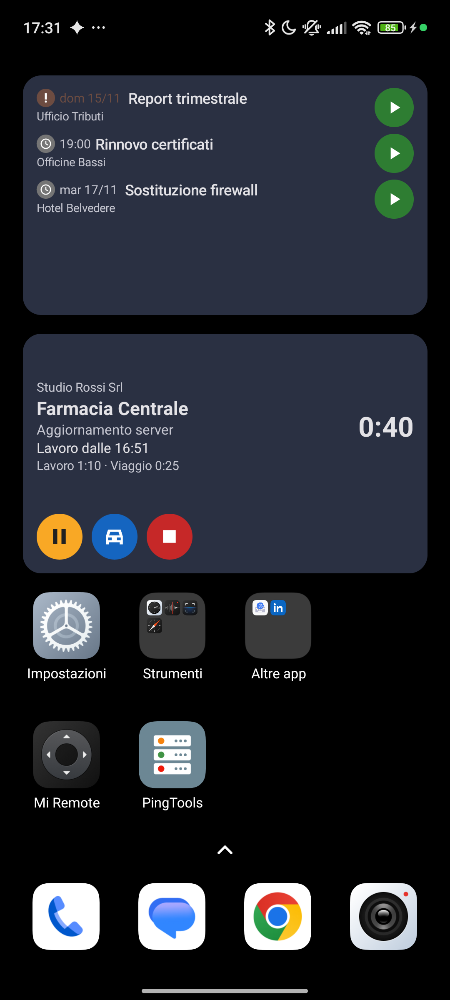

---

## 14. Impostazioni

Le impostazioni sono divise in sezioni, ognuna con la sua pagina e il suo
"Salva". L'elenco mostra prima le sezioni essenziali (**Visualizzazione**,
**Orari**, **Promemoria**, **Posizione**) e **"Gesti"**; le altre sono sotto
**"Altre impostazioni ▾"** (0.7.8). Con modifiche non salvate il
titolo della sezione mostra un pallino (•) e uscire chiede conferma
("Esci senza salvare", 0.7.6). Il significato di ogni voce è
spiegato nella Parte II, §17.

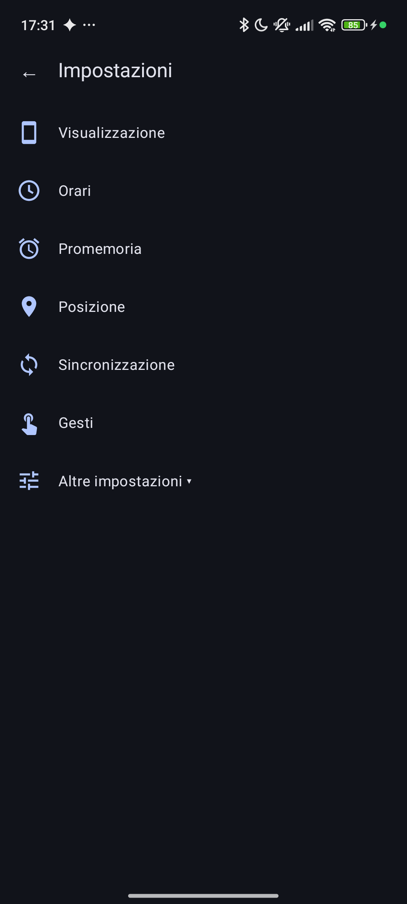

| Sezione | Voce | Predefinito |
|---|---|---|
| Visualizzazione | Normale / Compatta | Normale |
| | Lingua | Predefinita del sistema |
| | Widget «Da fare»: intervallo | 24 h |
| Orari | Orari modificabili liberamente: inizio e fine scelti all'avvio e allo stop, tratti modificabili ed eliminabili (spento: orari come registrati; "+ Viaggio" e "+ Pausa" restano) | acceso |
| Chiamate | Riconosci le chiamate in entrata / in uscita | spenti |
| | Metti in pausa l'attività di un altro cliente / Proponi un'attività | accesi |
| | Anche fuori orario (reperibilità) | spento |
| Promemoria | Intervallo di conferma | 30 min |
| | Numero massimo di conferme | 0 (illimitato) |
| | Intervallo promemoria pausa | 15 min |
| | Ritardo avviso inizio giornata | 15 min |
| Notifiche | per ogni tipo (conferma, pausa, pianificate, spostamento, arrivo, inizio giornata, riepilogo, dettagli mancanti, in corso) apre la pagina di Android per banner, suono e vibrazione | — |
| Posizione | accesso, batteria, riquadro rapido | — |
| | Soglia avviso spostamento | 100 m |
| | Raggio / tempo di arrivo | 100 m / 15 min |
| | Fattore distanza stradale (senza OSRM) | 1,25 |
| Calendario | calendario delle attività, sincronizza 90 giorni | nessuno |
| Dettatura | Lingua di dettatura | Italiano |
| Rendicontazione | attività notturne fino alle | 06:00 |
| | arrotondamenti lavoro / viaggio / pausa | §1 |
| Servizi online | Nominatim, OSRM, mappe OpenStreetMap (attivabili e con endpoint) | attivi |
| Archiviazione | cartella dati, backup conservati, backup ora | 14 |
| Avanzate | Promemoria Da fare pianificati (min prima) | 15 |
| | Posticipo (min) | 30 |

I valori fuori intervallo vengono corretti al salvataggio.

---

## 15. Dati e privacy

- Tutto resta sul telefono e nella cartella dati che hai scelto.
- Le **coordinate** dei tuoi spostamenti non vengono mai mandate al calendario,
  ai gestionali né al server; solo la località (es. "Milano"). Escono dal
  telefono solo se esporti tu il tracciato (GPX / KML). Per non registrare
  nessuna posizione, disattiva il tracciamento (policy `location`).
- Gli eventi nel calendario sono privati: chi lo condivide vede solo "occupato".
- I servizi online (indirizzi, distanze, mappe) ricevono solo coordinate di
  singoli punti; si possono disattivare o puntare a server propri.
- Le credenziali dei gestionali sono cifrate con il keystore del telefono.
- Con il riconoscimento delle chiamate l'app legge il registro chiamate sul
  telefono e conserva solo le chiamate con i tuoi contatti; non legge la
  rubrica (l'importazione usa il numero che scegli tu).

---

## 16. Problemi frequenti

| Problema | Soluzione |
|---|---|
| Il tracciamento si ferma | Impostazioni → Posizione: "Consenti sempre" e batteria "Senza restrizioni" |
| La notifica dell'attività è sparita | riapri l'app: ricompare |
| Una chiamata di un contatto non viene riconosciuta | il centralino può presentare un numero diverso da quello pubblicato: guarda nel registro chiamate del telefono il numero arrivato e aggiungilo al contatto |
| "L'accesso alla cartella dati è stato perso" | la cartella è stata spostata o rinominata: sceglila di nuovo |
| Dettatura: "lingua non disponibile" | Impostazioni → Dettatura: scegli la lingua; per l'uso offline scarica il pacchetto della lingua nelle impostazioni vocali del telefono |
| Il riquadro rapido non è nell'elenco | Impostazioni → "Riquadro Impostazioni rapide" → "Aggiungi" |
| Un'azione della notifica non fa nulla | tocca il pulsante, non il testo; espandi la notifica se i pulsanti non si vedono |
| Importazione: "Non importati" | il rapporto indica il motivo (es. azienda sconosciuta, attività in corso su un altro telefono) |

# Parte II — Riferimento

## 17. Impostazioni in dettaglio

Ogni sezione ha il suo "Salva". I valori fuori dall'intervallo ammesso vengono
riportati al limite più vicino.

### Visualizzazione

| Voce | Effetto | Predefinito |
|---|---|---|
| Normale / Compatta | Compatta: testo all'88 %, riquadri e pulsanti più stretti. | Normale |
| Lingua | **Predefinita del sistema** (la lingua del telefono; l'inglese se l'app non la conosce), Italiano, English, Deutsch o Español, ciascuna con il proprio nome. Una policy (`ui.language`) la fissa e la blocca (lucchetto); con un valore non supportato la lingua è l'inglese e la voce lo dice. | Predefinita del sistema |
| Widget «Da fare»: intervallo | Quanto guardare avanti nel widget omonimo: 24 h, 3, 7 o 30 giorni; le voci in ritardo sono sempre incluse. Una policy può fissarla (con lucchetto). | 24 h |
| Anche tag liberi | Acceso: si può scrivere qualsiasi tag. Spento: solo i tag dell'anagrafica; quelli liberi già sulle attività restano. Policy: `tagsFreeText`. | Acceso |

### Orari

| Voce | Effetto | Predefinito |
|---|---|---|
| Orari modificabili liberamente | Acceso: campi **Inizio** e **Fine** all'avvio, campo **Fine** nella domanda di Stop, tratti modificabili ed eliminabili (i nuovi valori sostituiscono quelli registrati). Spento: gli orari restano quelli registrati, i tratti non si toccano; "+ Viaggio" e "+ Pausa" restano disponibili. In futuro potrà essere imposta da una policy. | acceso |

### Chiamate

| Voce | Effetto | Predefinito |
|---|---|---|
| Riconosci le chiamate in entrata | le chiamate ricevute dai contatti vengono registrate e gestite (§5); all'attivazione chiede l'accesso allo stato del telefono e al registro chiamate | spento |
| Riconosci le chiamate in uscita | lo stesso per le chiamate fatte | spento |
| Metti in pausa l'attività di un altro cliente | durante la chiamata, l'attività in corso di un altro cliente va in pausa (almeno un minuto) | acceso |
| Proponi un'attività dopo la chiamata | notifica "Crea attività" con cliente, descrizione e orari arrotondati | acceso |
| Anche fuori orario (reperibilità) | spento: solo in orario di lavoro, non nei festivi e nei giorni liberi; acceso: sempre | spento |

### Promemoria

| Voce | Effetto | Intervallo | Predefinito |
|---|---|---|---|
| Intervallo di conferma | ogni quanti minuti di lavoro o viaggio arriva "Ancora su …?" | 10–240 min | 30 |
| Numero massimo di conferme | dopo quante conferme senza risposta l'app smette di chiedere (0 = mai) | 0–100 | 0 |
| Intervallo promemoria pausa | ogni quanti minuti di pausa arriva "Ancora in pausa?"; muto nella pausa pranzo | 10–120 min | 15 |
| Ritardo avviso inizio giornata | quanti minuti dopo l'inizio dell'orario arriva "Nessuna attività oggi" | 0–240 min | 15 |

### Notifiche
Per ogni tipo di notifica (conferma, pausa, pianificate, spostamento, arrivo,
inizio giornata, riepilogo, dettagli mancanti, in corso) apre la pagina di Android
dove scegliere banner, suono e vibrazione.

### Posizione

| Voce | Effetto | Intervallo | Predefinito |
|---|---|---|---|
| Accesso alla posizione | serve "Consenti sempre" perché il tracciamento riparta da solo | — | — |
| Ottimizzazione batteria | "Senza restrizioni" evita che OxygenOS fermi il servizio | — | — |
| Riquadro Impostazioni rapide | aggiunge il riquadro Pausa / riprendi | — | — |
| Soglia avviso spostamento | distanza oltre la quale, in lavoro, arriva "Lontano da …?" | 50–5000 m | 100 |
| Raggio di arrivo | entro quanti metri si considera fermo | 25–1000 m | 100 |
| Tempo di arrivo | dopo quanti minuti fermo, in viaggio, arriva "Arrivo?" | 5–120 min | 15 |
| Fattore distanza stradale | km stradali = linea d'aria × fattore, tra posizioni a più di 2 min quando OSRM non è disponibile | 1,0–3,0 | 1,25 |
| Campionamento durante il lavoro | ogni quanto si registra una posizione | 1, 2, 5, 10, 15, 20, 30, 60 min | 5 min |
| Campionamento durante il viaggio | più fitto, per disegnare il percorso fatto (più batteria) | 15, 30, 60 s; 2, 5, 10, 15, 30 min | 1 min |
| Mappa degli spostamenti | mostra la mappa dei Tracciati; richiede le mappe di *Servizi online* | sì / no | sì |

### Calendario
Accesso al calendario, calendario delle attività (Google o CalDAV tramite
DAVx5, oppure "Nuovo calendario ActivityTrack sul telefono") e
"Sincronizza 90 giorni". Il calendario di un'azienda si sceglie nella sua
scheda e prevale su quello generico.

### Dettatura
Lingua del riconoscimento vocale (italiano, inglese, tedesco, spagnolo),
indipendente dalla lingua del telefono. Predefinito: italiano.

### Rendicontazione

| Voce | Effetto | Predefinito |
|---|---|---|
| Attività notturne fino alle | un'attività che finisce entro quest'ora del giorno dopo resta sul giorno di inizio (0:00–12:00) | 06:00 |
| Arrotondamento lavoro | modo, quanto (1, 5, 15, 30 o 60 min) e minimo | per eccesso con tolleranza, 15 min |
| Arrotondamento viaggio | idem | per eccesso, 5 min |
| Arrotondamento pausa | idem | per difetto, 5 min, minimo 5 |
| Salva i valori arrotondati | i pulsanti (avvio, cambio, stop, riapri) registrano orari arrotondati: inizio per difetto, stop per eccesso, cambio al multiplo più vicino; gli orari scritti a mano restano esatti; vale solo con "Orari modificabili"; la policy può fissarlo | spento |

Modi di arrotondamento:
- **per eccesso con tolleranza**: si arrotonda per eccesso solo oltre un terzo
  del quanto (15 min: fino a 5 minuti oltre il quarto d'ora si scende);
- **per eccesso**: al quanto successivo;
- **per difetto**: al quanto precedente.

### Servizi online
Nominatim (località dagli indirizzi), OSRM (km su strada) e mappe
OpenStreetMap: ognuno si accende o spegne e può puntare a un server proprio.
Predefinito: attivi, server pubblici.

### Archiviazione
Cartella dati, numero di backup giornalieri conservati (1–365, predefinito 14).
"Esegui backup ora" e il ripristino sono in Altro → Importa / esporta.

### Aggiornamenti
La versione installata e, per l'app installata da GitLab, il controllo delle
versioni più recenti: una volta al giorno l'app scarica il **manifesto degli
aggiornamenti**, un file firmato che elenca le versioni per canale con
l'indirizzo e lo SHA-256 dei pacchetti. Se c'è una versione nuova la mostra
qui con **"Scarica"** e manda una notifica (una per versione); il file
scaricato è controllato con lo SHA-256 e passato all'installazione di Android
(la prima volta Android chiede di consentire ad ActivityTrack di installare
app). **"Controlla ora"** non aspetta il giorno dopo.

La **fonte** del manifesto è il progetto (GitLab, predefinita), il server
associato o un indirizzo https tuo. Chi può firmarlo: senza policy firmata,
l'app stessa o il server associato (il cui certificato è nel collegamento di
associazione); con una policy firmata, solo la stessa firma della policy. Il
server associato può anche segnalare una versione nuova al primo scambio,
qualunque sia la fonte scelta, e offrirla da scaricare da sé. Un manifesto
non firmato, firmato da altri o più vecchio dell'ultimo visto è rifiutato e il
motivo compare qui.

Un'app installata da uno store (Play, F-Droid…) la aggiorna lo store:
il controllo (**"Controlla ora"**) resta facoltativo ma non propone il download.

| Voce | Effetto | Predefinito |
|---|---|---|
| Controlla le nuove versioni | Una volta al giorno. Policy: `updateCheck`. | Acceso |
| Fonte | Il progetto (GitLab), il server associato, un indirizzo personalizzato. Policy: `updateSource`. | Il progetto |
| Indirizzo del manifesto | Solo con l'indirizzo personalizzato, https. Policy: `updateUrl`. | Vuoto |
| Includi le versioni beta, di test, di sviluppo | I canali seguiti oltre a quello stabile. Policy: `updateBetas`, `updateChannels`. | Spenti |

### Avanzate

| Voce | Intervallo | Predefinito |
|---|---|---|
| Promemoria Da fare pianificati (minuti prima) | 0–240 | 15 |
| Posticipo (minuti) | 10–240 | 30 |

### Gesti
Per le attività e per i *Da fare*, cosa offre il trascinamento a sinistra e a
destra (anche nessuna azione) e se il trascinamento lungo esegue subito la
prima azione. Predefiniti: attività in corso a sinistra Pausa / Riprendi, a destra Stop;
*Da fare* a sinistra Avvia o Fatta, a destra Posticipa o Elimina; chiuse a destra Riapri;
trascinamento lungo attivo. Il Sospendi non c'è più.

### Impostazioni ricordate dalle schermate
Il filtro azienda dei *Da fare*, il periodo (24 h, 7 gg, 30 gg, tutti),
lo Stato e la Priorità e l'ordine di ogni elenco delle anagrafiche si impostano nelle
schermate stesse e restano finché non li cambi.

## 18. Entità e relazioni

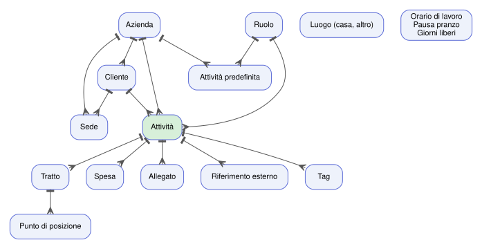

| Entità | Contenuto | Relazioni |
|---|---|---|
| Azienda | nome, colore, codice nel gestionale, connettore, calendario | ha clienti, sedi, attività, scelte rapide |
| Cliente | nome, colore, codice | appartiene a un'azienda (fissa dopo la prima attività); ha sedi |
| Sede | etichetta, coordinate, raggio, indirizzo | di un'azienda o di un cliente; serve a proporre cliente e azienda e a riconoscere l'arrivo |
| Ruolo | nome | proposto dalle scelte rapide, scelto sull'attività |
| Scelta rapida | testo, ruolo proposto, azienda (facoltativa) | riempie la descrizione |
| Attività | tipo (attività o assenza), stato, cliente, azienda, ruolo, descrizione, località, note, pianificazione, scadenza, priorità (Nessuna … Emergenza), chiave nel gestionale | ha tratti, spese, allegati, riferimenti, tag; da fare, in corso, chiusa o eliminata |
| Tratto | tipo (lavoro, viaggio, pausa, assenza), pianificato o reale, inizio, fine, km, origine (registrato o a mano), descrizione (pause) | di un'attività; i punti di posizione appartengono ai tratti |
| Spesa | importo, descrizione, scontrino | di un'attività |
| Allegato | foto, nota vocale, file | di un'attività, nella cartella dati |
| Riferimento esterno | ticket, URL, codice | di un'attività |
| Tag | nome, colore (se in anagrafica); libero se scritto a mano | di un'attività; l'anagrafica dei tag ne dà il colore, collegata per nome |
| Contatto | nome, numeri, e-mail | di un cliente; riconosce le chiamate; facoltativo su un'attività |
| Materiale di consumo | descrizione, unità, costo unitario, azienda | proposto nelle righe dei materiali |
| Riga di materiale | descrizione, quantità, unità, costo unitario | di un'attività |
| Chiamata | contatto, direzione, inizio, fine | di un contatto e del suo cliente |
| Luogo | casa o altro, coordinate | casa chiude i viaggi di rientro |
| Orario di lavoro, pausa pranzo, giorni liberi | per giorno | regolano promemoria e riepiloghi |

## 19. Stati dell'attività

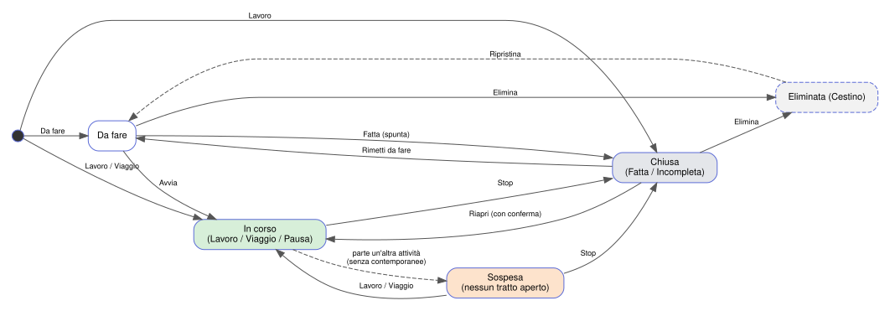

L'attività ha tre **stati registrati** (Da fare, In corso, Chiusa) più l'essere **Eliminata** (nel Cestino) o di tipo
**Assenza**; da questi, dal tratto aperto e dalle date l'app ricava lo **stato mostrato** (§1, §20).

| Stato registrato | Si entra con | Si esce con |
|---|---|---|
| Da fare | creazione con "Da fare"; "Rimetti da fare" | Avvia (diventa In corso), Fatta (spunta), Elimina |
| In corso | Avvia; Lavoro o Viaggio da una chiusa (Riapri); creazione con Lavoro "Adesso" / "Già iniziata" o Viaggio | Stop (Chiusa), Elimina; cambio di modalità |
| Chiusa | Stop; creazione con Lavoro "Passata"; spunta; Assenza | Riapri (In corso), Rimetti da fare (solo senza tratti), Elimina |
| Eliminata | Elimina | Ripristina, Elimina definitivamente |

Mentre è in corso l'attività ha una **modalità**: ogni cambio chiude il tratto aperto e ne apre uno nuovo.

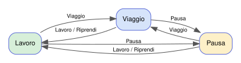

Regole:
- un'attività non parte in pausa; dalla pausa si torna a Lavoro o Viaggio, o a ciò che era aperto prima;
- da Lavoro a Viaggio l'app chiede se l'attività lavorativa è conclusa (§5);
- più attività possono essere in corso insieme, ognuna con le sue pause; senza contemporanee (policy) le altre
  diventano *Sospese* quando una parte;
- un'attività sotto il minuto, fermata dall'app, può essere scartata;
- un tratto aggiunto o modificato dura almeno un minuto e sta nel passato (la fine dell'ultimo tratto, fino a 24 ore
  avanti con gli orari modificabili; le assenze anche più avanti); sopra altri tratti della stessa attività viene salvato
  dopo una conferma, che li accorcia;
- all'avvio i tratti pianificati vengono sostituiti da quelli veri.

## 20. Stati mostrati

Ogni attività mostra **un solo stato**: vale il primo che si verifica, nell'ordine della tabella del §1: **Eliminata**,
**Assenza**, **In ritardo**, **Pianificata**, **Da fare**, **Lavoro**, **Viaggio**, **Pausa**, **Sospesa**, **Fatta**,
**Incompleta**.

Un'attività da fare è **in ritardo** quando la scadenza è passata (dopo l'ora di scadenza, o dal giorno dopo se la
scadenza non ha ora), oppure quando i suoi tratti pianificati sono tutti finiti, oppure — senza tratti — quando il
blocco pianificato è passato (una pianificazione di tutto il giorno dal giorno dopo). La stessa regola vale sul telefono,
sul web e sul PC.

Una chiusa è **Fatta** se non ha tratti reali (voce spuntata) o se ha un cliente, almeno un tratto di lavoro e tutti i
campi obbligatori del suo gestionale; altrimenti è **Incompleta**.

## 21. Flussi

### Avvio
1. Azienda e cliente proposti: dalla sede in cui ti trovi (entro il raggio), altrimenti l'azienda dell'ultima
   attività di oggi; un cliente scelto dal widget, da una scorciatoia o da un'attività *Da fare* prevale.
2. Descrizione e ruolo: dall'ultima attività sullo stesso cliente negli ultimi 30 giorni, finché non li modifichi.
3. Con "Orari modificabili": **Adesso** (nessun orario), **Già iniziata** (solo l'inizio; un orario ancora da venire
   chiede se pianificare, avviare adesso o da ieri) o **Passata** (data, inizio e fine: registrata chiusa).
4. Le attività già in corso: per ognuna l'app chiede cosa farne (chiudi, lascia; in viaggio "il viaggio è
   finito?"); senza contemporanee diventano Sospese. Un'attività **Passata** non chiede nulla. Il **Viaggio** da
   Lavoro chiede "Hai completato l'attività lavorativa?".

### Stop
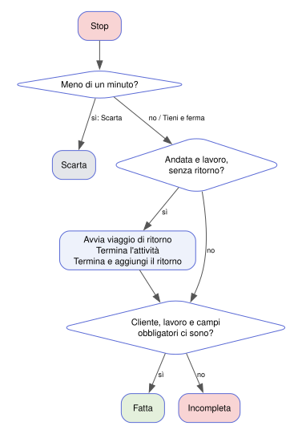

Dall'app lo Stop propone, se serve, la fine e il viaggio di ritorno (§6). Lo Stop dalla notifica, dal widget o dal
riquadro rapido ferma subito, senza domande; la chiusura è comunque Fatta o Incompleta secondo le stesse regole.

### Promemoria
Un solo allarme alla volta, puntato sul promemoria più vicino; i promemoria
"conferma" e "pausa" non scendono sotto i 10 minuti (Android limita gli
allarmi in Doze).

| Promemoria | Quando | Risposte |
|---|---|---|
| Conferma | ogni *intervallo di conferma* di lavoro o viaggio, anche fuori orario | Sì, Pausa, Stop alle (ultima conferma) |
| Pausa | ogni *intervallo pausa* in pausa; muto nella pausa pranzo | Riprendi, Stop |
| Fine prevista | all'ora di fine scelta all'avvio, una volta | Sì, stop alle HH:MM; No, continua |
| Inizio giornata | *ritardo* dopo l'inizio dell'orario, nei giorni lavorativi non liberi, se non hai fatto nulla | Assente oggi, Entrata in ritardo, Avvia |
| Riepilogo | a fine orario di lavoro | — |
| Da fare pianificata | *minuti prima* della pianificazione, anche fuori orario | Avvia, Posticipa, Ripianifica |

### Posizione
- Un punto ogni 5 minuti in lavoro e ogni minuto in viaggio (entrambi
  impostabili), più uno quando il telefono si muove, solo mentre un'attività è
  in corso (anche in pausa).
- In lavoro, oltre la *soglia di spostamento*: "Lontano da …?" con "Viaggio
  dalle HH:MM" (dal primo punto oltre la soglia).
- In viaggio, fermo entro il *raggio* per il *tempo di arrivo*: "Arrivo?";
  presso la sede di un cliente propone il lavoro per quel cliente, a casa lo
  stop.
- Km: posizioni a 2 min o meno congiunte direttamente; più distanti OSRM se attivo, altrimenti linea d'aria × fattore; località da
  Nominatim. Le coordinate escono dal telefono solo con l'esportazione del tracciato (GPX / KML).

### Report ed esportazione
- *Totale*: somma di lavoro e viaggio arrotondati (Report e riepilogo
  serale).
- Un'attività che passa la mezzanotte va sul giorno di inizio se finisce
  entro le *attività notturne fino alle*, altrimenti si divide a mezzanotte.
- CSV: una riga per attività e giorno, con inizio, fine, ore di lavoro, pausa
  e viaggio arrotondate, azienda, cliente, ruolo, descrizione, km, spese,
  note, riferimenti, località, tag, materiali (totale in €, separato dalle
  spese); km, spese e materiali sul primo giorno.

### Calendario
Un evento per attività e giorno, dall'avvio (un'attività in corso finisce
"adesso"). Ogni modifica risincronizza gli ultimi 14 giorni; "Sincronizza 90
giorni" va più indietro. Le attività *Da fare* pianificate sono eventi
provvisori fino a un anno avanti. Tutti gli eventi sono privati. La
sincronizzazione va solo dall'app al calendario.

### Importazione ed esportazione
Il formato generico (JSON o XML) contiene anagrafiche, attività (anche da fare e assenze)
con tratti, spese, riferimenti e tag, e giorni liberi. È la **versione 2** del formato; i file della versione 1 (con le voci
*Da fare* a parte) si importano ancora. L'importazione
riconosce ciò che ha già (codici e identificativi), non crea doppioni e in
caso di conflitto tiene i dati dell'app, elencando il conflitto nel rapporto.
Le attività in corso su un altro telefono non vengono importate.

### Backup e ripristino
Ogni giorno una copia del database va nella cartella `backup` (zip). Il
ripristino salva prima i dati attuali come `…-before-restore.zip`, poi
sostituisce il database e riavvia l'app.
