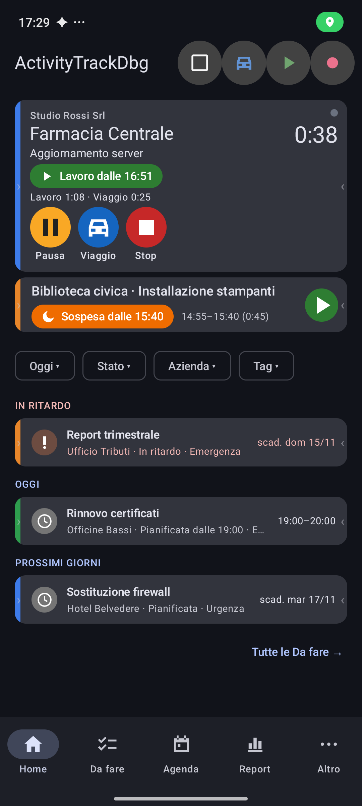
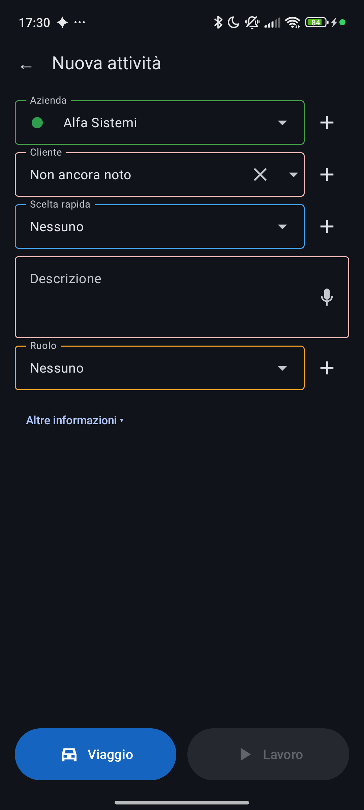
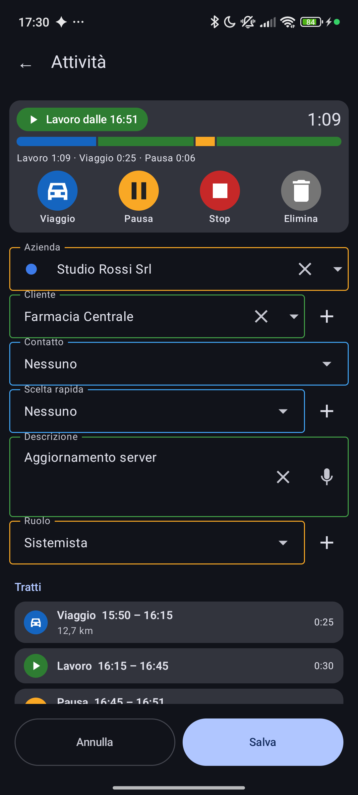
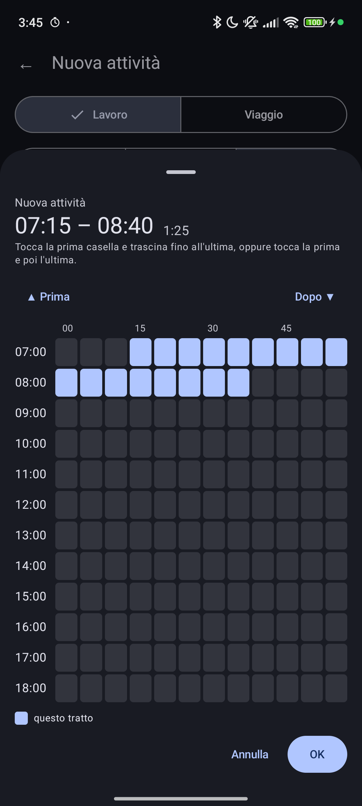

Versione 1.0.0-alfa-1 · per l'uso di tutti i giorni; il *Manuale* spiega tutto il
resto.

## 1. Prima volta
1. Installa `ActivityTrack-<versione>.apk` dalle *Releases* di GitLab.
2. Scegli la **cartella dati** (es. `ActivityTrack`): allegati, backup ed
   esportazioni vanno lì.
3. Concedi **notifiche** e **posizione** ("Consenti sempre"); in Impostazioni
   → Posizione togli le restrizioni della batteria.
4. In Home, **"Per iniziare"** → **"Crea il primo cliente"** (con la sua
   **azienda**), o "Importa da un file o da un gestionale"; in Altro →
   Anagrafiche imposta l'**orario di lavoro**.
5. Con un server **ActivityTrack Web**: Impostazioni → Sincronizzazione →
   "Inquadra il codice QR" mostrato dal web (*Dispositivi* → "Associa un
   dispositivo"); da lì i dati restano allineati da soli.

## 2. Creare
In Home hai quattro pulsanti: **Da fare**, **Lavoro**, **Viaggio** (parte subito, anche senza cliente) e **Assenza**.
Un *Da fare* è un'attività nello stato "Da fare": quando la avvii diventa Lavoro o Viaggio, alla fine Fatta o
Incompleta (§ stati nel *Manuale*).

<!-- screenshot to retake: Home 1.0 with the four buttons Da fare/Lavoro/Viaggio/Assenza -->

In "Lavoro" scegli **Adesso / Già iniziata / Passata**, poi il **cliente** (scrivi per cercare), la **descrizione** (o una
scelta rapida; anche dettata col microfono) e il **ruolo**. "Già iniziata"
chiede solo l'ora d'inizio, "Passata" giorno, inizio e fine. Il pulsante
verde dice cosa farà: "Avvia adesso", "Avvia dalle 09:15", "Registra
09:15–10:40". "Altre informazioni" apre tratti, note e riferimenti.

<!-- screenshot to retake: "Nuova attività" 1.0 (Adesso/Già iniziata/Passata, Altre informazioni, buttons Lavoro/Viaggio) -->

## 3. Durante il lavoro
- I pulsanti del riquadro (e della notifica), con il nome sotto: **▶ Lavoro**,
  **⏸ Pausa** (un'interruzione dentro l'attività), **🚗 Viaggio**, **⏹ Stop**.
  Non c'è "Sospendi": avviare un'altra attività mette da parte la prima (Sospesa) se le contemporanee non sono ammesse.
- Il **Viaggio** durante il lavoro chiede "Hai completato l'attività lavorativa?": Sì = chiude e parte un viaggio
  nuovo, No = viaggio nella stessa attività.
- Trascina il riquadro: a sinistra pausa / riprendi, a destra stop.
- Ogni 30 minuti l'app chiede "Ancora su …?": rispondi dalla notifica.
- Se ti sposti, l'app propone il **viaggio**; quando arrivi, il **lavoro**.
- Con Impostazioni → **Chiamate** attivo, una telefonata con un contatto di
  un altro cliente mette in pausa l'attività e propone di registrarla.

## 4. Fermare
**⏹ Stop** chiude l'attività. Se avevi fatto andata e lavoro senza ritorno, l'app offre: **Avvia viaggio di
ritorno**, **Termina l'attività**, **Termina l'attività ed aggiungi il viaggio di ritorno** (copia dell'andata).
Con gli orari modificabili puoi indicare la fine fino a 60 minuti nel futuro. Se cliente, lavoro e campi
obbligatori ci sono l'attività è **Fatta**, altrimenti **Incompleta**: toccala, correggi e "Salva". Riaprire
una chiusa chiede sempre conferma. Toccando qualunque attività si apre la scheda: stato, linea del tempo, azioni,
tratti (pulsante Lavoro · Viaggio · Pausa), spese, allegati, località, note e tag.

<!-- screenshot to retake: activity detail dialog 1.0 -->

## 5. Consultare
- **Agenda**: lista, giorno, settimana, mese; ricerca e filtro per tag.
- **Report**: il totale del giorno, esportazione CSV.
- **Da fare** (scheda della barra in basso): attività da gestionale o create a
  mano, con promemoria e **priorità** (Nessuna … Emergenza); dopo "Fatta" o "Elimina" c'è **"Annulla"** per
  qualche secondo. Le eliminate sono nel **Cestino** (Ripristina / Elimina definitivamente).
- **Assenza**: tipo (Assenza, Ferie, Permesso, Malattia), giorni e, se vuoi, orari: un permesso.

**Stati** (icona e colore): Da fare (casella, bianco), Pianificata (orologio, grigio), In ritardo (!, marrone),
Lavoro (▶, verde), Viaggio (auto, blu), Pausa (⏸, giallo), Sospesa (luna, arancione), Fatta (✓, verdino),
Incompleta (■, rossiccio), Assenza (punto, fucsia), Eliminata (cestino, grigio).

**Passando alla 1.0** i dati si convertono da soli e i vecchi backup si ripristinano; per sincronizzare servono
server e dispositivi tutti alla 1.0.

## 6. I colori dei campi
Il bordo di un campo dice quanto conta:
- **rosso**: obbligatorio e ancora vuoto (cliente, descrizione);
- **verde**: obbligatorio e compilato;
- **giallo**: importante ma facoltativo (ruolo, orari);
- **blu**: accessorio (note, località, riferimenti).

Il campo in cui stai scrivendo ha un bordo più spesso del colore del tema.

## 7. Orari
Gli orari si scelgono sulla **griglia a 5 minuti**: tocca una casella, o
trascina per un intervallo; "Orario esatto" per i minuti fuori griglia.

## 8. Se qualcosa non va

| Problema | Soluzione |
|---|---|
| Il tracciamento si ferma | Posizione "Consenti sempre", batteria senza restrizioni |
| La notifica è sparita | riapri l'app |
| Un'azione della notifica non fa nulla | tocca il pulsante, non il testo |
