Version 1.0.0-beta-2 (November 2026). For whoever installs and runs the
organisation's server; users of the app find everything in the ActivityTrack
*User manual*.

## 1. What ActivityTrack Web is

ActivityTrack Web is the organisation's server for the ActivityTrack app:
- it keeps a **copy of every phone**, synced both ways: activities
  (including those to do and absences), master data, attachments;
- it gives everyone the **same work from the browser**: Home, activities,
  Agenda, To-dos, reports;
- it manages **users and profiles**, the **central master data** and the
  **policies** that rule the phones' apps.

One server serves one organisation. The phone works without a network too:
the changes wait and leave when the network is back.

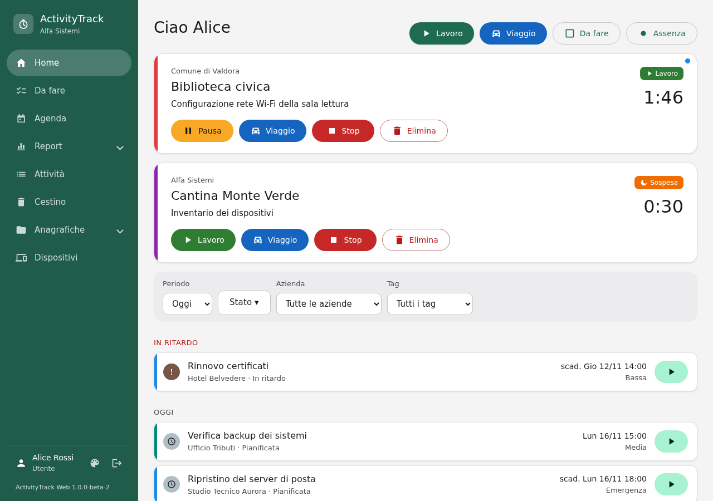

## 2. Installation and updates

The full instructions are in `docs/INSTALL.md`, in the repository and in
the package. In short:
- **Debian 13 and 14, Ubuntu 24.04 and 26.04**: the `.deb` package from the
  releases page.
- **RHEL / Oracle Linux 9, Arch, FreeBSD 14**: the `.tar.gz` archive, or a
  clone of the repository.

The package makes the service user, the folders and the database, but does
not start the service. First write `/etc/activitytrack-web/settings.ini`:

| Key | What |
|---|---|
| `[server] base_url` | the HTTPS address the phones reach the server by; it goes into the QR codes. With a path (`https://www.example.com/activitytrack`) the application lives there |
| `[server] allowed_hosts` | the names and addresses the server is reached by |
| `[server] time_zone` | the time zone of days and reports (default `Europe/Rome`) |
| `[server] tls_pin` | only with a self-signed certificate: the fingerprint of its key, which the app pins |
| `[database]` | SQLite (default) or PostgreSQL |
| `[files] max_mb`, `offload` | largest attachment; who sends the files: Django, nginx or Apache |
| `[policy] key`, `cert` | key and certificate to sign the policies and the update manifests (optional); without them the server makes its own key on first start, in `signing/` of the data folder: back it up |
| `[updates]` | the manifest address, channels and interval for the new versions (optional, see Updates) |
| `[mail]` | mail server for the login codes by email (optional) |

Then create the organisation with the first administrator and start the
service:

```sh
activitytrack-web-manage setup --org "My company" --admin admin
systemctl enable --now activitytrack-web.socket
```

A web server (nginx or Apache) goes in front: the examples are in
`/usr/share/activitytrack-web/deploy/`.

**Upgrading to 1.0.** 1.0 changes the data model: the *To-do* is no longer a separate object but an activity in the
"To do" state (see the app's *User manual*). The database converts **by itself** with `migrate`: items become activities
in the To do state (or Done, if ticked), absences become activities of kind Absence, ignored items go to the Bin, priorities
P1…P5 become Emergency…Low. The server's **backups** of earlier versions (SQLite file or PostgreSQL dump) are restored as
usual: the conversion runs with the migrations. **Sync requires the server and every device to be on 1.0**: an older app
gets the error `upgrade_required` ("Update the app to sync") and waits. Update **the server first**, then phones and PCs.
At the first sync after the upgrade every device realigns with the server, but **changes not yet synced are kept and
pushed**. If a phone has data the server has never seen, it arrives; as a last resort the phone's data can be reimported
on the server.

**Updating.** With the package, install the new `.deb`: the database is
updated and the service restarts by itself. With the archive or the clone,
replace the code, then `activitytrack-web-manage migrate`,
`activitytrack-web-manage collectstatic --noinput` and restart the service.

**Management commands.** `activitytrack-web-manage` runs Django's commands
as the service user, for example `migrate`, `createsuperuser` or `shell`.
`setup` and the web pages ask for a password of at least 10 characters, not
a common one and unlike the user name. `clean_json_fields` repairs, once
after updating from 0.9.4-beta4 or earlier, the tags, phone numbers and
plugin fields a phone stored in a wrong shape (`--dry-run` only lists them).

## 3. Logging in

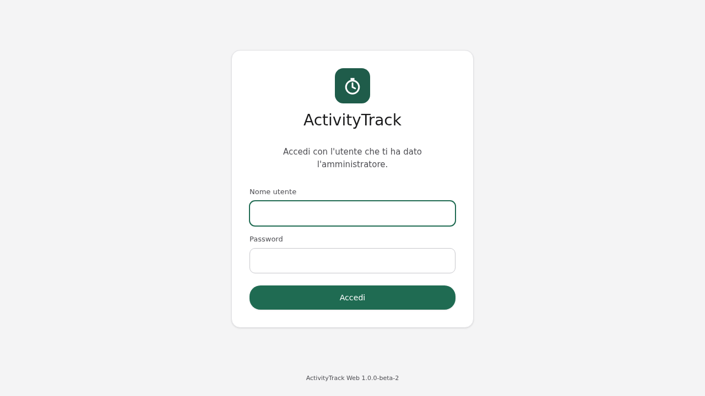

Everyone logs in with the user name and password the administrator gave
them. After 10 wrong attempts in a row from the same address, the login
holds back for a few minutes.

**Two-step login.** From **"Sicurezza dell'account"** (account security:
one's name at the bottom of the menu) anyone may ask, after the password,
for a 6-digit code:
- from an **authenticator app** on the phone (Aegis, FreeOTP, Google
  Authenticator…): scan the QR code and confirm with the first code;
- or by **email**, when the user has an address and the server has mail
  configured (`[mail]` in `settings.ini`).

Turning it on gives **10 recovery codes** to keep: each works once instead
of the code, when the phone or the mailbox is lost. After 5 wrong codes the
login starts again from the password. Paired phones are not concerned: they
sync with their token.

The menu on the left has **Home**, **Da fare** (To-dos), **Agenda**, **Report**, **Attività** (Activities), **Cestino**
(Bin), **Anagrafiche** (Master data) and **Dispositivi** (Devices); administrators also have **Policy**, **Mappe** (Maps), **Aggiornamenti** (Updates) and **Utenti**
(Users). **Report** and **Anagrafiche** are **branches** that open and close: under **Report** are **Riepilogativo**
(Summary) and **Dettaglio attività** (Activity detail), under **Anagrafiche** **Aziende** (Companies), **Clienti**
(Clients), **Ruoli** (Roles), **Tag**, **Scelte rapide** (Quick choices) and **Materiali** (Materials); the branch of the
page you are on is open, with the current entry marked, and it can also be opened from the keyboard (Enter or Space). On
a phone there is the bar at the bottom (Home, Da fare, Agenda, Report, Altro) and the two pages have the same entries as
tabs at the top. At the bottom is one's own
name: a click opens **"Sicurezza dell'account"** (account security), which also has **"Cambia password"** (change password).

The web interface comes in **Italian, English, German and Spanish**. The language is, in this order: the one set by the
policy (`ui.language`, §7), else the choice made in the Preferences (§8), else the browser's; if the browser asks for one
the server does not have, the pages are in **English** (never Italian). A policy with an unsupported `ui.language` (an imported or old policy)
forces English, over the choice and the browser. The screenshots show it in Italian, and the names of the pages and buttons in this manual are the Italian ones, with
the English in brackets.

## 4. Users and profiles

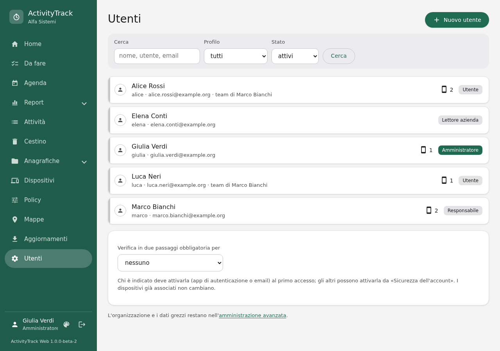

The **Users** page lists the people of the organisation. Search by name,
user name or email, and filter by profile and state. **"Nuovo utente"**
(new user) asks for a user name, name, profile and a password (at least 10
characters, not a common one, not like the name).

| Profile | May |
|---|---|
| **Administrator** | everything: users, phones, policies, central master data, everyone's data |
| **Manager** | central master data; reads their team's activities and those done for **their companies**, whoever did them; fixes their team's times; assigns *To-dos* to the team; the team's reports |
| **User** | their own activities and *To-dos*, from the phone and the web; their personal master data, when the policy allows it |
| **Company reader** | only the report of the **closed** activities of the companies given to them; no phone. Meant for a client's administration |

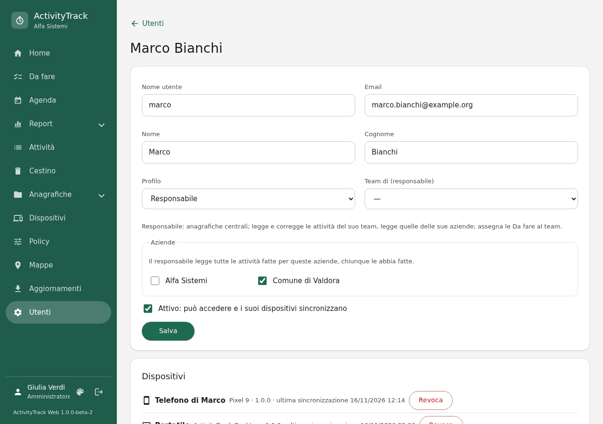

On a user's sheet:
- **Team di (responsabile)**: the manager whose team they belong to.
- **Aziende** (companies), for managers and readers only: for a manager,
  the companies whose activities they all read; for a reader, those whose
  report they see.
- **Attivo** (active): unticked, the user can no longer log in and their
  devices stop syncing at once. The data stay.
- **Dispositivi**: the paired phones and PCs, with their last sync and **"Revoca"**
  (revoke).
- **Policy dell'utente**: opens their own policy (§7).
- **Nuova password**: the user is logged out of the web; the devices stay
  paired.

An administrator cannot drop their own profile nor deactivate themselves.
Another administrator, or `activitytrack-web-manage createsuperuser`, helps
when needed.

At the bottom of the Users page, **"Verifica in due passaggi obbligatoria
per"** (two-step login required for): nobody, administrators,
administrators and managers, everyone. Whoever is concerned and has not
turned it on can only do that at their first login. On a user's sheet,
**"Azzera"** (reset) removes it for someone who lost their phone: they set
it up again at the next login. The padlock 🔒 in the list marks who has it.

Django's old administration stays reachable from the bottom of the Users
page (**"amministrazione avanzata"**), for the organisation and raw data.
Only users with the Administrator profile get in, through the normal login,
with the two-step login and the hold on wrong attempts; it takes the theme
and colour of their preferences.

## 5. Devices

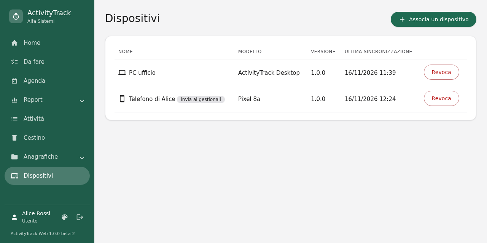

Each user pairs their phones and PCs from **Dispositivi** → **"Associa un
dispositivo"**: a **QR code** appears, to be scanned in the app with
Settings → Sync → "Scan the QR code", and below it the link to paste in
ActivityTrack Desktop on the PC. The code is good for 10 minutes and once;
the page shows the device as soon as it is paired. A PC never sends to the
management systems.

- **Revoke**: the phone stops syncing at once and says the server revoked its pairing.
  Its data stay on the phone and on the server. A new code pairs it again.
- **Invia ai gestionali** (sends to the management systems): with several
  phones, only the chosen one sends the activities to the management
  systems (plugins); the others work as usual.

**When the phone syncs.**
- a few seconds after each change;
- every 30 seconds while the app is open;
- every 15 minutes in the background.

There are no push notifications: a change made on the web reaches the
phone within 15 minutes, at once with the app open. Without a network it
waits and leaves when the network is back.

### Offline maps for the phones

The app's track map can use an **offline map**: a basic map (roads, rivers, lakes,
borders, place names) kept on the phone, which works without a network. The **Mappe** page
(admins only) prepares it:

1. Tick **Rendi disponibili le mappe offline ai telefoni** (offer offline maps to the
   phones). Off, the phones receive nothing and remove the maps they got from here.
2. In **Aree** (areas) add the places you need: a **centre** (latitude and longitude), a
   **radius** (5-250 km) and a **zoom level**. As you type, the form tells how many tiles
   and how many MB the map will be. Or start from one of the 23 ready-made areas (a town
   and 100 km around it) and change it.
3. Level 10 (about 1:400 000, 2-3 MB for 100 km) is enough for roads and towns; 11 (about
   1:200 000, 5 MB) adds the railway and more detail. The highest level is set in
   `settings.ini` (`[maps]`); a map above 48 MB is refused.
4. On saving, the server prepares the map (some tens of seconds), reading the
   OpenStreetMap data in Protomaps' format: it must reach `build.protomaps.com`. The row
   shows *in preparazione* (being prepared), then *pronta* (ready) or *non riuscita*
   (failed, with the reason; the previous version stays on offer). **Aggiorna** prepares it again.

The phones fetch the maps with the sync, on Wi-Fi (within 15 minutes, at once if the app
is open) and remove those you remove. A phone without a server can have the same maps by
copying `.pmtiles` files into the `maps` folder of its data folder. Details and commands
(`build_maps`, periodic refresh): `docs/OFFLINE-MAPS.md`.

### Updates

The **Aggiornamenti** page (admins only) tells the server where to look for new versions of
ActivityTrack and whom to believe:

- **Where to look**: the address of a signed manifest (by default the project's, on
  GitLab), the channels followed (`prod`, `beta`, `test`, `dev`), the hours between checks
  (0 = never on its own). **Controlla ora** checks at once.
- **Mirror**: on by default, the server keeps the packages and the devices download them
  from here; it always keeps at least the last two releases. Off, they download from the
  addresses in the manifest.
- **Di chi ci si fida**: the server accepts a manifest signed with the app's key or with a
  key whose fingerprint (SHA-256 of the certificate) you paste here. The server's own key,
  whose fingerprint is in the pairing QR code, signs what the phones and PCs receive: they
  see it at their first sync.
- When the manifest has a newer web server, the page says so; the server is updated by
  installing the package.

## 6. Master data

Companies, clients, roles, tags, quick choices and materials are
**central** (everyone sees them; administrators and managers change them)
or **personal** (a user's own, when the policy allows it). The app and the
web show which is which. Companies, clients and tags have an optional
**colour**, chosen among the app's, from the web too. In the menu on the left **Anagrafiche** is a branch with an entry
for each (Companies, Clients, Roles, Tags, Quick choices, Materials), the same as the tabs of the page.

When the phone and the server have master data with the same name, they
become one at the first sync, with the server's data. For tags the text
counts: the name stays, the colour is the server's.

## 7. Policies

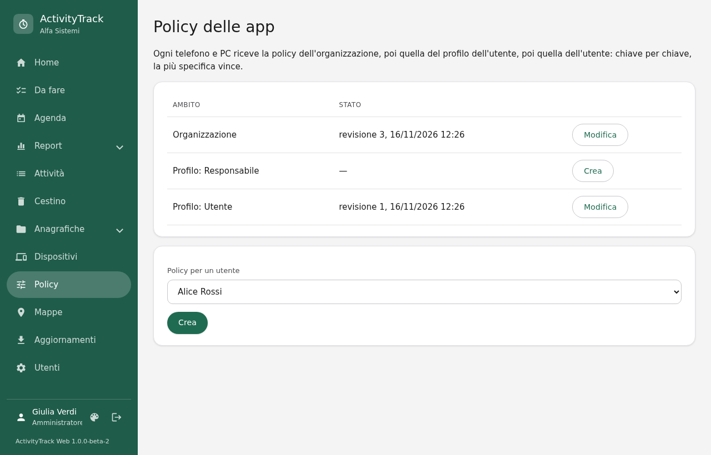

A policy decides what the phones' apps may do and change: features,
fields, settings, behaviours. Each phone gets, key by key, the
**organisation's** policy, then the **profile's**, then the **user's**:
the most specific wins. What stays "non impostato" (not set) leaves the app
as it is.

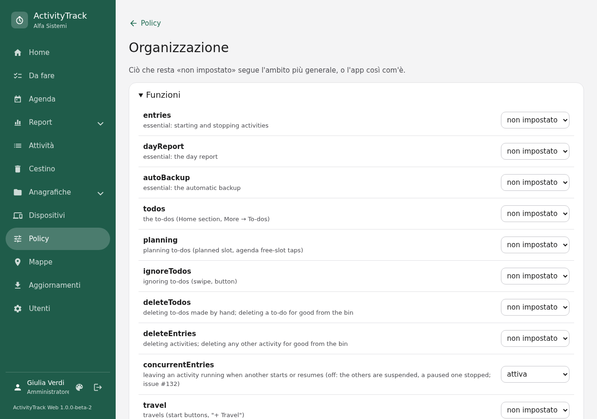

For each setting:
- **valore iniziale** (initial value): suggested, the user may change it;
- **bloccato** (locked): grey with a padlock for the user;
- **nascosto** (hidden): not shown.

The policies reach the phones with the sync, signed by the server: with the
key and certificate of `[policy]` in `settings.ini` if you set them, otherwise with a key the
server made for itself on first start (`signing/` in the data folder). The app checks the
signature, and **the first signed policy it applies fixes the signer's name (CN)**: from then
on it refuses policies signed by another name and unsigned ones. So back up `signing/` with the
data and do not replace the key with one of another name. Apps before 0.9.9 do not know the
generated key: they keep receiving the policy unsigned.

Some settings count on the web too:
- **Rounding** and **night carry-over** (`rounding…`, `carryOverMin`): the
  web computes Agenda and Report with each person's policy rules. The
  phone's own settings do not reach the server: to get on the web the same
  times as on the phone, set them in the policy.
- **Editable times** (`editableTimes`) locked to "no": on the web the user
  only adds travels and pauses; an administrator or their manager fixes
  the times.
- **Language** (`ui.language`: only `it`, `en`, `de` or `es`; the editor refuses another value with an error, and an
  imported or old policy with another value of any type, even not a text, makes the pages of its users English and never
  blocks them): also fixes the language of the web pages for the users the
  policy applies to, as for the apps; in the Preferences the language buttons are then disabled, with the note
  "Impostato dalla policy" (set by the policy); with a wrong value: "Lingua forzata sull'inglese da una policy con un
  valore errato" (forced to English by a policy with an invalid value).
- **Export** (feature `export`, formats `export.formats`, behaviour `exportMaxDays`): they hold for the web reports and
  the CSV too (§9): without the feature there are no exports, the formats are the ones listed (all three if it lists
  none), and a period longer than `exportMaxDays` days (366 when missing) is not exported.
- **Travel** (feature `travel`) and **Source of activities** (`entries.source`, "only from planned ones"): they also
  hold for the trip started from the web (§8).
- **Free tags** (`tagsFreeText`) off: on the web only the master-data tags
  can be chosen.
- The **To-dos** or **Planning** feature off removes the activities in the *To do* state from the
  Home and the planning from the Agenda.
- **Activities only from planned ones** (`plannedOnly`, formerly `todosOnly`: the old name is still read): activities
  start only from a planned or assigned To do activity.
- **Save rounded values** (`roundStoredTimes`): the start, switch, stop and reopen buttons record rounded times; only with
  editable times; times typed by hand stay exact.

**Field names.** In the **Campi** (Fields) table of the editor, the **"Etichetta per lingua"** (label per language) column has a box for every language
of the apps: Italian, English, German and Spanish. The app shows the field's name in the phone's language; if there is no
label for that language it uses the English one, then the app's own text. A policy with German or Spanish labels
written elsewhere keeps them when you save it from the web.

## 8. Working on the web

Everyone finds their own work on the web, as in the app.
- **Home**: the running activities with their commands (Pause, Work, Travel, Stop; there is no Suspend any more), then
  one list of all the activities in their **states**, with the filters period, state, company and tag. The groups of the
  list, with **State → "All"**, follow the time: **In ritardo** (Late), **Incompleta** (Incomplete: when the State filter
  includes it, as it does at the start, and there are any),
  **Oggi** (Today), **Prossimi giorni** (Next days), **Senza data** (Without a date), **Giorni precedenti**
  (Earlier): the to-dos without a date sit between the next days and the previous ones, not after the done ones.
- **Viaggio** (Travel). The Home's button opens a form: the **person** (oneself or, for a manager or an administrator, a
  person of the team), the **company** and the **client**, all three required (a client goes with its company and
  brings it; a linked To do brings its company and client; the description is optional; if the person sees no company,
  or no client, at all, that one is not asked) and **when** (now, from a time, or already made, with start and end). From the web a trip is never anonymous. For
  someone else only a trip **already made** is recorded: a running one would set aside the activities they have open on
  their phone. The rules of the person's policy hold: the Travel feature, "activities only from planned ones"
  (`entries.source`: a To do is required) and locked times (no times can be chosen).

  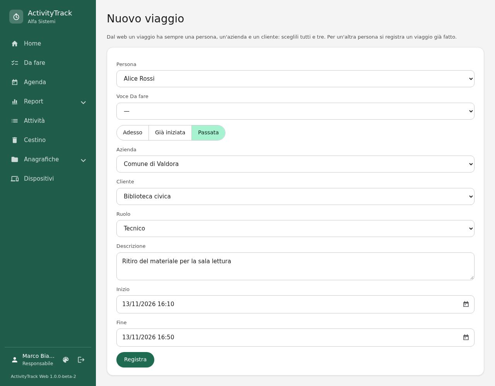

- **States.** Every activity shows one of eleven states, with icon and colour (the same as in the app):

  | State | Icon | Colour |
  |---|---|---|
  | To do | check box | white |
  | Planned | clock | grey |
  | Late | **!** | brown |
  | Work | ▶ | green |
  | Travel | car | blue |
  | Pause | ⏸ | yellow |
  | Suspended | moon | orange |
  | Done | ✓ | greenish |
  | Incomplete | ■ | reddish |
  | Absence | dot | fuchsia |
  | Deleted | bin | grey |

  *Suspended* appears only when another activity starts and concurrent ones are not allowed; *Incomplete* is a closed
  activity without a client or a work segment (fixed like any other: there is no "Complete" step). "Late" uses a single
  rule, on the Home as on the work page.
- **Activities** and the **activity sheet**: state ("In <state> since"), the state's actions, details, times (segments,
  planned ones too), expenses, attachments, place, tags. **Reopen** is split into **Work** and **Travel** and always asks
  for confirmation; **"Put back to do"** removes the tick from an item ticked by mistake (no real segments). Stopping an
  activity with an outbound trip and work can add the **return trip**. **Priority** has the names None, Low, Medium, High,
  Urgent, Emergency.
- **Activities, the list.** **"Ordina per"** (sort by) offers Data (date: by day, as before), Ora di inizio (start time),
  Azienda (company), Cliente (client), Durata (duration), Stato (state) and, for those who see several people, Persona
  (person), with a direction (also in the address, `?sort=` and `&dir=`); the orders other than the date are one list
  where every row says its day, and what has no value stays last in both directions. Every row (and those of the Home)
  has an icon for each kind of attachment (**Foto** photo, **Nota vocale** voice note, **Scontrino** receipt, **File**),
  with the number when there are several, and, when there are travel segments, the travel time and the km (the declared
  ones, else the estimated). The period also includes the activities recorded **later** for a past day (the "Passata"
  form).

  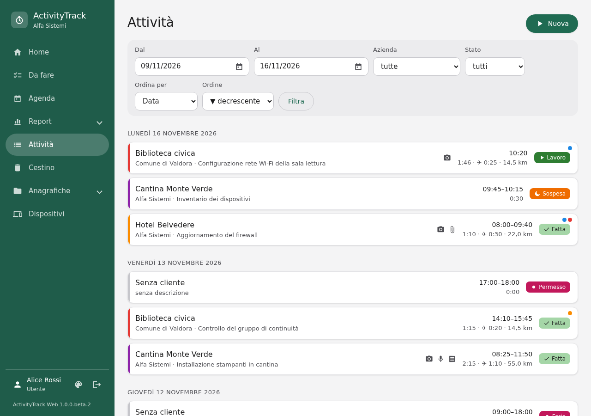

- **Cestino** (Bin): the deleted activities, with **Restore** and **Delete permanently** (instead of "Ignored").
- **Absences**: the form asks the kind (Absence, Holiday, Leave, Sick leave), the company (optional: empty = all), from day
  to day and optional times (a leave); without times one segment is created per working day, skipping days off. Future
  holidays can be planned too.
- **Agenda**: day, week and month; a click on a free slot plans a To do
  activity at that time (planned segments are dashed, absences fuchsia; the colour is the client's, else the company's).
  At the top of one's own agenda there are three buttons: **"Da fare"** (To do: the new To do activity of the day, when
  planning and To-dos are on), **"Assenza"** (Absence: the absence form on the agenda's day, then back to the agenda) and
  **"Già svolta"** (Already done), which opens the new-activity form on **"Passata"** (Past) with the times already
  proposed: the hour ending at the last quarter of an hour that has passed if the day is today, else 09:00–10:00.
  "Già svolta" is there only for today and past days, and when the policy leaves the times editable (§7).

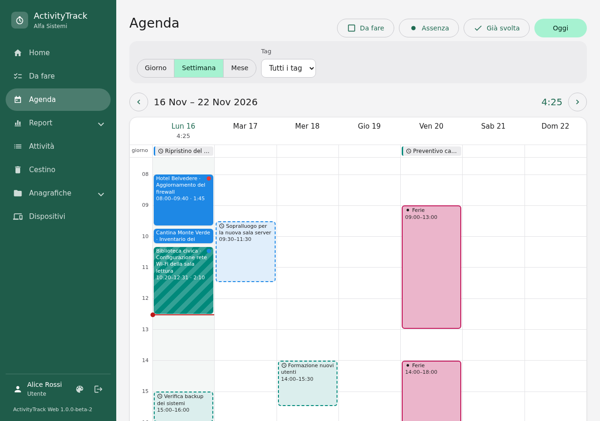

**Dates and times.** In the forms dates and times are typed in the format
chosen in the preferences, or picked with the button at the right of the
field: a calendar starting on Monday and, for times, the app's **5-minute
grid** (one row per hour, 12 hours at a time; **▲ Prima** / **Dopo ▼**
move the window by 3 hours). Start and end are chosen together: drag from
the first cell to the last, or tap the first and then the last, and **OK**;
at the top the range and its length, the **hatched** cells are taken by
other activities of that day. **Orario esatto** (exact time) takes the
minutes off the grid (e.g. 09:37). In the forms the **company** comes before
the **client** and filters its list; a client chosen brings its company.

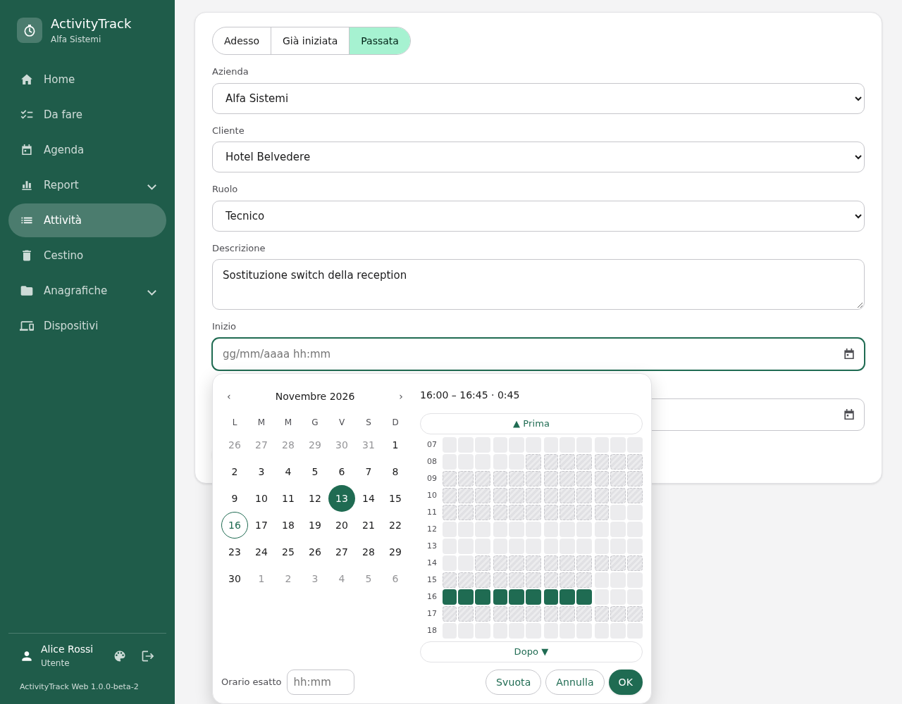

**Preferences.** From the palette icon next to one's name (on a phone:
*Altro → Preferenze*), everyone chooses:
- the **date format**: European (31/12/2026), American (12/31/2026) or ISO
  (2026-12-31);
- the **time format**: 24 hours (18:30) or 12 hours (6:30 PM);
- the **theme**: light, dark or as the system; the pages stay white and
  grey (black in the dark theme);
- the **theme colour**, for the menu bars and the buttons: green, blue,
  violet, orange or grey.

The preferences are the user's: they hold on every browser they sign in
with.

The **language** (Italian, English, German or Spanish) is chosen on the same page and holds for
the browser in use; until you choose one, the pages follow the browser's
language, or English if the server does not have it. If the policy fixes the language (§7) the buttons are disabled and
the page says "Impostato dalla policy"; with a wrong value it says "Lingua forzata sull'inglese da una policy con un
valore errato" and the pages are English. The buttons, labels, messages and emails are translated; what you type
(names, notes) stays as written.

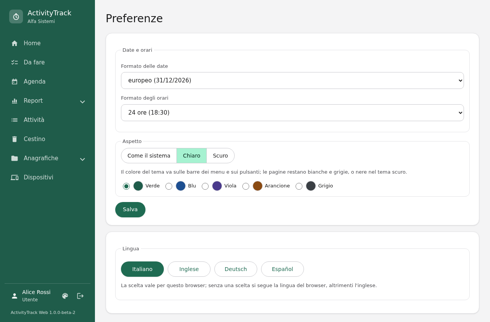

**Assigned to-dos.** A manager, or an administrator, creates a To do activity and
picks **"Assegnata a"** (assigned to): it becomes the chosen
person's and reaches their phones. While it is still in the To do state it can be reassigned: it then leaves the phones of
whoever had it. The assignee sees "Assegnata da …" (assigned by) and works
it as their own; the manager follows it on the *Da fare* page with
**Persona → "Tutto il team"** (the whole team).

On the **Da fare** (To-dos) page the buttons **"Nuova voce"** (new item) and **"Nuova assenza"** (new absence) sit at the top
right, side by side.

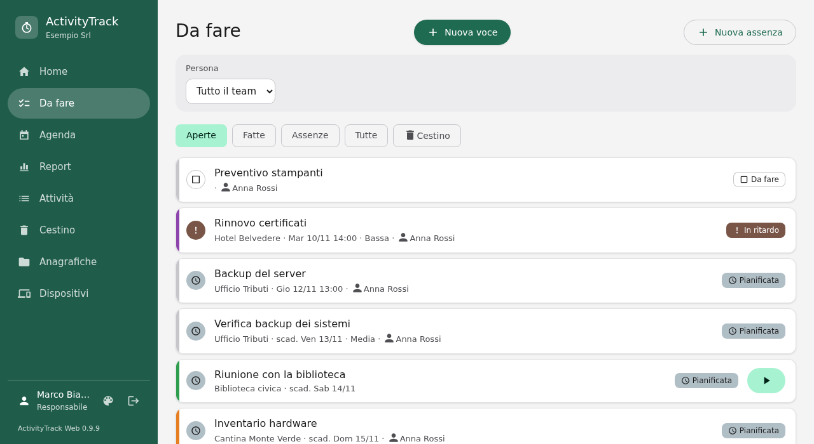

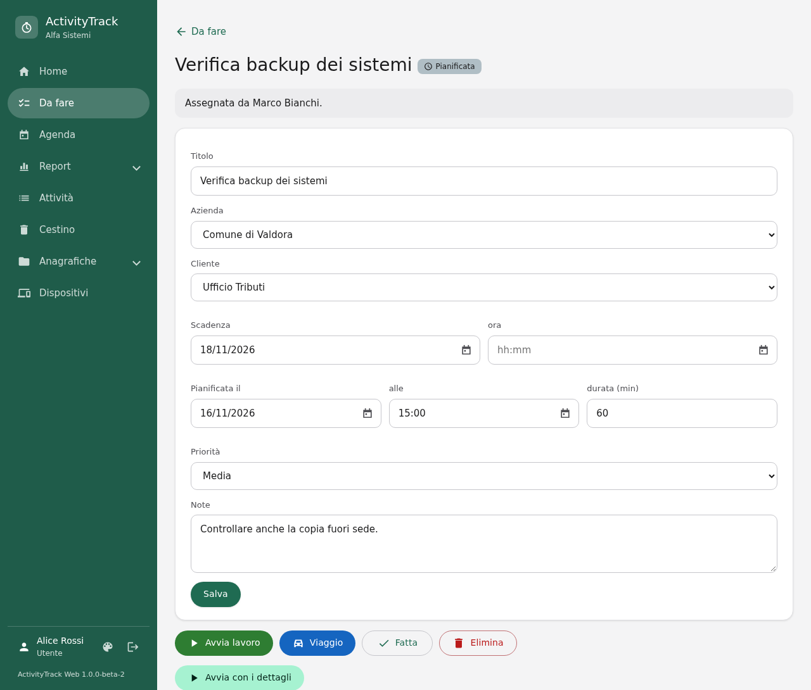

**Checks after a sync.** When two phones changed the same activity and its
segments overlap, the activity is marked **"To check"**. With times locked by
the policy, an administrator or the manager fixes it from the sheet on the
web. A change the server refuses (for example locked central master data)
shows on the phone as "Not synced", with the reason.

## 9. Reports

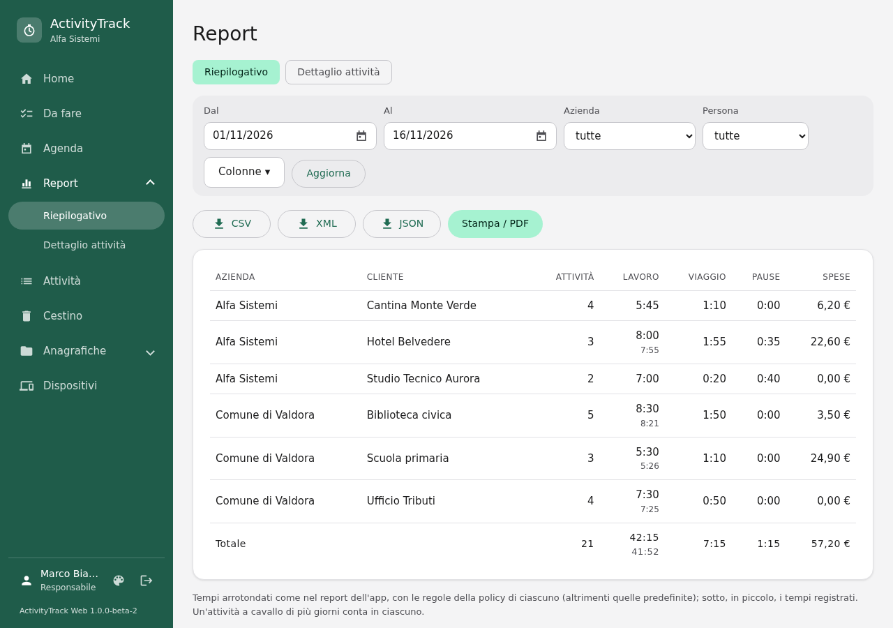

There are two **Reports**, entries of the menu (tabs on a phone), with the same filters (period, company, person):
- **Riepilogativo** (Summary): the totals by company and client over a period (activities, work, travel, pauses,
  expenses; the **reported** time and the km on request), with the times **rounded** as in the app and, in small, the
  recorded ones. An activity over several days counts in each, except for the night carry-over. **Absences** are
  counted apart, by kind (Absence, Holiday, Leave, Sick leave), in an *Assenze* section.
- **Dettaglio attività** (Activity detail): one row per **activity and day** (like the app's report line, so the rows
  add up to the summary and are rounded by the same rules), plus the rows of the days' **absences**: date, time,
  person, company, client, role, activity, place, tags, work, travel, pauses, reported, km, expenses, attachments,
  state. Km, expenses and attachments are on the activity's first row in the period. A switch above the filters chooses
  between **"Una riga per attività"** (one row per activity, the default) and **"Una riga per tratto"** (one row per
  segment; `?rows=activity` or `segment`): a row for each work, travel, pause or absence segment, on the day it starts,
  with its own start and end, kind, duration, km (travel) and note, and its activity's data. Here the minutes are the
  **recorded** ones, not rounded, so the totals can differ from the summary's (the page says so). This view has its
  own columns; sort, columns, exports and print follow the view shown.

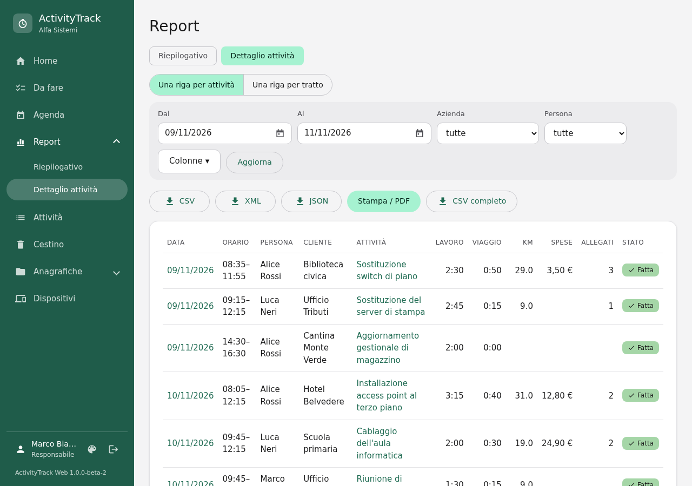

A period with no rows has no total row.

**Columns.** A click on a column's head sorts the table, and a second click reverses the order (also in the address:
`?sort=` and `&dir=`); rows without a value stay last. The **"Colonne"** (columns) menu shows or hides columns.
Columns, sort and the detail's view stay **with the user, permanently** (at every login and on every browser), for each
report and view; **"Colonne predefinite"** (default columns) forgets the table's choice, sort included.

**Exporting.** The table **as shown** (filters, sort, visible columns) downloads as **CSV** (semicolon, with the byte
order mark spreadsheets want; free text that would read as a formula is guarded), **XML** or **JSON**, with plain values
(ISO dates, 24-hour times, durations in minutes, amounts in euros) and the unit in the head; the addresses are
`/report/esporta/summary.csv`, `/report/esporta/detail.json` and so on. The **policy** (§7) decides: the export feature,
the allowed formats and the longest period (`exportMaxDays`); when it does not allow, the page says so. On the detail
the **"CSV completo"** (full CSV; semicolon and byte order mark, like the others) stays: one row per activity and day with all the columns, the recorded and the rounded
minutes; absence segments have rows of their own and there is an `absence_min` column.

**Stampa / PDF** (print / PDF) prints the page with a print style sheet (no menu, filters or tabs, the table's head
repeated, the chosen sort and columns kept); for a PDF use the browser's print.

Managers and administrators filter by person; a reader only sees the closed activities of their companies.

## 10. Security and backups

`docs/SECURITY.md` describes what protects the server and what the
administrator has to do. In short:
- **HTTPS** only, with a valid certificate, or a self-signed one pinned
  with `tls_pin`; then HSTS in the web server;
- regular **backups** of the database and of the `files/` folder
  (attachments), together with the secret key
  (`/var/lib/activitytrack-web/secret_key`) and the policy key;
- **updates** of the distribution: Django and the libraries come from it;
- long passwords, users deactivated as soon as someone leaves the
  organisation, lost phones revoked at once.

To save an SQLite database:

```sh
sqlite3 /var/lib/activitytrack-web/activitytrack.sqlite3 ".backup '/root/activitytrack-$(date +%F).sqlite3'"
```

With PostgreSQL, use `pg_dump activitytrack`.

## 11. Common problems

| Problem | What to do |
|---|---|
| The site answers 400 "Bad Request" | the name used is not in `allowed_hosts` |
| The phone says "certificate not valid" | self-signed certificate without `tls_pin`, or made as a CA (`docs/INSTALL.md` §4) |
| The QR code is not read | raise the screen brightness, or paste in the app the link under "Non riesci a inquadrarlo?" |
| "Codice scaduto" (code expired) | the code is good for 10 minutes and once: make another |
| A user lost the phone with the authenticator app | a recovery code, or the administrator **"Azzera"** (resets) it on their sheet |
| The app's code is always "non valido" (not valid) | the phone's or the server's clock is wrong: sync it (NTP) |
| A user no longer syncs | deactivated, or the phone was revoked (Users → their sheet) |
| Attachments do not open on the web | with `offload = nginx` or `apache` the web server needs the example's configuration |
| A phone or PC says "Update the app to sync" | the server is on 1.0 and the device is not: update the app or Desktop to 1.0 |
| A change from the web does not arrive at once | it arrives within 15 minutes; opening the app brings it at once |
| Different times on the phone and the web | the phone's own rounding: set it in the policy (§7) |
| The site does not answer after an update | `systemctl status activitytrack-web.socket activitytrack-web.service`, and the log with `journalctl -u activitytrack-web` |
