Versione 1.0.0-rc-1 (novembre 2026). Per chi installa e amministra il server
dell'organizzazione; chi usa l'app trova tutto nel *Manuale* di
ActivityTrack.

## 1. Cos'è ActivityTrack Web

ActivityTrack Web è il server dell'organizzazione per l'app ActivityTrack:
- tiene una **copia di ogni telefono**, sincronizzata nei due sensi:
  attività (comprese quelle da fare e le assenze), anagrafiche, allegati;
- dà a ciascuno lo **stesso lavoro dal browser**: Home, attività, Agenda,
  Da fare, report;
- gestisce **utenti e profili**, le **anagrafiche centrali** e le
  **policy** che regolano le app dei telefoni.

Un server serve una sola organizzazione. Il telefono funziona anche senza
rete: le modifiche aspettano e partono quando la rete torna.

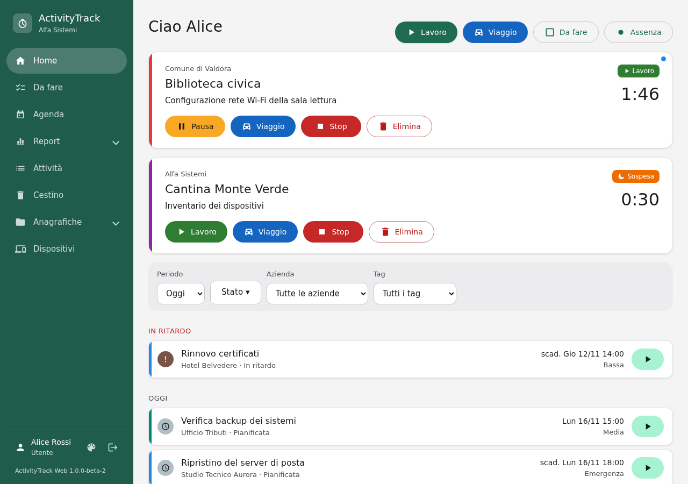

## 2. Installazione e aggiornamenti

Le istruzioni complete sono in `docs/INSTALL.md`, nel repository e nel
pacchetto. In breve:
- **Debian 13 e 14, Ubuntu 24.04 e 26.04**: il pacchetto `.deb` della pagina
  delle release.
- **RHEL / Oracle Linux 9, Arch, FreeBSD 14**: l'archivio `.tar.gz`, o un
  clone del repository.

Il pacchetto prepara l'utente di servizio, le cartelle e il database, ma non
avvia il servizio. Prima si scrive `/etc/activitytrack-web/settings.ini`:

| Chiave | Cosa |
|---|---|
| `[server] base_url` | l'indirizzo HTTPS con cui i telefoni raggiungono il server; finisce nei codici QR. Con un percorso (`https://www.example.com/activitytrack`) l'app vive lì |
| `[server] allowed_hosts` | i nomi e gli indirizzi con cui si raggiunge il server |
| `[server] time_zone` | il fuso dei giorni e dei report (predefinito `Europe/Rome`) |
| `[server] tls_pin` | solo con un certificato autofirmato: l'impronta della sua chiave, che l'app fissa |
| `[database]` | SQLite (predefinito) o PostgreSQL |
| `[files] max_mb`, `offload` | dimensione massima degli allegati; chi li invia: Django, nginx o Apache |
| `[policy] key`, `cert` | chiave e certificato per firmare le policy e i manifesti degli aggiornamenti (facoltativi); senza, il server genera una chiave propria al primo avvio, in `signing/` della cartella dei dati: salvala |
| `[updates]` | indirizzo del manifesto, canali e intervallo per le nuove versioni (facoltativi, vedi Aggiornamenti) |
| `[mail]` | server di posta per i codici di accesso via email (facoltativo) |

Poi si crea l'organizzazione con il primo amministratore e si avvia il
servizio:

```sh
activitytrack-web-manage setup --org "La mia azienda" --admin admin
systemctl enable --now activitytrack-web.socket
```

Davanti serve un web server (nginx o Apache): gli esempi sono in
`/usr/share/activitytrack-web/deploy/`.

**Aggiornamento alla 1.0.** La 1.0 cambia il modello dei dati: la voce *Da fare* non è più un oggetto a parte, ma
un'attività nello stato "Da fare" (vedi il *Manuale* dell'app). Il database si converte **da solo** con
`migrate`: le voci diventano attività Da fare (o Fatte, se spuntate), le assenze attività di tipo Assenza, le voci ignorate
vanno nel Cestino, le priorità P1…P5 diventano Emergenza…Bassa. I **backup** del server di versioni precedenti (file
SQLite o dump PostgreSQL) si ripristinano come sempre: la conversione parte con le migrazioni. **La sincronizzazione richiede
che il server e tutti i dispositivi siano alla 1.0**: un'app più vecchia riceve l'errore `upgrade_required` ("Aggiorna
l'app per sincronizzare") e aspetta. Aggiorna **prima il server**, poi i telefoni e i PC. Alla prima sincronizzazione dopo
l'aggiornamento ogni dispositivo si riallinea al server, ma **le modifiche non ancora sincronizzate sono conservate e
inviate**. Se un telefono ha dati che il server non ha mai visto, vi arrivano; in ultima istanza si possono reimportare i
dati del telefono sul server.

**Aggiornare.** Con il pacchetto basta installare il nuovo `.deb`: il
database si aggiorna e il servizio riparte da solo. Con l'archivio o il
clone si sostituisce il codice, poi `activitytrack-web-manage migrate`,
`activitytrack-web-manage collectstatic --noinput` e il riavvio del
servizio.

**Comandi di gestione.** `activitytrack-web-manage` esegue i comandi di
Django con l'utente del servizio, per esempio `migrate`,
`createsuperuser` o `shell`. `setup` e le pagine web chiedono una password
di almeno 10 caratteri, non comune e diversa dal nome utente.
`clean_json_fields` ripara, una volta dopo l'aggiornamento da 0.9.4-beta4 o
precedenti, i tag, i numeri di telefono e i campi dei gestionali salvati da
un telefono in una forma sbagliata (`--dry-run` li elenca soltanto).

## 3. Accesso

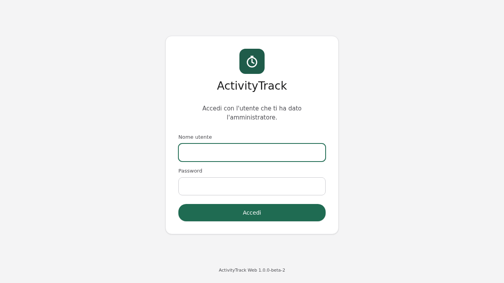

Ognuno accede con il nome utente e la password che gli ha dato
l'amministratore. Dopo 10 tentativi sbagliati di fila dallo stesso
indirizzo, il login si blocca per qualche minuto.

**Verifica in due passaggi.** Da **"Sicurezza dell'account"** (il proprio
nome in fondo al menu) ognuno può chiedere, dopo la password, un codice di
6 cifre:
- da un'**app di autenticazione** sul telefono (Aegis, FreeOTP, Google
  Authenticator…): si inquadra il codice QR e si conferma con il primo
  codice;
- oppure via **email**, se l'utente ha un indirizzo e sul server è
  configurata la posta (`[mail]` in `settings.ini`).

Attivandola si ricevono **10 codici di recupero**, da conservare: ognuno
vale una volta al posto del codice, se si perde il telefono o la posta.
Dopo 5 codici sbagliati si ricomincia dalla password. I telefoni associati
non cambiano: sincronizzano con il loro token.

Il menu a sinistra contiene **Home**, **Da fare**, **Agenda**, **Report**, **Attività**, **Cestino**, **Anagrafiche** e
**Dispositivi**; per gli amministratori anche **Policy**, **Mappe**, **Aggiornamenti** e **Utenti**. **Report** e **Anagrafiche** sono **rami** che
si aprono e si chiudono: sotto **Report** ci sono **Riepilogativo** e **Dettaglio attività**, sotto **Anagrafiche**
**Aziende**, **Clienti**, **Ruoli**, **Tag**, **Scelte rapide** e **Materiali**; il ramo della pagina in cui ti trovi è
aperto, con la voce corrente evidenziata, e si apre anche dalla tastiera (Invio o Spazio). Sul telefono c'è la barra in
basso (Home, Da fare, Agenda, Report, Altro) e le due pagine hanno le stesse voci come schede in alto. In fondo c'è il
proprio nome: un clic apre **"Sicurezza dell'account"**, dove c'è anche **"Cambia password"**.

L'interfaccia web parla **italiano, inglese, tedesco e spagnolo**. La lingua è, nell'ordine: quella imposta dalla policy
(`ui.language`, §7), altrimenti la scelta fatta nelle Preferenze (§8), altrimenti quella del browser; se il browser ne
chiede una che il server non ha, le pagine sono in **inglese** (mai in italiano). Una policy con `ui.language` non
supportato (una policy importata o vecchia) forza l'inglese, sopra scelta e browser. Gli schermi del manuale la mostrano in
italiano.

## 4. Utenti e profili

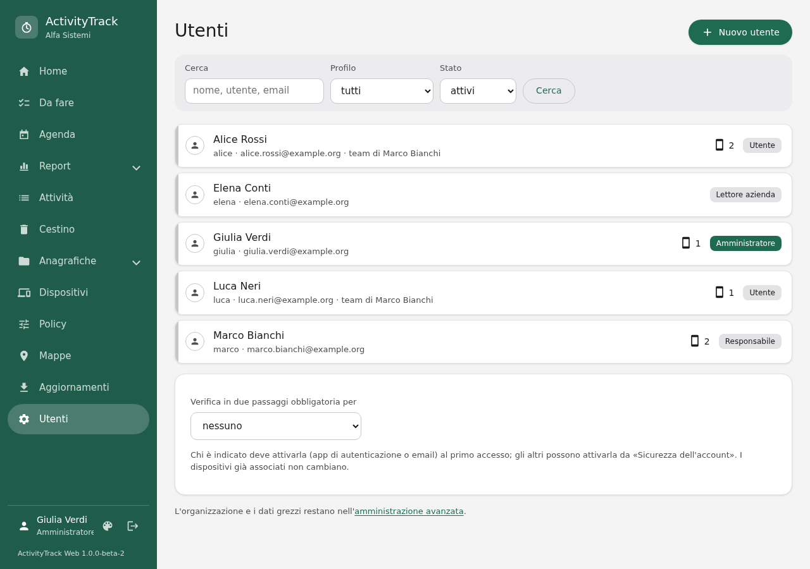

La pagina **Utenti** elenca le persone dell'organizzazione. Si cerca per
nome, utente o email, e si filtra per profilo e stato. **"Nuovo utente"**
chiede nome utente, nome, profilo e una password (almeno 10 caratteri, non
comune, non simile al nome).

| Profilo | Può |
|---|---|
| **Amministratore** | tutto: utenti, telefoni, policy, anagrafiche centrali, i dati di tutti |
| **Responsabile** | le anagrafiche centrali; legge le attività del suo team e quelle fatte per le **sue aziende**, chiunque le abbia fatte; corregge gli orari del suo team; assegna le *Da fare* al team; i report del team |
| **Utente** | le sue attività e *Da fare*, dal telefono e dal web; le sue anagrafiche personali, se la policy lo permette |
| **Lettore azienda** | solo il report delle attività **chiuse** delle aziende assegnate; nessun telefono. Pensato per l'amministrazione di un cliente |

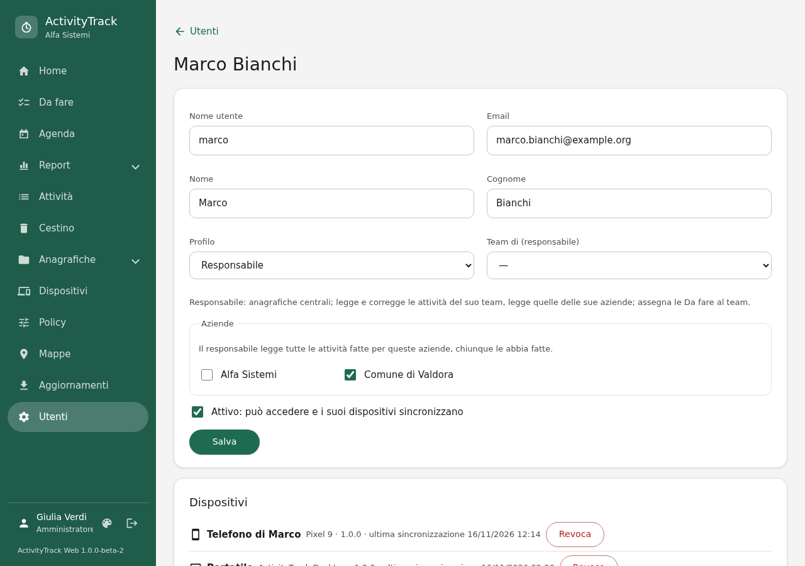

Nella scheda di un utente:
- **Team di (responsabile)**: il responsabile del cui team fa parte.
- **Aziende**, solo per responsabili e lettori: per un responsabile, le
  aziende di cui legge tutte le attività; per un lettore, quelle di cui
  vede il report.
- **Attivo**: togliendo la spunta l'utente non entra più nel web e i suoi
  dispositivi smettono subito di sincronizzare. I dati restano.
- **Dispositivi**: i telefoni e i PC associati, con l'ultima sincronizzazione e
  **"Revoca"**.
- **Policy dell'utente**: apre la sua policy personale (§7).
- **Nuova password**: l'utente esce dal web; i dispositivi restano associati.

Un amministratore non può togliersi il profilo né disattivarsi. L'altro
amministratore, o il comando `activitytrack-web-manage createsuperuser`,
rimedia se serve.

In fondo alla pagina Utenti, **"Verifica in due passaggi obbligatoria
per"**: nessuno, amministratori, amministratori e responsabili, tutti. Chi è
indicato e non l'ha ancora attivata, al primo accesso può solo attivarla.
Nella scheda di un utente, **"Azzera"** la toglie a chi ha perso il
telefono: la riattiva al prossimo accesso. Il lucchetto 🔒 nell'elenco
indica chi l'ha attiva.

La vecchia amministrazione di Django resta raggiungibile dal fondo della
pagina Utenti (**"amministrazione avanzata"**), per l'organizzazione e i
dati grezzi. La usa solo chi ha il profilo Amministratore, e ci si entra
dall'accesso normale, con la verifica in due passaggi e il blocco dei
tentativi sbagliati; ha il tema e il colore scelti nelle preferenze.

## 5. Dispositivi

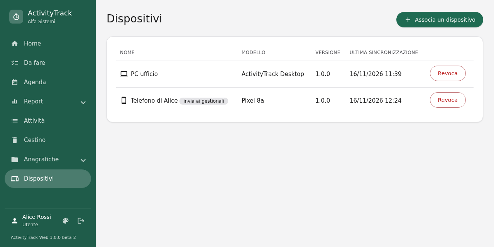

Ogni utente associa i suoi telefoni e PC da **Dispositivi** → **"Associa un
dispositivo"**: compare un **codice QR**, da inquadrare nell'app con
Impostazioni → Sincronizzazione → "Inquadra il codice QR", e sotto il
collegamento da incollare in ActivityTrack Desktop sul PC. Il codice vale
10 minuti e una sola volta; la pagina mostra il dispositivo appena è
associato. Un PC non manda mai ai gestionali.

- **Revoca**: il telefono smette subito di sincronizzare e avvisa
  che il server ha revocato l'associazione. I suoi dati restano sul telefono e sul server.
  Per ricollegarlo serve un nuovo codice.
- **Invia ai gestionali**: con più telefoni, solo quello scelto manda le
  attività ai gestionali (plugin); gli altri lavorano normalmente.

**Quando sincronizza il telefono.**
- pochi secondi dopo ogni modifica;
- con l'app aperta, ogni 30 secondi;
- ogni 15 minuti in background.

Non ci sono notifiche push: una modifica fatta sul web arriva al telefono
entro 15 minuti, o subito se l'app è aperta. Senza rete aspetta e parte al
ritorno della rete.

### Mappe offline per i telefoni

La mappa degli spostamenti dell'app può usare una **mappa offline**: una mappa
basilare (strade, fiumi, laghi, confini, nomi dei luoghi) tenuta sul telefono, che
funziona senza rete. La pagina **Mappe** (solo amministratori) la prepara:

1. Spunta **Rendi disponibili le mappe offline ai telefoni**. Spenta, i telefoni non
   ricevono nulla e tolgono le mappe avute da qui.
2. In **Aree** aggiungi le zone che servono: un **centro** (latitudine e longitudine), un
   **raggio** (5–250 km) e un **livello di zoom**. Il modulo dice, mentre scrivi, quanti
   tile e quanti MB sarà la mappa. In alternativa parti da una delle 23 aree predefinite
   (una città e 100 km attorno) e la modifichi.
3. Il livello 10 (circa 1:400.000, 2–3 MB per 100 km) basta per strade e paesi; l'11
   (circa 1:200.000, 5 MB) aggiunge la ferrovia e più dettaglio. Il massimo si fissa in
   `settings.ini` (`[maps]`); una mappa sopra i 48 MB è rifiutata.
4. Salvando, il server prepara la mappa (qualche decina di secondi) leggendo i dati di
   OpenStreetMap nel formato di Protomaps: serve che raggiunga `build.protomaps.com`.
   La riga mostra *in preparazione*, poi *pronta* (o *non riuscita*, con il motivo; la
   versione precedente resta disponibile). **Aggiorna** la prepara di nuovo.

I telefoni scaricano le mappe con la sincronizzazione, su Wi-Fi (entro 15 minuti, subito
se l'app è aperta) e tolgono quelle che togli tu. Un telefono senza server può avere le
stesse mappe copiando file `.pmtiles` nella cartella `maps` della sua cartella dati.
Dettagli e comandi (`build_maps`, aggiornamento periodico): `docs/OFFLINE-MAPS.md`.

### Aggiornamenti

La pagina **Aggiornamenti** (solo admin) dice al server dove cercare le nuove versioni di
ActivityTrack e di chi fidarsi:

- **Dove cercare**: l'indirizzo di un manifesto firmato (di default quello del progetto, su
  GitLab), i canali seguiti (`prod`, `beta`, `test`, `dev`), le ore fra un controllo e
  l'altro (0 = mai da solo). **Controlla ora** controlla subito.
- **Copia dei pacchetti**: acceso di default, il server conserva i pacchetti e i dispositivi li
  scaricano da qui; tiene sempre almeno le ultime due versioni. Spento, scaricano dagli
  indirizzi del manifesto.
- **Di chi ci si fida**: il server accetta un manifesto firmato con la chiave dell'app o con una
  chiave di cui incolli qui l'impronta (SHA-256 del certificato). La chiave del server, la cui
  impronta è nel QR dell'associazione, firma ciò che ricevono telefoni e PC, che lo vedono alla
  prima sincronizzazione.
- Se il manifesto ha una versione più recente del server web, la pagina lo dice; il server si
  aggiorna installando il pacchetto.

## 6. Anagrafiche

Aziende, clienti, ruoli, tag, scelte rapide e materiali sono **centrali**
(le vedono tutti; le modificano amministratori e responsabili) o
**personali** (di un utente, se la policy lo consente). L'app e il web
mostrano quale è quale. Aziende, clienti e tag hanno un **colore** facoltativo,
scelto tra quelli dell'app, anche dal web. Nel menu a sinistra **Anagrafiche** è un ramo con una voce per ciascuna
(Aziende, Clienti, Ruoli, Tag, Scelte rapide, Materiali), le stesse delle schede della pagina.

Se sul telefono e sul server c'è un'anagrafica con lo stesso nome,
diventano una sola alla prima sincronizzazione, con i dati del server. Per i
tag conta il testo: il nome resta, il colore è quello del server.

**Rendere centrali le proprie anagrafiche.** Un amministratore o un responsabile che ha anagrafiche
personali può renderle centrali dal pulsante **Rendi centrali le mie** nelle pagine di **Anagrafiche**
(per una sola voce, **Rendi centrale** nella sua pagina). La pagina mostra prima cosa diventerà
centrale e cosa resta personale, e chiede conferma. La voce non cambia identità: le attività e le scelte rapide
che la usano restano valide, i telefoni la ricevono di nuovo come centrale e gli altri utenti la vedono come nuova
(se hanno una voce personale con lo stesso nome, la loro app le unisce da sola). Le sedi e i contatti di
un'azienda o di un cliente la seguono. Restano personali, con il motivo accanto: le voci per cui esiste già una
voce centrale con lo stesso nome o codice (senza distinguere maiuscole e minuscole), e un cliente, una scelta rapida
o un materiale che si riferisce a un'azienda o a un ruolo personale non reso centrale insieme (prima va
resa centrale l'azienda o il ruolo; il pulsante generale lo fa nell'ordine giusto). Dopo, la voce la modificano
solo amministratori e responsabili, e **l'operazione non si annulla**. Gli altri utenti non possono
farlo per te: ognuno rende centrali le proprie.

## 7. Policy

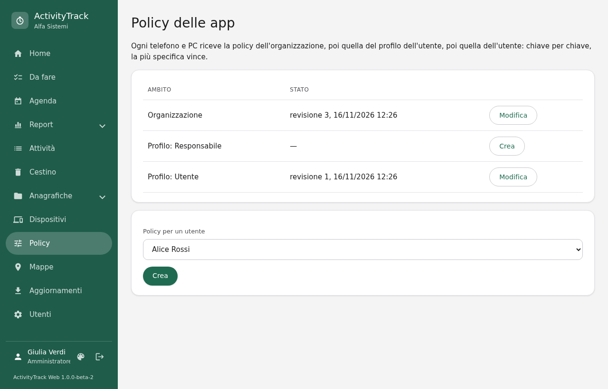

Una policy decide cosa possono fare e cambiare le app dei telefoni:
funzioni, campi, impostazioni, comportamenti. Ogni telefono riceve, chiave
per chiave, la policy dell'**organizzazione**, poi quella del **profilo**,
poi quella dell'**utente**: vince la più specifica. Ciò che resta "non
impostato" lascia l'app com'è.

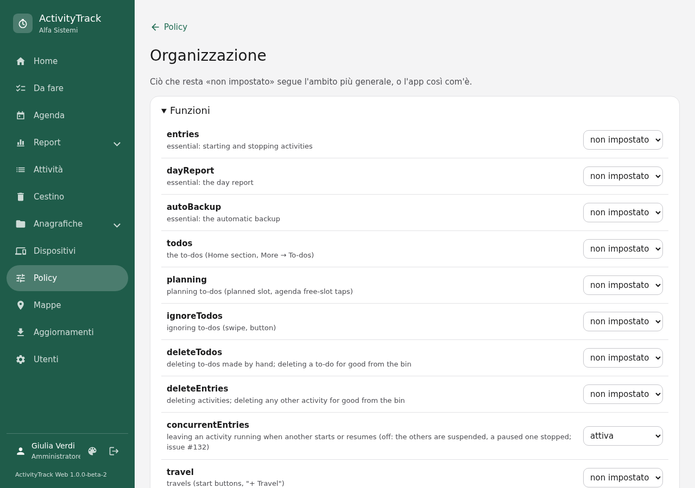

Per ogni impostazione:
- **valore iniziale**: lo propone, l'utente lo può cambiare;
- **bloccato**: l'utente lo vede grigio con il lucchetto;
- **nascosto**: non compare.

Le policy arrivano ai telefoni con la sincronizzazione, firmate dal server: con
chiave e certificato di `[policy]` in `settings.ini` se li imposti, altrimenti con una chiave che
il server genera per sé al primo avvio (`signing/` nella cartella dei dati). L'app controlla la
firma, e **la prima policy firmata che applica fissa il nome (CN) del firmatario**: da allora
rifiuta quelle firmate con un altro nome e quelle non firmate. Quindi salva `signing/` insieme ai
dati e non sostituire la chiave con una di un altro nome. Le app precedenti alla 0.9.9 non
conoscono la chiave generata: continuano a ricevere la policy non firmata.

Alcune impostazioni valgono anche sul web:
- **Arrotondamenti** e **scavalco notturno** (`rounding…`,
  `carryOverMin`): il web calcola Agenda e Report con le regole della policy
  di ciascuno. Le impostazioni personali del telefono non arrivano al
  server: per avere sul web gli stessi tempi del telefono, conviene fissarle
  nella policy.
- **Orari modificabili** (`editableTimes`) bloccato su "no": sul web
  l'utente può solo aggiungere viaggi e pause; gli orari li corregge un
  amministratore o il suo responsabile.
- **Lingua** (`ui.language`: solo `it`, `en`, `de` o `es`; l'editor rifiuta un altro valore con un errore, e una policy
  importata o vecchia con un altro valore di qualunque tipo, anche non un testo, rende inglesi le pagine dei suoi utenti senza mai
  bloccarle): fissa anche la lingua delle pagine web per gli utenti a cui si
  applica la policy, come per le app; nelle Preferenze i pulsanti della lingua sono allora disabilitati, con la
  scritta "Impostato dalla policy" (con un valore errato: "Lingua forzata sull'inglese da una policy con un valore
  errato").
- **Esportazione** (funzione `export`, formati `export.formats`, comportamento `exportMaxDays`): valgono anche per i
  report del web e per il CSV (§9): senza la funzione non ci sono esportazioni, i formati sono quelli elencati (tutti e
  tre se non ne elenca), e un periodo più lungo di `exportMaxDays` giorni (366 se manca) non si esporta.
- **Viaggi** (funzione `travel`) e **Origine delle attività** (`entries.source`, "solo da pianificate"): valgono anche per
  il viaggio avviato dal web (§8).
- **Tag liberi** (`tagsFreeText`) spento: sul web si scelgono solo i tag
  dell'anagrafica.
- La funzione **Da fare** o **Pianificazione** spenta toglie le attività *Da
  fare* dalla Home e la pianificazione dall'Agenda.
- **Attività solo da pianificate** (`plannedOnly`, prima `todosOnly`: il vecchio nome è ancora letto): le attività
  si avviano solo da un'attività Da fare pianificata o assegnata.
- **Salva i valori arrotondati** (`roundStoredTimes`): i pulsanti di avvio, cambio, stop e riapri registrano orari
  arrotondati; vale solo con gli orari modificabili; gli orari scritti a mano restano esatti.

**Nomi dei campi.** Nella tabella **Campi** dell'editor, la colonna **"Etichetta per lingua"** ha una casella per ogni
lingua delle app: italiano, inglese, tedesco e spagnolo. L'app mostra il nome del campo nella lingua del telefono; se per
quella lingua non c'è un'etichetta usa quella inglese, poi il testo dell'app. Una policy con etichette in tedesco o
spagnolo scritte altrove le conserva anche se la salvi dal web.

## 8. Il lavoro sul web

Ognuno trova sul web il proprio lavoro, come nell'app.
- **Home**: le attività in corso con i comandi (Pausa, Lavoro, Viaggio, Stop; non c'è più Sospendi), poi una lista
  unica di tutte le attività nei loro **stati**, con i filtri periodo, stato, azienda e tag. I gruppi
  della lista, con **Stato → "Tutti"**, seguono il tempo: **In ritardo**, **Incompleta** (se il filtro Stato la
  comprende, come all'inizio, e ce ne sono), **Oggi**, **Prossimi
  giorni**, **Senza data**, **Giorni precedenti** (le Da fare senza data stanno quindi tra i giorni a venire e quelli
  passati, non dopo le Fatte).
- **Viaggio.** Il pulsante della Home apre un modulo: la **persona** (se stessi o, per un responsabile o un
  amministratore, una persona del team), l'**azienda** e il **cliente**, tutti e tre obbligatori (un
  cliente va con la sua azienda e la porta con sé; una voce Da fare collegata porta azienda e cliente; la descrizione è
  facoltativa; se la persona non vede nessuna azienda, o nessun cliente, quello non è chiesto) e **quando** (adesso, da un'ora, oppure già fatto, con inizio e fine). Dal web un viaggio
  non è mai anonimo. Per un'altra persona si registra solo un viaggio **già fatto**: uno in corso metterebbe da parte le
  attività che ha aperte sul telefono. Valgono le regole della policy della persona: la funzione Viaggi, "attività solo da
  pianificate" (`entries.source`: serve una voce Da fare) e gli orari bloccati (niente orari scelti).

  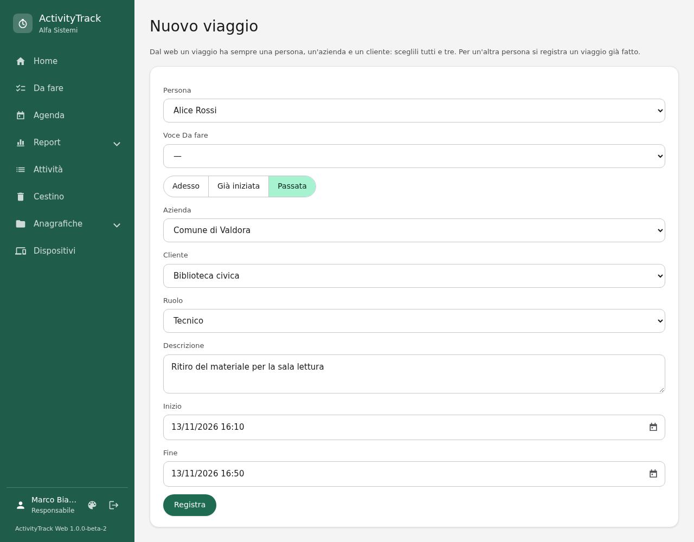

- **Stati.** Ogni attività mostra uno di undici stati, con icona e colore (gli stessi dell'app):

  | Stato | Icona | Colore |
  |---|---|---|
  | Da fare | casella | bianco |
  | Pianificata | orologio | grigio |
  | In ritardo | **!** | marrone |
  | Lavoro | ▶ | verde |
  | Viaggio | auto | blu |
  | Pausa | ⏸ | giallo |
  | Sospesa | luna | arancione |
  | Fatta | ✓ | verdino |
  | Incompleta | ■ | rossiccio |
  | Assenza | punto | fucsia |
  | Eliminata | cestino | grigio |

  *Sospesa* appare solo quando un'altra attività parte e le contemporanee non sono ammesse; *Incompleta* è una chiusa senza
  cliente o senza tratto di lavoro (si corregge come le altre: non c'è un passo "Completa"). Lo stato "In ritardo" usa
  una sola regola, sulla Home come nella pagina del lavoro.
- **Attività** e la **scheda dell'attività**: stato ("In <stato> dalle"), azione dello stato, dettagli, orari
  (segmenti, anche pianificati), spese, allegati, località, tag. **Riapri** si divide in **Lavoro** e **Viaggio** e
  chiede sempre conferma; **"Rimetti da fare"** toglie la spunta a una voce spuntata per errore (senza tratti reali).
  Allo Stop di un'attività con andata e lavoro si può aggiungere il **viaggio di ritorno**. La **priorità** ha i nomi
  Nessuna, Bassa, Media, Alta, Urgenza, Emergenza.
- **Attività, l'elenco.** **"Ordina per"** offre Data (per giorno, come prima), Ora di inizio, Azienda, Cliente, Durata,
  Stato e, per chi vede più persone, Persona, con una direzione (anche nell'indirizzo, `?sort=` e `&dir=`); gli ordini
  diversi dalla data sono un'unica lista in cui ogni riga dice il suo giorno, e ciò che non ha valore resta in fondo in
  entrambe le direzioni. Ogni riga (e quelle della Home) ha un'icona per ogni tipo di allegato (**Foto**, **Nota vocale**,
  **Scontrino**, **File**), con il numero se sono più d'uno, e, se ci sono tratti di viaggio, il tempo di viaggio e i km
  (quelli dichiarati, altrimenti quelli stimati). Il periodo comprende anche le attività registrate **dopo** per un giorno
  passato (il modulo "Passata").

  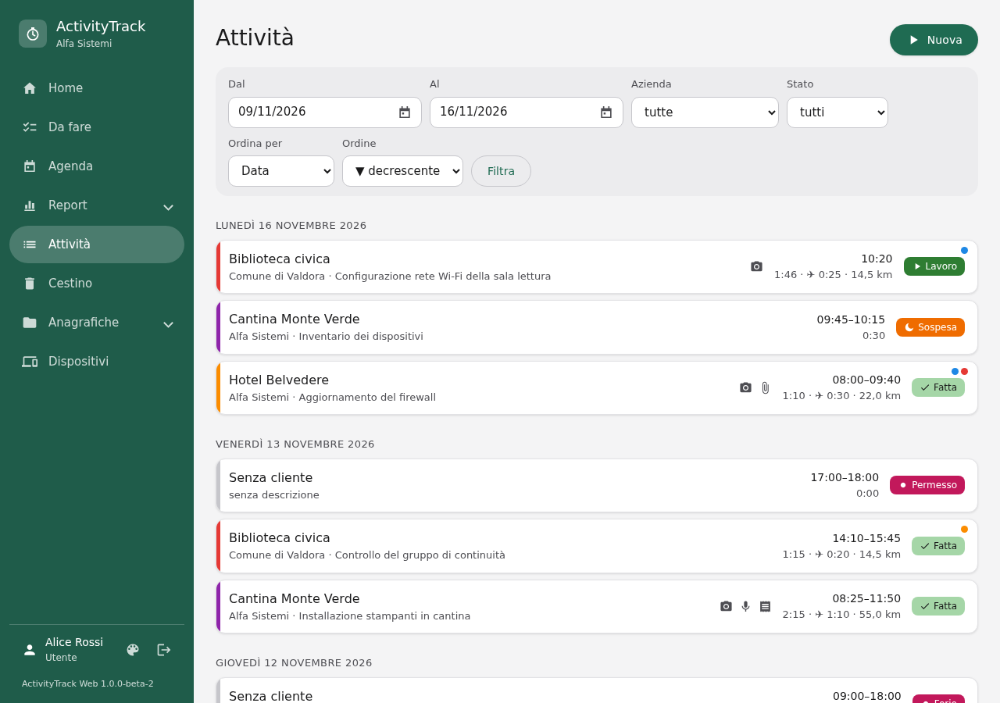

- **Cestino**: le attività eliminate, con **Ripristina** ed **Elimina definitivamente** (al posto di "Ignorate").
- **Assenze**: il modulo chiede il tipo (Assenza, Ferie, Permesso, Malattia), l'azienda (facoltativa: vuota = tutte),
  dal giorno al giorno e gli orari facoltativi (un permesso); senza orari si crea uno spezzone per ogni giorno
  lavorativo, saltando i giorni liberi. Si possono pianificare anche ferie future.
- **Agenda**: giorno, settimana e mese; un clic su uno spazio libero
  pianifica un'attività Da fare a quell'ora (i tratti pianificati sono tratteggiati, le assenze fucsia; il colore è
  quello del cliente, altrimenti dell'azienda). In alto, nella propria agenda, tre pulsanti: **"Da fare"** (la nuova
  attività Da fare del giorno, se pianificazione e Da fare sono attive), **"Assenza"** (il modulo dell'assenza sul
  giorno dell'agenda, poi si torna all'agenda) e **"Già svolta"**, che apre il modulo della nuova attività su
  **"Passata"** con orari già proposti: l'ora che finisce all'ultimo quarto d'ora trascorso se il giorno è oggi, altrimenti
  09:00–10:00. "Già svolta" c'è solo per oggi e per i giorni passati, e quando la policy lascia gli orari modificabili (§7).

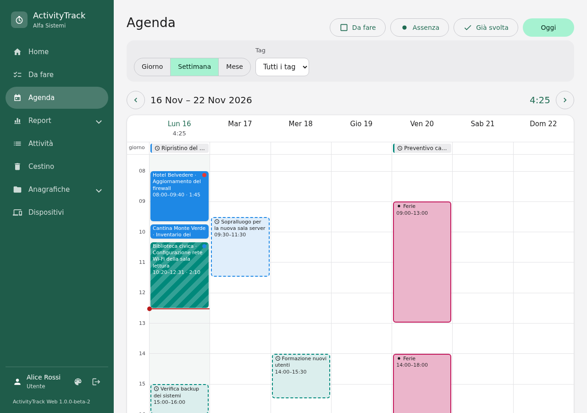

**Date e orari.** Nei moduli date e orari si scrivono nel formato scelto
nelle preferenze, oppure si scelgono con il pulsante a destra del campo: un
calendario che parte dal lunedì e, per gli orari, la **griglia a 5 minuti**
dell'app (una riga per ora, 12 ore alla volta; **▲ Prima** / **Dopo ▼**
spostano la finestra di 3 ore). Inizio e fine si scelgono insieme:
trascinando dalla prima casella all'ultima, oppure toccando la prima e poi
l'ultima, e **OK**; in alto l'intervallo e la durata, le caselle
**tratteggiate** sono occupate da altre attività di quel giorno. **Orario
esatto** accetta i minuti fuori griglia (es. 09:37). Nei moduli l'**azienda**
viene prima del **cliente** e ne filtra l'elenco; scegliendo un cliente,
l'azienda diventa la sua.

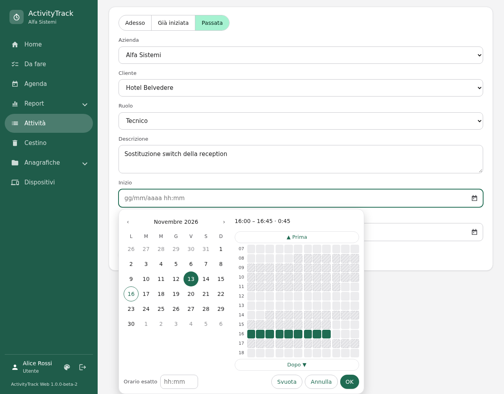

**Preferenze.** Dall'icona della tavolozza, accanto al proprio nome (sul
telefono: *Altro → Preferenze*), ognuno sceglie:
- il **formato delle date**: europeo (31/12/2026), americano (12/31/2026) o
  ISO (2026-12-31);
- il **formato degli orari**: 24 ore (18:30) o 12 ore (6:30 PM);
- il **tema**: chiaro, scuro o come il sistema; le pagine restano bianche e
  grigie (nere nel tema scuro);
- il **colore del tema**, per le barre dei menu e i pulsanti: verde, blu,
  viola, arancione o grigio.

Le preferenze sono dell'utente: valgono su ogni browser con cui accede.

La **lingua** (italiano, inglese, tedesco o spagnolo) si sceglie nella stessa pagina e vale per il
browser in uso; finché non la scegli, le pagine seguono la lingua del browser, o l'inglese se il server non ha quella del
browser. Se la policy fissa la lingua (§7) i pulsanti sono disabilitati e la pagina dice "Impostato dalla policy"; con un valore errato dice "Lingua forzata sull'inglese da una policy con un
valore errato" e le pagine sono in inglese. I pulsanti, le etichette, i messaggi e le
email sono tradotti; ciò che scrivi (nomi, note) resta com'è.

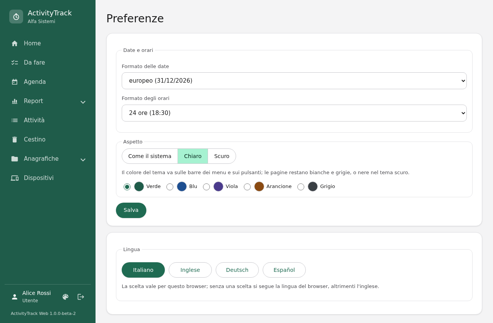

**Da fare assegnate.** Un responsabile, o un amministratore, crea un'attività Da fare
e sceglie **"Assegnata a"**: diventa della persona scelta e arriva
sui suoi telefoni. Finché è nello stato Da fare si può riassegnare: sparisce dai telefoni di chi l'aveva.
Chi la riceve vede "Assegnata da …" e la lavora come le sue; il
responsabile la segue nella pagina *Da fare* con **Persona → "Tutto il
team"**.

Nella pagina **Da fare** i pulsanti **"Nuova voce"** e **"Nuova assenza"** stanno in alto a destra, uno accanto all'altro.

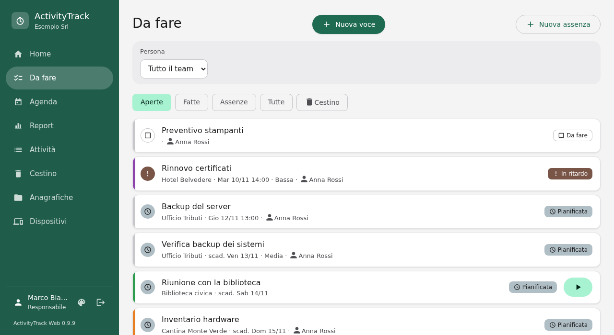

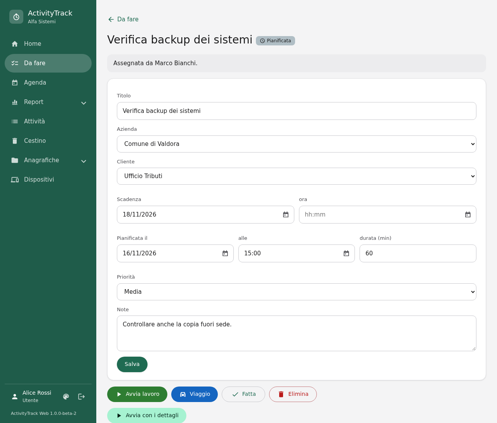

**Verifiche dopo la sincronizzazione.** Se due telefoni hanno modificato la
stessa attività e i tratti si sovrappongono, l'attività diventa **"da
verificare"**. Con gli orari bloccati dalla policy la correggono un
amministratore o il responsabile, dalla scheda sul web. Una modifica che il
server rifiuta (per esempio un'anagrafica centrale bloccata) compare sul
telefono come "Non sincronizzati", con il motivo.

## 9. Report

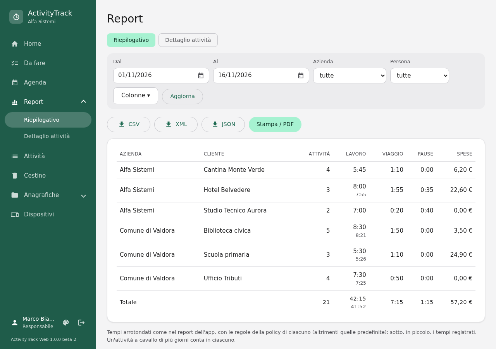

I **Report** sono due, voci del menu (schede sul telefono), con gli stessi filtri (periodo, azienda, persona):
- **Riepilogativo**: i totali per azienda e cliente in un periodo (attività, lavoro, viaggio, pause, spese; il tempo
  **rendicontato** e i km a richiesta), con i tempi **arrotondati** come nell'app e, in piccolo, quelli registrati.
  Un'attività a cavallo di più giorni conta in ciascuno, salvo lo scavalco notturno. Le **assenze** sono contate a
  parte, per tipo (Assenza, Ferie, Permesso, Malattia), in una sezione *Assenze*.
- **Dettaglio attività**: una riga per **attività e giorno** (come la riga del report dell'app, quindi le righe sommano
  al riepilogo e sono arrotondate con le stesse regole), più le righe delle **assenze** dei giorni: data, orario,
  persona, azienda, cliente, ruolo, attività, località, tag, lavoro, viaggio, pause, rendicontato, km, spese, allegati,
  stato. Km, spese e allegati stanno sulla prima riga dell'attività nel periodo. Un interruttore sopra i filtri sceglie
  tra **"Una riga per attività"** (predefinito) e **"Una riga per tratto"** (`?rows=activity` o `segment`): una riga per
  ogni tratto di lavoro, viaggio, pausa o assenza, nel giorno in cui inizia, con il suo inizio e la sua fine, il tipo, la
  durata, i km (viaggio) e la nota, e i dati della sua attività. Qui i minuti sono quelli **registrati**, non
  arrotondati, quindi i totali possono differire dal riepilogo (la pagina lo dice). Questa vista ha colonne proprie;
  ordine, colonne, esportazioni e stampa seguono la vista mostrata.

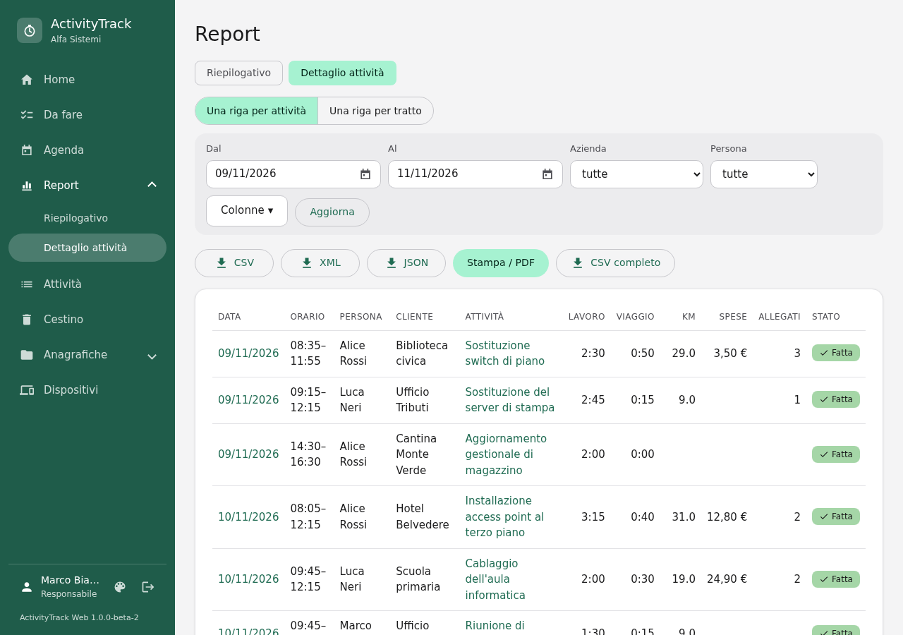

Un periodo senza righe non ha la riga del totale.

**Colonne.** Un clic sull'intestazione di una colonna ordina la tabella, e un secondo clic inverte l'ordine (anche
nell'indirizzo: `?sort=` e `&dir=`); le righe senza valore restano in fondo. Il menu **"Colonne"** mostra o nasconde le
colonne. Colonne, ordine e vista del dettaglio restano **dell'utente, in modo permanente** (a ogni accesso e su ogni
browser), per ciascun report e vista; **"Colonne predefinite"** azzera la scelta della tabella, ordine compreso.

**Esportare.** La tabella **così com'è** (filtri, ordine, colonne visibili) si scarica in **CSV** (punto e virgola, con il
BOM per i fogli di calcolo; il testo libero che sembrerebbe una formula è protetto), **XML** o **JSON**, con valori
semplici (date ISO, orari a 24 ore, durate in minuti, importi in euro) e l'unità nell'intestazione; gli indirizzi sono
`/report/esporta/summary.csv`, `/report/esporta/detail.json` e simili. Decide la **policy** (§7): la funzione di esportazione, i formati
consentiti e il periodo massimo (`exportMaxDays`); se non consente, la pagina lo dice. Sul Dettaglio resta **"CSV
completo"** (punto e virgola e BOM, come gli altri): una riga per attività e giorno con tutte le colonne, i minuti registrati e quelli arrotondati; gli spezzoni
di assenza hanno righe proprie e c'è la colonna `absence_min`.

**Stampa / PDF** stampa la pagina con un foglio di stile apposito (senza menu, filtri e schede, con l'intestazione della
tabella ripetuta, e con l'ordine e le colonne scelti); per il PDF si usa la stampa del browser.

Responsabili e amministratori filtrano per persona; un lettore vede solo le attività chiuse delle sue aziende.

## 10. Sicurezza e backup

Il documento `docs/SECURITY.md` descrive cosa protegge il server e cosa
deve fare l'amministratore. In sintesi:
- solo **HTTPS**, con un certificato valido, o autofirmato e fissato con
  `tls_pin`; poi HSTS nel web server;
- **backup** regolari del database e della cartella `files/` (allegati),
  insieme alla chiave segreta (`/var/lib/activitytrack-web/secret_key`) e
  alla chiave delle policy;
- **aggiornamenti** della distribuzione: Django e le librerie arrivano da
  lì;
- password lunghe, utenti disattivati appena una persona lascia
  l'organizzazione, telefoni persi revocati subito.

Per salvare un database SQLite:

```sh
sqlite3 /var/lib/activitytrack-web/activitytrack.sqlite3 ".backup '/root/activitytrack-$(date +%F).sqlite3'"
```

Con PostgreSQL si usa `pg_dump activitytrack`.

## 11. Problemi frequenti

| Problema | Cosa fare |
|---|---|
| Il sito risponde 400 "Bad Request" | il nome usato non è in `allowed_hosts` |
| Il telefono dice "certificato non valido" | certificato autofirmato senza `tls_pin`, o creato come CA (`docs/INSTALL.md` §4) |
| Il QR non viene letto | aumentare la luminosità dello schermo, o copiare nell'app il collegamento sotto "Non riesci a inquadrarlo?" |
| "Codice scaduto" | il codice vale 10 minuti e una volta: generarne un altro |
| Un utente ha perso il telefono con l'app di autenticazione | usa un codice di recupero, o l'amministratore **"Azzera"** la verifica nella sua scheda |
| Il codice dell'app è sempre "non valido" | l'ora del telefono o del server è sbagliata: va sincronizzata (NTP) |
| Un utente non sincronizza più | è disattivato, o il telefono è stato revocato (Utenti → la sua scheda) |
| Gli allegati non si aprono sul web | con `offload = nginx` o `apache` serve la configurazione del web server dell'esempio |
| Un telefono o un PC dice "Aggiorna l'app per sincronizzare" | il server è alla 1.0 e il dispositivo no: aggiornare l'app o Desktop alla 1.0 |
| Una modifica dal web non arriva subito | arriva entro 15 minuti; aprire l'app la fa arrivare subito |
| Tempi diversi fra telefono e web | arrotondamenti personali del telefono: fissarli nella policy (§7) |
| Dopo un aggiornamento il sito non risponde | `systemctl status activitytrack-web.socket activitytrack-web.service`, e il log con `journalctl -u activitytrack-web` |
